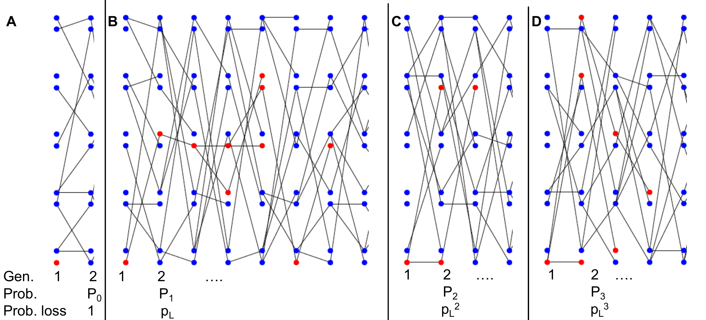

# The Impact of Genetic Drift on Selected Alleles {#sec-Selection-Stochasticity}

> “Natural selection is a mechanism for generating an exceedingly high degree of improbability.” –R.A. Fisher

In the previous chapter we assumed that the selection acting on our alleles was strong enough that we could ignore the action of genetic drift in shaping allele frequencies. However, genetic drift affects all alleles, and so in this chapter we explore the interaction of selection and drift. Strongly selected alleles can be lost from the population via drift when they are rare in the population, while both weakly beneficial and weakly deleterious alleles are subject to the random whims of genetic drift throughout their entire time in the population. Understanding the interaction of selection and genetic drift is key to understanding the extent to which small populations may be mutation-limited in their rates of adaptation, and how rates of molecular and genome evolution may differ across taxa.

## Stochastic loss of strongly selected alleles

Even strongly beneficial alleles can be lost from the population when they are sufficiently rare. This is because the number of offspring left by individuals to the next generation is fundamentally stochastic. A selection coefficient of s=$1\%$ is a strong selection coefficient, which can drive an allele through the population in a few hundred generations once the allele is established. However, if individuals have on average a small number of offspring per generation, the first individual to carry our beneficial allele, who has on average $1\%$ more children than their peers, could easily have zero offspring, leading to the loss of our allele before it ever gets a chance to spread.

To take a first stab at this problem, let’s think of a very large haploid population in which a single individual starts with the selected allele, and ask about the probability of eventual loss of our selected allele starting from this single copy. To derive this probability of loss ($p_L$), we’ll make use of a simple argument [derived using branching processes by @fisher1923xxi; @haldane1927mathematical]. Our selected allele will be eventually lost from the population if every individual with the allele fails to leave descendants.

{#fig-Proof-of-pL-2s .column-page-right width="90%" fig-alt="Four different outcomes of a selected allele present as a single copy in the population, leaving zero, one, two, three offspring in the next generation."}

Well we can think about different cases:

1.  In our first generation, with probability $P_0$ our individual allele leaves no copies of itself to the next generation, in which case our allele is lost ([@fig-Proof-of-pL-2s]A).

2.  Alternatively, our allele could leave one copy of itself to the next generation (with probability $P_1$), in which case with probability $p_L$ this copy eventually goes extinct ([@fig-Proof-of-pL-2s]B).

3.  Our allele could leave two copies of itself to the next generation (with probability $P_2$), in which case with probability $p_L^2$ both of these copies eventually go extinct ([@fig-Proof-of-pL-2s]C).

4.  More generally, our allele could leave could leave $k$ copies ($k>0$) of itself to the next generation (with probability $P_k$), in which case with probability $p_L^k$ all of these copies eventually go extinct (e.g. [@fig-Proof-of-pL-2s]D).

Summing over these probabilities, we see that

$$p_L = \sum_{k=0}^{\infty} P_k p_L^{k}$$ {#eq-drift-and-selection-1}

We’ll now need to specify $P_k$, the probability that an individual carrying our selected allele has $k$ offspring. In order for this population to stay constant in size, we’ll assume that individuals without the selected mutation have on average one offspring per generation, while individuals with our selected allele have on average $1+s$ offspring per generation. We’ll assume that the number of offspring an individual has is Poisson distributed with mean given by $1$ or $1+s$, i.e. the probability that an individual with the selected allele has $i$ children is

$$P_i= \frac{(1+s)^i e^{-(1+s)}}{i!}$$ {#eq-drift-and-selection-2}

Substituting $P_k$ into the equation above, we see

$$\begin{aligned}
p_L &=  \sum_{k=0}^{\infty} \frac{(1+s)^ke^{-(1+s)}}{k!} p_L^{k} 
\\
&= e^{-(1+s)} \left( \sum_{k=0}^{\infty} \frac{\left(p_L(1+s) \right)^k}{k!}  \right)
\end{aligned}$$

The term in the brackets is itself an exponential expansion, so we can rewrite this equation as

$$p_L = e^{(1+s)(p_L-1)}$$ {#eq-prob-loss}

Solving for $p_L$ would give us our probability of loss for any selection coefficient. Let’s rewrite our result in terms of the the probability of escaping loss, $p_F = 1-p_L$. We can rewrite @eq-prob-loss as

$$1-p_F = e^{-p_F(1+s)}$$ {#eq-drift-and-selection-3}

To gain an approximate solution for this result, let’s consider a small selection coefficient $s \ll 1$ such that $p_F \ll 1$ and then use a Taylor series to expand out the exponential on the right hand side (ignoring terms of higher order than $s^2$ and $p_F^2$):

$$1-p_F \approx 1-p_F(1+s)+p_F^2(1+s)^2/2$$ {#eq-drift-and-selection-4}

Solving this we find that

$$p_F = 2s.$$ {#eq-prob-fix-strong}

Thus even an allele with a $1\%$ selection coefficient has a $98\%$ probability of being lost when it is first introduced into the population by mutation.

If the mutation rate towards our advantageous allele is $\mu$, and there are $N$ individuals in our haploid population, then $N \mu$ advantageous mutations arise per generation. Each of these new beneficial mutations has a probability $p_F$ of fixing. Thus the number of advantageous mutations arising per generation that will eventually fix in the population is $N \mu p_F$, and the waiting time for a mutation that will fix to arise is the reciprocal of this: ${}^{1}\!/\!{}_{N\mu p_F}$. Thus, in adapting to a novel selection pressure via new mutations, the population size, the mutational target size, and the selective advantage of new mutations all matter. One reason why combinations of drugs are used against viruses like HIV and malaria is that, even if the viruses adapt to one of the drugs, the viral load ($N$) of the patient is greatly reduced, making it very unlikely that the population will manage to fix a second drug-resistant allele.

**Diploid model of stochastic loss of strongly selected alleles.** We can also adapt this result to a diploid setting. Assuming that heterozygotes for the $1$ allele have on average $1+hs$ children, the probability allele $1$ is not lost, starting from a single copy in the population, is

$$p_F = 2 h s$$ {#eq-diploid-escape}

for $h>0$. Note this is a slightly different parameterization from our diploid model in the previous chapter; here $h$ is the dominance of our positively selected allele, with $h=1$ corresponding to the full selective advantage expressed in an individual with only a single copy. Thus the probability that a beneficial allele is not lost depends just on the relative fitness advantage of the heterozygote; this is because when the allele is rare it is usually present in heterozygotes and so its probability of escaping loss just depends on the fitness of these individuals compared to homozygotes for the ancestral allele (assuming an outbred population).

{#fig-G6PD-map width="90%" fig-alt="Map of G6PD-deficiency allele frequencies across Asia."}

Over roughly the past ten thousand years, adaptive alleles conferring resistance to malaria have arisen in a number of genes and spread through human populations in areas where malaria is endemic [@Kwiatkowski:05]. One particularly impressive case of convergent evolution in response to selection pressures imposed by malaria are the numerous changes throughout the *G6PD* gene, which include at least 15 common variants in Central and Eastern Asia alone that lower the activity of the enzyme [@Howes-g6pd-variants]. These alleles are now found at a combined frequency of around 8% frequency in malaria endemic areas, rarely exceeding 20% [@Howes-g6pd-preval]. Whether these variants *all* confer resistance to malaria is unknown, but a number of these alleles have demonstrated effects against malaria and are thought to have a selective advantage to heterozygotes $sh > 5\%$ where malaria is endemic [@Ruwende-g6pd; @tishkoff-g6pd; @Louicharoen-g6pd].

With a 5% advantage in heterozygotes, a *G6PD* allele present as a single copy would only have a 10% probability of fixing in the population. If that’s so, how come malaria adaptation has repeatedly occurred via changes at *G6PD*? Well, maybe adaptation didn’t start from a single copy of the selected allele. How many copies of the *G6PD*-deficiency alleles do we expect were segregating in the population before selection pressures changed?

.](images/illustration_images/Genetic_drift_selection/Pythagoras_fava_beans/586px-Do_Not_Eat_Beans.jpg){#fig-fava .column-margin width="100%" fig-alt="Pythagoras’s “just say no to fava beans” campaign."}

In the absence of malaria, these *G6PD* alleles are deleterious with carriers suffering from G6PD deficiency, leading to hemolytic anemia when individuals are exposed to a variety of different compounds, notably those present in fava beans. There’s upward of one hundred bases where G6PD-deficiency alleles can arise, so assuming a mutation rate of $\approx 10^{-8}$ per base pair per generation, we can roughly estimate the rate of mutations arising that affect the G6PD gene as $\mu \approx
10^{-6}$ per generation. In the absence of malaria, the selective cost of being a heterozygotes carrier of a G6PD-deficient allele must have been on the order of $5\%$ or more, and thus the frequency of the allele under mutation-selection balance would have been $\approx {}^{10^{-6}}\!/\!{}_{0.05} =2
\times 10^{-5}$. [A full analysis of this case requires modeling of G6PD’s X chromosome inheritance, and the randomness in the number of copies of the allele present at mutation-selection balance [@ralph2015role].]{.aside} Assuming an effective population size of $2-20$ million individuals, roughly five to ten thousand years ago that means that there would have been forty to four hundred copies of the G6PD-deficiency allele present in the population when selection pressures shifted at the introduction of malaria. The chance that one of these newly adaptive alleles is lost is $90\%$ but the chance that they’re all lost is $<(0.9)^{40}\approx 0.02$, i.e. there would have been a greater than $98\%$ chance that adaptation would occur via one or more alleles at *G6PD*. How many alleles would escape drift? Well with $40 - 400$ copies of the allele pre-malaria, and each of them having a $10\%$ probability of escaping drift, we expect between $4$ and $40$ *G6PD* alleles to escape drift and contribute to adaptation. We see $15$ common *G6PD* alleles in Eurasia, so our simple model of adaptation from mutation-selection balance seems reasonable.

 licensed under CC BY 2.0. Haldane, Public Domain [wikimedia](https://en.wikipedia.org/wiki/J._B._S._Haldane#/media/File:J._B._S._Haldane.jpg).](images/figures/haldanes_sieve.png){#fig-haldanes-sieve .column-margin width="60%" fig-alt="Haldane’s sieve."}

::: {#exr-drift-and-selection-1}
‘Haldane’s sieve’ is the name for the idea that the mutations that contribute to adaptation are likely to be dominant or at least co-dominant.\
**A)** Briefly explain this argument with a verbal model relating to the results we’ve developed in the last two chapters.\
**B)** Haldane’s sieve is thought to be less important for adaptation from previously deleterious standing variation, than adaptation from new mutation. Can you explain the intuition behind of this idea?\
**C)** Haldane’s sieve is likely to be less important in inbred, e.g. selfing, populations. Why is this?
:::

. Contributed by Smithsonian Libraries. Not in copyright.]{.attribution}](images/illustration_images/Genetic_drift_selection/Isopod_Asellidae/20406697312_1a9aa75024_z.jpg){#fig-asellid-isopod .column-margin width="70%" fig-alt="cress bug (Asellus aquaticus) in the isopod family Asellidae."}

## The interaction between genetic drift and weak selection.

For strongly selected alleles, once the allele has escaped initial loss at low frequencies, its path will be determined deterministically by its selection coefficients. However, if selection is weak compared to genetic drift, the stochasticity of reproduction can play a role in the trajectory an allele takes even when it is common in the population. If selection is sufficiently weak compared to genetic drift, then genetic drift will dominate the dynamics of alleles and they will behave like they’re effectively neutral. Thus, the extent to which selection can shape patterns of molecular evolution will depend on the relative strengths of selection and genetic drift. But how weak must selection on an allele be for drift to overpower selection? And do these interactions between selection and drift have longterm consequences for genome-wide patterns evolution?

![Asellid isopods have repeatedly invaded subterranean, ground-water habitats from surface-water habitats, and leading to a genome-wide increase in ${}^{d_N}\!/\!{}_{d_S}$ and larger genomes [Data from @lefebure2017less comparing independent isopod species pairs]. One possible explanation of this is that the longterm effective population sizes of the subterranean species are lower and so these species are less able to prevent mildly deleterious alleles fixing, and also less able to prevent genome expansion from the accumulation of weakly deleterious, extraneous genomic DNA. Code [here](https://github.com/cooplab/popgen-notes/blob/master/Journal_figs/drift_selection/asellid_isopods_Nes/asellid_isopods_Nes.R).](images/Journal_figs/drift_selection/asellid_isopods_Nes/asellid_isopods_Nes.png){#fig-asellid-isopods-Nes .column-margin width="100%" fig-alt="Asellid isopods have repeatedly invaded subterranean, ground-water habitats from surface-water habitats, and leading to a genome-wide increase in ^d_N!/!_d_S and larger genomes ."}

To model selection and drift each generation, we can first calculate the deterministic change in our allele frequency due to selection using our deterministic formula. Then, using our newly calculated expected allele frequency, we can binomially sample two alleles for each of our offspring to construct the next generation. This approach to jointly modeling genetic drift and selection is called the Wright-Fisher model.

Under the Wright-Fisher model, we will calculate the expected change in allele frequency due to selection and the variance around this expectation due to drift. To make our calculations simpler, let’s assume an additive model, i.e. $h=1/2$, and that $s \ll 1$ so that $\overline{w}
\approx 1$. Using our directional selection deterministic model, from @sec-OneLocusSelection, and these approximations gives us our deterministic change due to selection

$$\Delta_S p = \mathbb{E}(\Delta p) = \frac{s}{2} p(1-p)$$ {#eq-WF-mean}

To obtain our new frequency in the next generation, $p_1$, we binomially sample from our new deterministic frequency $p^{\prime}= p + \Delta_S p$, so the variance in our allele frequency change from one generation to the next is given by

$$Var(\Delta p) = Var(p_1 - p) = Var(p_1) = \frac{p^{\prime}(1-p^{\prime})}{2N} \approx  \frac{p(1-p)}{2N}.$$ {#eq-WF-var}

[To see this denote our new count of allele $1$ by $i$, then $$\begin{aligned}
\textrm{Var} (p_1 - p)  = &\textrm{Var} (\frac{i}{2N} - p) = \textrm{Var} (\frac{i}{2N} )\\ 
= &  \frac{\textrm{Var} (i)}{(2N)^2} 
\end{aligned}$$ and from binomial sampling $\textrm{Var} (i) = 2N p^{\prime}(1-p^{\prime})$ and so we arrive at our answer. Assuming that $s \ll 1$, $p^{\prime}
\approx p$, then in practice we can use $$\textrm{Var} (\Delta p)  =\textrm{Var} (p^{\prime} - p) \approx {}^{p(1-p)}\!/\!{}_{2N}.$$]{.aside} where the previous allele frequency $p$ drops out because it is a constant and the variance in our new allele frequency follows from the fact that we are binomially sampling $2N$ new alleles from a frequency $p^{\prime}$ to form the next generation.

To get our first look at the relative effects of selection vs. drift we can simply look at when our change in allele frequency caused by selection within a generation is reasonably faithfully passed down through the generations. In particular, if our expected change in allele frequency is much greater than the variance around this change, genetic drift will play little role in the fate of our selected allele (once the allele is not at low copy number within the population). When does selection dominant genetic drift? This will happen if $\mathbb{E}(\Delta p) \gg Var(\Delta p)$, i.e. when $|Ns| \gg 1$. Conversely, any hope of our selected allele following its deterministic path will be quickly undone if our change in allele frequencies due to selection is much less than the variance induced by drift. So if the absolute value of our population-size-scaled selection coefficient $| Ns| \ll 1$, then drift will dominate the fate of our allele.

.](images/figures/prob_fix_diffusion.png){#fig-prob-fix-diffusion width="90%" fig-alt="The probability of the fixation of a new mutation with selection coefficient s (h=1/2) in a diploid population of effective size N_e."}

To make further progress on understanding the fate of alleles with selection coefficients of the order ${}^{1}\!/\!{}_{N}$ requires more careful modeling. However, under our diploid model, with an additive selection coefficient $s$, we can obtain the probability that allele $1$ fixes within the population, starting from a frequency $p$ :

$$p_F(p) = \frac{1-e^{-2Ns p }}{1-e^{-2Ns}}$$ {#eq-prob-fixed}

The proof of this result is sketched out below (see @sec-fixation-weakly-sel). A new allele that arrives in the population at frequency $p=1/(2N)$ has a probability of reaching fixation of

$$p_F \left({}^{1}\!/\!{}_{2N} \right) = \frac{1-e^{-s }}{1-e^{-2Ns}}$$ {#eq-new-mut-prob-fixed}

If $s \ll1$ but $Ns \gg 1$ then $p_F({}^{1}\!/\!{}_{2N}) \approx s$, which nicely gives us back the result that we obtained above for an allele under strong selection (@eq-diploid-escape). Our probability of fixation (@eq-new-mut-prob-fixed) is plotted as a function of $s$ and $N$ in @fig-prob-fix-diffusion. To recover our neutral result, we can take the limit $s \rightarrow 0$ to obtain our neutral fixation probability, ${}^{1}\!/\!{}_{2N}$.

In the case where $Ns$ is close to $1$, then

$$p_F \left( {}^{1}\!/\!{}_{2N} \right) \approx \frac{s}{1-e^{-2Ns}}$$ {#eq-escape-from-intro}

This is greater than our earlier result $p_F=s$ from the branching process argument (using our additive model of $h=1/2$), increasingly so for smaller $N$. Why is this? Well in a smaller population a new mutation starts at a higher frequency (${}^{1}\!/\!{}_{2N}$) than in a larger population, this gives an initial boost to the selected allele in smaller populations.

.](images/figures/prob_fix_diffusion_var_N.png){#fig-prob-fix-diffusion-2 width="90%" fig-alt="The probability of the fixation of a new mutation with selection coefficient s relative to the neutral fixation probability (^1!/!_2N) as a function of the effective size N."}

If, for selection to operate on an allele, we need the selection coefficient to satisfy $|Ns|\gg 1$, then that holds if $|s|\gg {}^{1}\!/\!{}_{N}$. Well, effective population sizes are often reasonably large, on the order of hundreds of thousands or millions of individuals, thus selection coefficients on the order of $10^{-5}$ to $10^{-6}$ can be effectively selected upon, these represent incredibly slight (dis)advantages in terms of the number of offspring they leave to the next generation (see @fig-prob-fix-diffusion-2). While we are incapable of detecting measuring all but the large fitness effect sizes, except in some elegant experiments (e.g. in microbes), such small effects are visible to selection in large populations. Thus, if consistent selection pressures are exerted over long time periods, natural selection can potentially finely tune various aspects of an organism.

. Code [here](https://github.com/cooplab/popgen-notes/blob/master/Journal_figs/drift_selection/Codon_bias_Drosophila/codon_bias.R).](images/Journal_figs/drift_selection/Codon_bias_Drosophila/Leucine_codon_bias.png){#fig-Leucine .column-margin width="100%" fig-alt="Data from Drosophila melanogaster on the frequency of different codons for Leucine."}

As one example of this fine-tuning, consider how carefully crafted and optimized the sequence of codons is for translation. Due to the degeneracy of the protein code, multiple codons code for the same aminoacid. For example, there are six different codons that can code leucine. While these synonymous codons are equivalent at the protein level, cells do differ in the number of tRNA molecules that bind these codons and so the efficacy and accuracy with which proteins can be formed through translation and folding. These slight differences in translation rates likely often correspond to tiny differences in fitness, but do they matter?

.](images/Journal_figs/drift_selection/Codon_bias_Drosophila/Drosophila_codon_bias_expression.png){#fig-gene-expression-codon-bias .column-margin width="100%" fig-alt="A measure of unequal codon frequencies plotted in bins of gene expression for genes across the Drosophila melanogaster genome."}

In many organisms there is a strong bias in the codons to encode particular aminoacids, see @fig-Leucine, with the most abundant codon matching the most abundant tRNA in cells. This ’codon bias’ likely reflects the combined action of weak selection and mutational pressure, pushing the codon composition of the genome and tRNA abundances towards an adaptive compromise. These selection pressures have acted over long time periods, as codon usage patterns are often very similar for species that diverged over many tens of millions of years ago. Compared to other genes, highly expressed genes show a strong bias towards using codons matching abundant tRNAs, consistent with the idea that the synonymous codon content of highly expressed genes is evolving to optimize their translation (see @fig-gene-expression-codon-bias for an early example). These patterns likely represent the action of selection pressures that are incredibly weak on average, but that have played out over vast time-periods.

**The fixation of slightly deleterious alleles.** From @fig-prob-fix-diffusion we can see that weakly deleterious alleles can also fix, especially in small populations. To understand how likely it is that deleterious alleles by chance reach fixation by genetic drift, let’s assume a diploid model with additive selection (with a selection coefficient of $-s$ against our allele $2$).

If $N s \gg 1$ then our deleterious allele (allele $2$) cannot possibly reach fixation. However, if $Ns$ is not large, then the probability of fixation

$$p_F \left( \frac{1}{2N} \right) \approx \frac{s}{e^{2Ns}-1}$$ {#eq-fix-deleterious}

for our single-copy deleterious allele. So deleterious alleles can fix within populations (albeit at a low rate) if $Ns$ is not too large. As above, this is because while deleterious mutations will never escape loss in infinite populations, they can become fixed in finite population by reaching $2N$ copies.

::: {#exr-drift-and-selection-2}
An additive mutation arises that lowers the relative fitness of heterozygotes by $10^{-5}$. What is the probability that this mutation fixes in a diploid population with effective size of $10^4$? What is the probability it fixes in a population of effective size $10^6$? By comparing both to their neutral probability describe the intuition behind this result.
:::

@ohta1973slightly proposed the ‘nearly-neutral’ theory of molecular evolution in a series of papers@ohta1972population [@ohta1973slightly; @ohta1987very]. She suggested that a reasonable fraction of newly arising functional mutations may have very weak selection coefficients, such that species with smaller effective population sizes may have higher rates of fixation of these very weakly deleterious alleles. In effect, her suggestion is that the constraint parameter $C$ of a functional region is not a fixed property, but rather depends on the ability of the population to resist the influx of very weakly deleterious mutations.

.](images/Journal_figs/drift_selection/Galtier_dNdS/Galtier_dNdS.png){#fig-Galtier-dNdS width="80%" fig-alt="Data from 44 metazoan species from cuttlefish to sifakas."}

. Contributed by Smithsonian Libraries. Licensed under CC BY-2.0.]{.attribution}](images/illustration_images/Genetic_drift_selection/Cuttlefish/Cuttlefish.jpg){#fig-Cuttlefish .column-margin width="100%" fig-alt="Common cuttlefish (Sepia officinalis)."}

. Contributed by Smithsonian Libraries. Licensed under CC BY-2.0.]{.attribution}](images/illustration_images/Genetic_drift_selection/Coquerels_sifaka/Coquerels_sifaka.jpg){#fig-Sifakas .column-margin width="100%" fig-alt="Coquerel’s sifaka (Propithecus coquereli)."}

Across species, genome-wide averages of ${}^{d_N}\!/\!{}_{d_S}$ do seem to be correlated with measures of the effective population size (such as synonymous diversity), see @fig-Galtier-dNdS. This evidence supports the idea that in species with smaller effective population sizes (lower $\pi_S$), proteins may be subject to lower degrees of constraint, as very weakly deleterious mutations are able to fix. Thus, some reasonable proportion of functional substitutions in populations with small effective population sizes, such as humans, may be mildly deleterious.

### Appendix: The fixation probability of weakly selected alleles {#sec-fixation-weakly-sel}

What is the probability a weakly beneficial or deleterious additive allele fixes in our population? We’ll let $P(\Delta p)$ be the probability that our allele frequency shifts by $\Delta p$ in the next generation. Using this, and following the diffusion argument of @kimura1962probability, we can write our fixation probability $p_F(p)$ in terms of the probability of achieving fixation averaged over the frequency in the next generation

$$p_F(p)  = \int p_F(p+\Delta p) P(\Delta p) d(\Delta p)$$ {#eq-prob-fix-diff-step1}

This is very similar to the technique that we used when deriving our probability of escaping loss in a very large population above.

So we need an expression for $p_F(p+\Delta p)$. To obtain this, we’ll do a Taylor series expansion of $p_F(p)$, assuming that $\Delta p$ is small:

$$p_F(p+\Delta p) \approx p_F(p) + \Delta p \frac{dp_F(p)}{dp} + (\Delta p)^2
\frac{d^2p_F(p)}{dp^2} (p)$$ {#eq-drift-and-selection-5}

ignoring higher order terms.

Taking the expectation over $\Delta p$ on both sides, as in @eq-prob-fix-diff-step1, we obtain

$$p_F(p) = p_F(p) + \mathbb{E}(\Delta p) \frac{dp_F (p)}{dp} + \mathbb{E}((\Delta p)^2)
\frac{d^2p_F(p)}{dp^2}$$ {#eq-drift-and-selection-6}

Well, $\mathbb{E}(\Delta p) = \frac{s}{2}p(1-p)$ and $Var(\Delta p)= \mathbb{E}((\Delta
p)^2)-\mathbb{E}^2(\Delta p)$, so if $s \ll 1$ then $\mathbb{E}^2(\Delta p) \approx
0$, and $\mathbb{E}(\Delta p)^2 = \frac{p(1-p)}{2N}$. Substituting in these values and subtracting $p$ from both sides of our equation, this leaves us with

$$0= \frac{s}{2}p(1-p)\frac{dp_F (p) }{dp} + \frac{p(1-p)}{2N}
\frac{d^2p_F (p) }{dp^2}$$ {#eq-drift-and-selection-7}

and we can specify the boundary conditions to be $p_F(1)=1$ and $p_F(0)=0$. Solving this differential equation is a somewhat involved process, but in doing so we find that

$$p_F(p) = \frac{1-e^{-2Ns p }}{1-e^{-2Ns}}$$ {#eq-drift-and-selection-8}

This proof can be extended to alleles with arbitrary dominance, however, this does not lead to a analytically tractable expression so we do not pursue this here.

::: chapter-summary
**Chapter summary.**

-   Even strongly advantagous alleles can be lost when they are rare in the population. In a haploid population the probability that a strongly advantagous allele escapes loss starting from a single copy is $p_F=2s$. In a diploid population this probability is $p_F=2hs$, where $hs$ is the relative fitness advantage to heterozygotes. Strongly deleterious alleles can not fix in large populations.

-   Alleles are strongly selected when their absolute population-scaled selection coefficient is $|Ns| \gg 1$. Alleles are effectively neutral when $|Ns| \ll 1$. Alleles that are weakly selected when their $|Ns|$ is on order $1$.

-   The dynamics of weakly selected alleles are subject to selection and genetic drift throughout their time in the population, and their fixation probabillity ($p_F$) depends on $N$ and $s$.

-   Very weakly selected alleles can be efficiently selected on in large populations. Thus levels of evolutionary constraint may be stronger in species with large long-term population sizes.
:::

::: {#exr-drift-and-selection-3}
Melanic squirrels suffer a higher rate of predation (due to hawks) than the normally grey pigmented squirrels. Melanism is due to a dominant, autosomal mutation. The frequency of melanic squirrels at birth is $4 \times 10^{-5}$.

**A)** If the mutation rate to new melanic alleles is $10^{-6}$, assuming the melanic allele is at mutation-selection equilibrium, what is the reduction in fitness of the heterozygote?\
Suddenly levels of pollution increase dramatically in our population, and predation by hawks now offers an equal (and opposite) advantage to the dark individuals as it once offered to the normally pigmented individuals.\
**B)** What is the probability that a single copy of this allele (present just once in the population) is lost?\
**C)** If the population size of our squirrels is a million individuals, and is at mutation-selection balance, what is the probability that the population adapts from one or more allele(s) from the standing pool of melanic alleles?
:::

::: {#exr-drift-and-selection-4}
You find that pairwise genetic diversity in humans is $0.0005$/bp and in cockroaches it is $0.01$/bp. Assume that in both species the mutation rates is about $\mu = 2
  \times 10^{-8}$ /bp/generation in both species. Suppose you introduce a deleterious mutation in each population with a selective coefficient of $s=10^{-6}$. Calculate the probability of this allele fixing in humans and cockroaches, given the allele starts off in one copy (at frequency ${}^{1}\!/\!{}_{2N}$). Compare your answer to the neutral probability of the mutant allele eaching fixation in both cases.
:::
