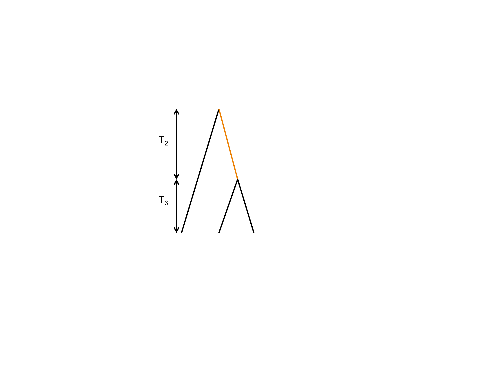

# Genetic Drift and Neutral Diversity {#sec-Drift}

[Randomness is inherent to evolution]{.smallcaps}, from the lucky birds blown off course to colonize some new oceanic island, to which mutations arise first in the HIV strain infecting an individual taking anti-retroviral drugs. One major source of stochasticity in evolutionary biology is genetic drift. Genetic drift occurs because more or less copies of an allele by chance can be transmitted to the next generation [@wright1931evolution][^genetic-drift-1]. This can occur because, by chance, the individuals carrying a particular allele can leave more or less offspring in the next generation. In a sexual population, genetic drift also occurs because Mendelian transmission means that only one of the two alleles in an individual, chosen at random at a locus, is transmitted to the offspring.

[^genetic-drift-1]: @fisher1923xxi also discusses models related to genetic drift, but @wright1931evolution’s treatment is more extensive and he uses the name ‘drift’. Both @wright1931evolution and @fisher1923xxi credit earlier authors [@gulick1873diversity; @Hagedoorn] with the intuition behind the concept of genetic drift.

Genetic drift can play a role in the dynamics of all alleles in all populations, but it will play the biggest role for neutral alleles. A neutral polymorphism occurs when the segregating alleles at a polymorphic site have no discernible differences in their effect on fitness. We’ll make clear what we mean by "discernible" later, but for the moment think of this as "no effect" on fitness. **The neutral theory of molecular evolution.** The role of genetic drift in molecular evolution has been hotly debated since the 60s when the Neutral theory of molecular evolution was proposed [see @ohta1996development for a history][@kimura:68; @king:69; @kimura:83]. The central premise of Neutral theory is that patterns of molecular polymorphism within species and substitution between species can be well understood by supposing that the vast majority of these molecular polymorphisms and substitutions were neutral alleles, whose dynamics were just subject to the vagaries of genetic drift and mutation. Early proponents of this view suggested that the vast majority of new mutations are either neutral or highly deleterious (e.g. mutations that disrupt important protein functions). This latter class of mutations are too deleterious to contribute much to common polymorphisms or substitutions between species, because they are quickly weeded out of the population by selection.

Neutral theory can sound strange given that much of the time our first brush with evolution often focuses on adaptation and phenotypic evolution. However, proponents of this world-view didn’t deny the existence of advantageous mutations, they simply thought that beneficial mutations are rare enough that their contribution to the bulk of polymorphism or divergence can be largely ignored. They also often thought that much of phenotypic evolution may well be adaptive, but again the loci responsible for these phenotypes are a small fraction of all the molecular change that occur. The neutral theory of molecular evolution was originally proposed to explain protein polymorphism. However, we can apply it more broadly to think about neutral evolution genome-wide. With that in mind, what types of molecular changes could be neutral? Perhaps:

1.  Changes in non-coding DNA that don’t disrupt regulatory sequences. For example, in the human genome only about 2% of the genome codes for proteins. The rest is mostly made up of old transposable element and retrovirus insertions, repeats, pseudo-genes, and general genomic clutter. Current estimates suggest that, even counting conserved, functional, non-coding regions, less than 10% of our genome is subject to evolutionary constraint [@rands:14].

2.  Synonymous changes in coding regions, i.e. those that don’t change the amino-acid encoded by a codon.

3.  Non-synonymous changes that don’t have a strong effect on the functional properties of the amino acid encoded, e.g. changes that don’t change the size, charge, or hydrophobic properties of the amino acid too much.

4.  An amino-acid change with phenotypic consequences, but little relevance to fitness, e.g. a mutation that causes your ears to be a slightly different shape, or that prevents an organism from living past 50 in a species where most individuals reproduce and die by their 20s.

There are counter examples to all of these ideas, e.g. synonymous changes can affect the translation speed and accuracy of proteins and so are subject to selection. However, the list above hopefully convinces you that the general thinking that some portion of molecular change may not be subject to selection isn’t as daft as it may have initially sounded.

Various features of molecular polymorphism and divergence have been viewed as consistent with the neutral theory of molecular evolution. In this chapter we’ll focus on the prediction of a high level of molecular polymorphism in many species (see for example @fig-Leffer). In a subsequent chapter we’ll talk about the prediction of a molecular clock. We’ll see that various aspects of the original neutral theory have merit in describing some features and types of molecular change, but we’ll also see that it is demonstrably wrong in some cases. We’ll also see the primary utility of the neutral theory isn’t whether it is right or wrong, but that it serves as a simple null model that can be tested and in some cases rejected, and subsequently built on. The broader debate currently in the field of molecular evolution is the balance of neutral, adaptive, and deleterious changes that drive different types of evolutionary change.

## Loss of heterozygosity due to drift. {#sec-LossofHet}

Genetic drift will, in the absence of new mutations, slowly purge our population of neutral genetic diversity, as alleles slowly drift to high or low frequencies and are lost or fixed over time.

Imagine a randomly mating population of a constant size $N$ diploid individuals, and that we are examining a locus segregating for two alleles that are neutral with respect to each other. This population is randomly mating with respect to the alleles at this locus. See Figures [-@fig-LossHet-two-alleles] and [-@fig-LossHet-many-alleles] to see how genetic drift proceeds, by tracking alleles within a small population.

In generation $t$ our current level of heterozygosity is $H_t$, i.e. the probability that two randomly sampled alleles in generation $t$ are non-identical is $H_t$. Assuming that the mutation rate is zero (or vanishingly small), what is our level of heterozygosity in generation $t+1$?

.](images/figures/Loss_of_he_col_two_alleles.png){#fig-LossHet-two-alleles width="100%" fig-alt="Loss of heterozygosity over time, in the absence of new mutations."}

.](images/figures/Loss_of_het_2_many_alleles.png){#fig-LossHet-many-alleles width="100%" fig-alt="Loss of heterozygosity over time, in the absence of new mutations."}

In the next generation ($t+1$) we are looking at the alleles in the offspring of generation $t$. If we randomly sample two alleles in generation $t+1$ which had different parental alleles in generation $t$, that is just like drawing two random alleles from generation $t$. So the probability that these two alleles in generation $t+1$, that have different parental alleles in generation $t$, are non-identical is $H_t$.

Conversely, if the two alleles in our pair had the same parental allele in the proceeding generation (i.e. the alleles are identical by descent one generation back) then these two alleles must be identical (as we are not allowing for any mutation).

In a diploid population of size $N$ individuals there are $2N$ alleles. The probability that our two alleles have the same parental allele in the proceeding generation is ${}^{1}\!/\!{}_{(2N)}$ and the probability that they have different parental alleles is is $1-{}^{1}\!/\!{}_{(2N)}$. So by the above argument, the expected heterozygosity in generation $t+1$ is

$$H_{t+1} = \frac{1}{2N} \times 0 + \left(1-\frac{1}{2N} \right)H_t$$ {#eq-genetic-drift-1}

Thus, if the heterozygosity in generation $0$ is $H_0$, our expected heterozygosity in generation $t$ is

$$H_t = \left(1-\frac{1}{2N} \right)^tH_0$$ {#eq-loss-het-discrete}

i.e. the expected heterozygosity within our population is decaying geometrically with each passing generation. If we assume that ${}^{1}\!/\!{}_{(2N)}
\ll 1$ then we can approximate this geometric decay by an exponential decay (see @exr-geoquestion below), such that

$$H_t =H_{0} e^{ - {}^{t}\!/\!{}_{(2N)} }$$ {#eq-genetic-drift-2}

i.e. heterozygosity decays exponentially at a rate ${}^{1}\!/\!{}_{(2N)}$. [By a similar argument, in a haploid population the expected proportion of pairs of differing alleles decays as: $$H_t = \left(1-\frac{1}{2N} \right)^tH_0 = H_{0} e^{ - {}^{t}\!/\!{}_{(N)} }$$]{.aside}

In @fig-LossHet-WF-N50 we show trajectories through time for 40 independently simulated loci drifting in a population of 50 individuals. Each population was started from a frequency of $30\%$. Some drift up and some drift down, eventually being lost or fixed from the population, but, on average across simulations, the allele frequency doesn’t change. We also track heterozygosity, you can see that heterozygosity sometimes goes up, and sometimes goes down, but on average we are losing heterozygosity, and this rate of loss is well predicted by @eq-loss-het-discrete.

.](images/figures/WF_loss_het/WF_loss_het_N50.png){#fig-LossHet-WF-N50 width="100%" fig-alt="Change in allele frequency and loss of heterozygosity over time for 40 replicates."}

. Contributed by Smithsonian Libraries. Not in copyright.]{.attribution}](images/illustration_images/Genetic_drift/smelt/20497452375_9be855d9ff_z.jpg){#fig-smelt .column-margin width="100%" fig-alt="Pond smelt (Hypomesus olidus), a close relative of delta smelt."}

::: {#exr-genetic-drift-1}
You are in charge of maintaining a population of delta smelt in the Sacramento River delta. Using a large set of microsatellites you estimate that the mean level of heterozygosity in this population is 0.005. You set yourself a goal of maintaining a level of heterozygosity of at least 0.0049 for the next two hundred years. Assuming that the smelt have a generation time of 3 years, and that only genetic drift affects these loci, what is the smallest fully outbreeding population that you would need to maintain to meet this goal?
:::

Note how this picture of decreasing heterozygosity stands in contrast to the consistency of Hardy-Weinberg equilibrium from the previous chapter. However, our Hardy-Weinberg *proportions* still hold in forming each new generation. As the offspring genotypes in the next generation ($t+1$) represent a random draw from the previous generation ($t$), if the parental frequency is $p_t$, we *expect* a proportion $2p_t(1-p_t)$ of our offspring to be heterozygotes (and HW proportions for our homozygotes). However, because population size is finite, the observed genotype frequencies in the offspring will (likely) not match exactly with our expectations. As our genotype frequencies likely change slightly due to sampling, biologically this reflects random variation in family size and Mendelian segregation, the allele frequency will changed. Therefore, while each generation represents a sample from Hardy-Weinberg proportions based on the generation before, our genotype proportions are not at an equilibrium (an unchanging state) as the underlying allele frequency changes over the generations. We’ll develop some mathematical models for these allele frequency changes later on. For now, we’ll simply note that under our simple model of drift (formally the Wright-Fisher model), our allele count in the $t+1^{th}$ generation represents a binomial sample (of size $2N$) from the population frequency $p_t$ in the previous generation. If you’ve read to here, please email Prof Coop a picture of JBS Haldane in a striped suit with the title "I’m reading the chapter 3 notes”. (It’s well worth googling JBS Haldane and to read more about his life; he’s a true character and one of the last great polymaths. )

.](images/Journal_figs/genetic_drift/black_footed_ferrets/black_footed_ferrets_He.png){#fig-LossHet-ferrets width="100%" fig-alt="Loss of heterozygosity in the Black-footed Ferrets in their declining population."}

To see how a decline in population size can affect levels of heterozygosity, let’s consider the case of black-footed ferrets (*Mustela nigripes*). The black-footed ferret population has declined dramatically through the twentieth century due to destruction of their habitat and sylvatic plague. In 1979, when the last known black-footed ferret died in captivity, they were thought to be extinct. In 1981, a very small wild population was rediscovered ($40$ individuals), but in 1985 this population suffered a number of disease outbreaks.

. Contributed by American Museum of Natural History Library. Not in copyright.]{.attribution}](images/illustration_images/Genetic_drift/Black_footed_ferrets/Black_footed_ferret.png){#fig-black-footed-ferret .column-margin width="100%" fig-alt="The black-footed ferret (M."}

At that point of the $18$ remaining wild individuals were brought into captivity, 7 of which reproduced. Thanks to intense captive breeding efforts and conservation work, a wild population of over 300 individuals has been established since. However, because all of these individuals are descended from those 7 individuals who survived the bottleneck, diversity levels remain low. @Wisely:02 measured heterozygosity at a number of microsatellites in individuals from museum collections, showing the sharp drop in diversity as population sizes crashed (see @fig-LossHet-ferrets).

::: {#exr-geoquestion}
In mathematical population genetics, a commonly used approximation is $(1-x) \approx e^{-x}$ for $x << 1$ (formally, this follows from the Taylor series expansion of $\exp(-x)$, ignoring second order and higher terms of $x$, see Appendix @eq-Taylor-geo). This approximation is especially useful for approximating a geometric decay process by an exponential decay process, e.g. $(1 - x)^t \approx e^{-xt}$. Using your calculator, or R, check how well this expression approximates the exact expression for two values of $x$, $x = 0.1$, and $0.01$, across two different values of t, $t=5$ and $t=50$. Briefly comment on your results.
:::

### Levels of diversity maintained by a balance between mutation and drift {#sec-DriftMutationBalance}

Next we’re going to consider the amount of neutral polymorphism that can be maintained in a population as a balance between genetic drift removing variation and mutation introducing new neutral variation, see @fig-Mut-Sel-balance for an example. Note in our example, how no single allele is maintained at a stable equilibrium, rather an equilibrium level of polymorphism is maintained by a constantly shifting set of alleles.

.](images/figures/Mut_drift_balance.png){#fig-Mut-Sel-balance width="100%" fig-alt="Mutation-drift balance."}

**The neutral mutation rate.** We’ll first want to consider the rate at which neutral mutations arise in the population.Thinking back to our discussion of the neutral theory of molecular evolution, let’s suppose that there are only two classes of mutation that can arise in our genomic region of interest: neutral mutations and highly deleterious mutations. The total mutation rate at our locus is $\mu$ per generation, i.e. per transmission from parent to child. A fraction $C$ of our mutations are new alleles that are highly deleterious and so quickly removed from the population. We’ll call this $C$ parameter the constraint, and it will differ according to the genomic region we consider. The remaining fraction $(1-C)$ are our neutral mutations, such that our neutral mutation rate is $(1-C)\mu$. This is the per generation rate. In the rest of the chapter for simplicity we’ll assume that $C=0$ and use a neutral mutation rate of $\mu$. However, we’ll return to this discussion of constaint when we discuss molecular divergence in a subsequent chapter.

::: {#exr-genetic-drift-3}
It’s worth taking a minute to get familiar with both how rare, and how common, mutation is. The per base pair mutation rate in humans is around $1.5$ $\times$ $10^{-8}$ per generation. That means, on average, we have to monitor a site for $\sim 66.6$ million transmissions from parent to child to see a mutation. Yet populations and genomes are big places, so mutations are common at these levels.\
**A)** Your autosomal genome is $\sim$ 3 billion base pairs long ($3$ $\times$ $10^9$). You have two copies, the one you received from your mum and one from your dad. What is the average (i.e. the expected) number of mutations that occurred in the transmission from your mum and your dad to you?\
**B)** The current human population size is $\sim$`<!-- -->`{=html}7 billion individuals. How many times, at the level of the entire human population, is a single base-pair mutated in the transmission from one generation to the next?
:::

**Levels of heterozygosity maintained as a balance between mutation and drift.**

Looking backwards in time from one generation to the previous generation, we are going to say that two alleles which have the same parental allele (i.e. find their common ancestor) in the preceding generation have *coalesced*, and refer to this event as a *coalescent event*. If our pairs of alleles are to be different from each other in the present day, a mutation must have occured more recently on one or other lineage before they found a common ancestor.

The probability that our pair of randomly sampled alleles have coalesced in the preceding generation is ${}^{1}\!/\!{}_{(2N)}$, and the probability that our pair of alleles fail to coalesce is $1-{}^{1}\!/\!{}_{(2N)}$.

The probability that a mutation changes the identity of the transmitted allele is $\mu$ per generation. So the probability of no mutation occurring is $(1-\mu)$. We’ll assume that when a mutation occurs it creates some new allelic type which is not present in the population. This assumption (commonly called the infinitely-many-alleles model) makes the math slightly cleaner, and also is not too bad an assumption biologically. See @fig-Mut-Sel-balance for a depiction of mutation-drift balance in this model over the generations.

This model lets us calculate when our two alleles last shared a common ancestor and whether these alleles are identical as a result of failing to mutate since this shared ancestor. For example, we can work out the probability that our two randomly sampled alleles coalesce $2$ generations in the past (i.e. they fail to coalesce in generation $1$ and then coalesce in generation $2$), and that they are identical as

$$\left(1- \frac{1}{2N} \right) \frac{1}{2N} (1-\mu)^4$$ {#eq-genetic-drift-3}

Note the power of $4$ is because our two alleles have to have failed to mutate through $2$ meioses each.

More generally, the probability that our alleles coalesce in generation $t+1$ (counting backwards in time) and are identical due to no mutation to either allele in the subsequent generations is

$$\mathbb{P}(\textrm{coal. in t+1 \& no mutations}) =  \frac{1}{2N} \left(1- \frac{1}{2N} \right)^t \left(1-\mu \right)^{2(t+1)}$$ {#eq-genetic-drift-4}

To make this slightly easier on ourselves let’s further assume that $t
\approx t+1$ and so rewrite this as:

$$\mathbb{P}(\textrm{coal. in t+1 \& no mutations}) \approx \frac{1}{2N} \left(1- \frac{1}{2N} \right)^t \left(1-\mu \right)^{2t}$$ {#eq-genetic-drift-5}

This gives us the approximate probability that two alleles will coalesce in the $(t+1)^\text{th}$ generation. In general, we may not know when two alleles may coalesce: they could coalesce in generation $t=1, t=2, \ldots$, and so on. Thus, to calculate the probability that two alleles coalesce in *any* generation before mutating, we can write:

$$\begin{aligned}
  \mathbb{P}(\textrm{coal. in any generation \& no mutations}) \approx & \mathbb{P}(\textrm{coal. in} \; t=1 \; \textrm{\& no mutations}) \; + \\
&  \mathbb{P}(\textrm{coal. in} \; t=2 \; \textrm{\& no mutations}) + \ldots \\
  = & \sum_{t=1}^\infty \mathbb{P}(\textrm{coal. in } \; t \; \textrm{generations \& no mutation})
\end{aligned}$$

an example of using the Law of Total Probability, see Appendix @eq-law-tot-prob, combined with the fact that coalescing in a particular generation is mutually exclusive with coalescing in a different generation.

While we could calculate a value for this sum given $N$ and $\mu$, it’s difficult to get a sense of what’s going on with such a complicated expression. Here, we turn to a common approximation in population genetics (and all applied mathematics), where we assume that ${}^{1}\!/\!{}_{(2N)} \ll 1$ and $\mu \ll 1$. This allows us to approximate the geometric decay as an exponential decay (see Appendix @eq-Taylor-exp). Then, the probability two alleles coalesce in generation $t+1$ and don’t mutate can be written as:

$$\begin{aligned}
 \mathbb{P}(\textrm{coal. in t+1 \& no mutations}) &\approx \frac{1}{2N}
\left(1- \frac{1}{2N} \right)^t \left(1-\mu \right)^{2t} \\
& \approx \frac{1}{2N} e^{-t/(2N)} e^{-2\mu t } \\
&=\frac{1}{2N} e^{-t(2\mu+1/(2N))} 
\end{aligned}$$ {#eq-genetic-drift-6}

Then we can approximate the summation by an integral, giving us:

$$\frac{1}{2N} \int_0^{\infty} e^{-t(2\mu+1/(2N))} dt =
\frac{1/(2N)}{1/(2N)+2\mu}$$ {#eq-coal-no-mut}

[We can use a very similar argument for a haploid population and replace $\theta=4N\mu$ with $\theta=2N \mu$. Haploids can’t be heterozygous, but we interpret ‘heterozygosity’ as the probability that two alleles paired at random in our population differ from each other.]{.aside} The equation above gives us the probability that our two alleles coalesce at some point in time, and do not mutate before reaching their common ancestor. Equivalently, this can be thought of as the probability our two alleles coalesce *before* mutating, i.e. that they are homozygous.

Then, the complementary probability that our pair of alleles are non-identical (or heterozygous) is simply one minus this. The following equation gives the equilibrium heterozygosity in a population at equilibrium between mutation and drift:

[This result was derived by @kimura1964number and @malecot:48 [see @malecot:69 for an English translation, the lack of earlier translation meant this result was missed]. Technically we’re assuming that every new mutation creates a new allele, the so-called "infinitely many alleles" model, otherwise our pair of sequences could be identical due to repeat or back mutation. See this GENETICS [blog post](http://genestogenomes.org/kimura-crow-infinite-alleles/) and @ewens2016motoo for a nice discussion of the history.]{.aside}

$$H = \frac{2\mu}{1/(2N)+2\mu}  = \frac{4N\mu}{1+4N\mu}$$ {#eq-hetero}

The compound parameter $4N\mu$, the population-scaled mutation rate, will come up a number of times so we’ll give it its own name:

$$\theta = 4N\mu$$ {#eq-genetic-drift-7}

What’s the intuition of our @eq-hetero, well the probability that any event happens in a particular generation is $\mathbb{P}(\textrm{mutation or coalescence}) \approx {}^{1}\!/\!{}_{(2N)}+2\mu$, so conditional [^genetic-drift-2] on an event happening the probability that it is a mutation is $\mathbb{P}(\textrm{mutation} \mid \textrm{mutation or coalescence}) =  {}^{2\mu}\!/\!{}_{\left({}^{1}\!/\!{}_{(2N)}+2\mu \right)}$.

[^genetic-drift-2]: See Math Appendix @eq-cond-prob for more background on conditional probabilities.

So all else being equal, species with larger population sizes should have proportionally higher levels of neutral polymorphism. Indeed, populations of animals, e.g. birds, on small islands have lower levels of diversity than closely related species on the mainland with larger ranges. More generally, we do see higher levels of heterozygosity in larger census population sizes across animals @fig-allozyme-N. However, while census population sizes vary over many orders of magnitude, levels of diversity vary much less than that. So, if levels of diversity in natural populations represent a balance between genetic drift and mutation, levels of genetic drift in large populations must be a lot faster than their census population size suggests. In the next section we’ll talk about some possible reasons why.

![Average basepair heterozygosity plotted against the log of range size for endemic island and mainland bird populations [@leroy2020endemic]. Average allozyme heterozygosity plotted against the log of census population size (N) for animals. Data from @soule1976allozyme [@frankham1996relationship] Code [here](https://github.com/cooplab/popgen-notes/blob/master/Journal_figs/genetic_drift/Allozyme_pop_size/allozyme_pop_size.R).](images/Journal_figs/genetic_drift/Allozyme_pop_size/bird_allozyme_pop_size.png){#fig-allozyme-N width="100%" fig-alt="Average basepair heterozygosity plotted against the log of range size for endemic island and mainland bird populations ."}

### The effective population size

[The effective population size ($N_e$) is the population size that would result in the same rate of drift in an idealized population of constant size (following our modeling assumptions) as that observed in our true population .]{.aside}

In practice, populations rarely conform to our assumptions of being constant in size with low variance in reproductive success. Real populations experience dramatic fluctuations in size, and there is often high variance in reproductive success. Thus rates of drift in natural populations are often a lot higher than the census population size would imply. See @fig-LossHet-varying-pop for a depiction of a repeatedly bottlenecked population losing diversity at a fast rate.

.](images/figures/Loss_of_he_col_alleles_varying_pop_dark.png){#fig-LossHet-varying-pop width="100%" fig-alt="Loss of heterozygosity over time in a bottlenecking population."}

To cope with this discrepancy, population geneticists often invoke the concept of an *effective population size* ($N_e$). In many situations (but not all), departures from model assumptions can be captured by substituting $N_e$ for $N$.

If population sizes vary rapidly in size, we can (if certain conditions are met) replace our population size by the harmonic mean population size. Consider a diploid population of variable size, whose size is $N_t$ $t$ generations into the past. The probability our pairs of alleles have not coalesced by generation $t$ is given by

$$\prod_{i=1}^{t} \left(1-\frac{1}{2N_i} \right)$$ {#eq-var-pop-coal}

Note that this simply collapses to our original expression $\left(1-\frac{1}{2N } \right)^t$ if $N_i$ is constant. Under this model, the rate of loss of heterozygosity in this population is equivalent to a population of effective size

$$N_e =\frac{1}{\frac{1}{t} \sum_{i=1}^{t} \frac{1}{N_i} }.$$ {#eq-Ne-harmonic}

This is the harmonic mean of the varying population size. [^genetic-drift-3]

[^genetic-drift-3]: To see this, note that if $1/(N_i)$ is small, then we can approximate ([-@eq-var-pop-coal]) using the exponential approximation:

    $$\prod_{i=1}^{t} \exp \left( -\frac{1}{2N_i} \right)   =
    \exp \left(- \sum_{i=1}^{t} \frac{1}{2N_i} \right) .$$ {#eq-genetic-drift-8}

    When we put the product inside the exponent, it becomes a sum. We can also write the probability of not coalescing by generation $t$ in a population of constant size ($N_e$) as an exponential, so that it takes the same form as the expression above on the right. Comparing the exponent in the two cases, we see

    $$\frac{t}{2N_e} = \sum_{i=1}^{t} {}^{1}\!/\!{}_{(2N_i)}$$ {#eq-genetic-drift-9}

    So that if we want a constant effective population size ($N_e$) that has the same rate of loss of heterozygosity as our variable population, we need to rearrange and solve this equation to give ([-@eq-Ne-harmonic]).

Thus our effective population size, the size of an idealized constant population which matches the rate of genetic drift, is the harmonic mean true population size over time. The harmonic mean is very strongly affected by small values, such that if our population size is one million $99\%$ of the time but drops to $1000$ every hundred or so generations, $N_e$ will be much closer to $1000$ than a million.

.](images/figures/Loss_of_he_col_alleles_varying_RS.png){#fig-LossHet-varying-RS width="100%" fig-alt="High variance on reproductive success increases the rate of genetic drift."}

Variance in reproductive success will also affect our effective population size. Even if our population has a large constant size $N$ individuals, if only small proportion of them get to reproduce, then the rate of drift will reflect this much smaller number of reproducing individuals. See @fig-LossHet-varying-RS for a depiction of the higher rate of drift in a population where there is high variance in reproductive success.

To see one example of this, consider the case where $N_F$ of females get to reproduce and $N_M$ males get reproduce. While every individual has a biological mother and father, not every individual gets to be a parent. In practice, in many animal species far more females get to reproduce than males, i.e. $N_M <N_F$, as a few males get many mating opportunities and many males get no/few mating opportunities [see @janicke:16 for a broad analysis, and note that there a certainly many exceptions to this general pattern]. When our two alleles pick an ancestor, $25\%$ of the time our alleles were both in a female ancestor, in which case they are IBD with probability $1/(2N_F)$, and $25\%$ of the time they are both in a male ancestor, in which case they coalesce with probability $1/(2N_M)$. The remaining $50\%$ of the time, our alleles trace back to two individuals of different sexes in the prior generation and so cannot coalesce. Therefore, our probability of coalescence in the preceding generation is

$$\frac{1}{4}\left(\frac{1}{2N_M} \right)+\frac{1}{4}\left(\frac{1}{2N_F} \right)$$ {#eq-genetic-drift-10}

i.e. the rate of coalescence is the harmonic mean of the two sexes’ population sizes, equating this to $\frac{1}{2N_e}$ we find

. Contributed by University of Illinois Urbana-Champaign. Not in copyright.]{.attribution}](images/illustration_images/Genetic_drift/Hamadryas_baboon/Hamadryas_baboon.png){#fig-Hamadryas-baboon .column-margin width="70%" fig-alt="Male Hamadryas baboons."}

$$N_e = \frac{4N_FN_M}{N_F+N_M}$$ {#eq-genetic-drift-11}

Thus if reproductive success is very skewed in one sex (e.g. $N_M \ll
N/2$), our autosomal effective population size will be much reduced as a result. For more on how different evolutionary forces affect the rate of genetic drift, and their impact on the effective population size, see @charlesworth:09.

::: {#exr-genetic-drift-4}
You are studying a population of 500 male and 500 female Hamadryas baboons. Assume that all of the females but only 1/10 of the males get to mate. What is the effective population size for the autosome?
:::

Variance in male and female reproductive success can have very different effects on chromosomes with differing modes of inheritance such as the X chromosome, mitochondria, and Y chromosome. The mitochondria (mtDNA) and Y chromosome are haploid and only inherited through the females and males respectively, so they have a haploid effective population sizes of $N_M$ and $N_F$.

..](images/Journal_figs/genetic_drift/Scythian_horses/Scythian_horses.png){#fig-Scythian-horses-pi width="60%" fig-alt="Levels of genome-wide diversity in Scythian horses from 2300 year old Scythian horses and Modern horses (Nordic)."}

To see the impact of differential variance in male and female reproductive success, let’s look at how levels of genetic diversity over thousands of years in domestic horses.

 contributed by Inritter. This is a faithful photographic reproduction of a two-dimensional, public domain work of art..]{.attribution}](images/illustration_images/Genetic_drift/Scythian_rider/616px-Szkíta.jpg){#fig-Scythian-horse .column-margin width="100%" fig-alt="A gold plaque showing Scythian rider found in a burial mound in eastern Crimera (c400–350 BC)."}

@librado2017ancient sequenced ancient DNA from 13 sacrificed stallions from an $2300$ year old Scythian burial mound in Kazakhstan. The Scythian were a nomadic people whose Russian Steppe empire stretched from the Black Sea to the borders of China. They were among the first people to master horseback warfare with both men and women riding armed with short bows. 

By comparing these data to modern horses, @librado2017ancient found that levels of diversity had been substantially reduced on the autosomes and greatly reduced on the Y chromosome. This constrasts with the mtDNA where levels of diversity have decreased only slightly. This pattern likely reflects the fact that much of modern horse breeding relies on a breeding a small number of stallions to a large number of mares, and so the effective population size of the Y chromosome has been much smaller than the mtDNA leading to a much higher rate of loss of diversity on the Y than on other chromosomes.

::: {#exr-genetic-drift-5}
Using the data on the reduction in horse genetic diversity in @fig-Scythian-horses-pi:\
**A)** Estimate the effective number of stallions and mares contributing to the horse population using the mtDNA and Y chromosome data. B) Predict what the reduction in diversity over the $2300$ years should be on the autosomes using these numbers?\
Assume a horse generation time of $8$ years. Assume no new mutations during this time interval.
:::

::: {#exr-genetic-drift-6}
One of the highest levels of genetic diversity is seen in the diploid split-gill fungus, *Schizophyllum commune*. Populations in the USA have a sequence-level heterozygosity of $0.13$ per synonymous base [@baranova2015extraordinary]. @baranova2015extraordinary sequenced parents and multiple offspring to estimate that $\mu= 2 \times 10^{-8} bp^{-1}$ per generation. What is your estimate of the effective population size of *S. commune*?
:::

. Contributed by Institute of Botany, Chinese Academy of Sciences. No known copyright restrictions.]{.attribution}](images/illustration_images/Genetic_drift/splitgill_mushroom/splitgill_mushrooms.png){#fig-splitgill .column-margin width="100%" fig-alt="Split-gill fungus (Schizophyllum commune)."}

## The Coalescent and patterns of neutral diversity

> “Life can only be understood backwards; but it must be lived forwards” – Kierkegaard

**Pairwise Coalescent time distribution and the number of pairwise differences.** Thinking back to our calculations we made about the loss of neutral heterozygosity and equilibrium levels of diversity (in Sections [-@sec-LossofHet] and [-@sec-DriftMutationBalance]), you’ll note that we could first specify which generation a pair of sequences coalesce in, and then calculate some properties of heterozygosity based on that. That’s because neutral mutations do not affect the probability that an individual transmits an allele, and so don’t affect the way in which we can trace ancestral lineages back through the generations.\
[In discussing the coalescent we’ll be making use of random variables, e.g. number of generations back to the common ancestor of a pair of sequences is a random variable. We’ll also use the expectation of random variables, e.g. the average number of generations back to the common ancestor of a pair of sequences. Have a look at sections [-@sec-rv] and [-@sec-appendix-expectation].]{.aside}

As such, it will often be helpful to consider the time to the common ancestor of a pair of sequences ($T_2$), and then think of the impact of that time to coalescence on patterns of diversity. See @fig-Coalescent-simulation for an example of this.

![A simple demonstration of the coalescent process. The simulation consists of a diploid population of 10 individuals (20 alleles). In each generation, each individual is equally likely to be the parent of an offspring (and the allele transmitted is indicated by a light grey line). We track a pair of alleles, chosen in the present day, back 14 generations until they find a common ancestor. Deeper in time than 14 generations those two alleles have the same ancestral lineage and completely share their history, e.g. the mutations that occur on that lineage. Code [here](https://github.com/cooplab/popgen-notes/blob/master/Rcode/track_alleles.R).](images/figures/Coalescent.png){#fig-Coalescent-simulation width="100%" fig-alt="A simple demonstration of the coalescent process."}

The probability that a pair of alleles have failed to coalesce in $t$ generations and then coalesce in the $t+1$ generation back is

$$\mathbb{P}(T_2=t+1) = \frac{1}{2N} \left(1- \frac{1}{2N} \right)^{t}$$ {#eq-coal-time-dist}

For example, the probability that a pair of sequences coalesce three generations back is the probability that they fail to coalesce in generation 1 and 2, which is $\left(1- {}^{1}\!/\!{}_{2N} \right) \times \left(1- {}^{1}\!/\!{}_{2N} \right)$, multipled by the probability that they find a common ancestor, i.e. coalesce, in the third generation, which happens with probability ${}^{1}\!/\!{}_{2N}$.

From the form of @eq-coal-time-dist we can see that the coalescent time of our pair of alleles is a Geometrically distributed random variable,[^genetic-drift-4] where the probability of success is $p={}^{1}\!/\!{}_{2N}$. The waiting time for a pair of lineages to coalesce is like the number of tails thrown while waiting for a head on a coin with the probability of a head is ${}^{1}\!/\!{}_{2N}$, i.e. if the population is large we might be waiting for a long time for our pair to coalesce. We’ll denote this geometric distribution by $T_2 \sim  \text{Geo}(1/(2N))$. The expected (i.e. the mean over many replicates) coalescent time of a pair of alleles is then

[^genetic-drift-4]: See Appendix @eq-geometric-def and surrounding text for more on the Geometric distribution.

$$\mathbb{E}(T_2) = 2N$$ {#eq-genetic-drift-12}

generations. This form to the expectation follows from the fact that the mean of an geometric random variable is ${}^{1}\!/\!{}_{p}$.

Conditional on a pair of alleles coalescing $t$ generations ago, there are $2t$ generations in which a mutation could occur. See @fig-pair-coal-muts for an example. If the per generation mutation rate is $\mu$, then the expected number of mutations between a pair of alleles coalescing $t$ generations ago is $2 t\mu$ (the alleles have gone through a total of $2t$ meioses since they last shared a common ancestor).

{#fig-pair-coal-muts .column-margin width="100%" fig-alt="The ancestral lineages of a pair of sequences coalese t generations in the past."}

So we can write the expected number of mutations ($S_2$) separating two alleles drawn at random from the population as

$$\begin{aligned}
\mathbb{E}(S_2) &= \sum_{t=0}^{\infty} \mathbb{E}(S_2 | T_2=t) P(T_2=t) \\
& =\sum_{t=0}^{\infty} 2 \mu t P(T_2=t) \\
& =2\mu \mathbb{E}(T_2)  \\
& = 4 \mu N 
\end{aligned}$$

this makes use of the law of total expectation (see Appendix @eq-tot-exptation-def) to average which generation our pair of sequences coalesce in. We’ll assume that mutation is rare enough that it never happens at the same basepair twice, i.e. no multiple hits, such that we get to see all of the mutation events that separate our pair of sequences. This is assumption that repeat mutation is vanishingly rare at a basepair is called the *i*nfinitely-many-sites assumption, which should hold if $N\mu_{BP} \ll 1$, where $\mu_{BP}$ is the mutation rate per basepair. Thus the number of mutations between a pair of sites is the observed number of differences between a pair of sequences. In the previous chapter we denote the observed number of pairwise differences at putatively neutral sites separating a pair of sequences as $\pi$ (we usually average this over a number of pairs of sequences for a region). Therefore, under our simple, neutral, constant population-size model we expect

$$\mathbb{E}(\pi) = 4 N \mu = \theta$$ {#eq-pi-expectation}

So we can get an empirical estimate of $\theta$ from $\pi$, let’s call this $\widehat{\theta}_{\pi}$, by setting $\widehat{\theta}_{\pi}=\pi$, i.e. our observed level of pairwise genetic diversity. If we have an independent estimate of $\mu$, then from setting $\pi =\widehat{\theta}_{\pi} = 4N\mu$ we can furthermore obtain an estimate of the population size $N$ that is consistent with our levels of neutral polymorphism. If we estimate the population size this way, we should call it the effective coalescent population size ($N_e$). It’s best to think about $N_{e}$ estimated from neutral diversity as a long-term effective population size for the species, but there are many caveats that come along with that assumption. For example, past bottlenecks and population expansions are all subsumed into a single number and so this estimated $N_{e}$ may not be very representative of the population size at any time. That said, it’s not a bad place to start when thinking about the rate of genetic drift for neutral diversity in our population over long time-periods. [^genetic-drift-5]

[^genetic-drift-5]: Up to this point we’ve been describing only neutral processes, however, selection can also alter levels of polymorphism. For example, if some synonymous sites directly experience selection, then even if we use $\pi$ calculated for synonymous changes we may underestimate the coalescent effective population size. As we’ll see later in the notes, selection at linked sites can also impact neutral diversity. As such, if we can, we may want to use genomic sites subject to the weakest selective constraints, and also far from gene-dense or otherwise very constrained regions of the genome, to estimate $N_e$ from $\pi$. But even then caution is warranted.

Let’s take a moment to distinguish our expected heterozygosity (@eq-hetero) from our expected number of pairwise differences ($\pi$). Our expected heterozygosity is the probability that two alleles at a locus, sampled from a population at random, are different from each other. If one or more mutations have occurred since a pair of alleles last shared a common ancestor, then our sequences will be different from each other. On the other hand, our $\pi$ measure keeps track of the average total number of differences between our loci. As such, $\pi$ is often a more useful measure, as it records the number of differences between the sequences, not just whether they are different from each other (however, for certain types of loci, e.g. microsatellites, heterozygosity is often used as we cannot usually count up the minimum number of mutations in a sensible way). In the case where our locus is a single basepair, the two measures will usually be close to one another, as $H \approx \theta$ for small values of $\theta$. For example, comparing two sequences at random in humans, $\pi \approx 1/1000$ per basepair, and the probability that a specific base pair differs between two sequences is $\approx 1/1000$. However, these two quantities start to differ from each other when we consider regions with higher mutation rates. For example, if we consider a 10kb region, our mutation rate will be 10,000 times larger than a single base pair. For this length of sequence the probability that two randomly chosen haplotypes differ is quite different from the number of mutational differences between them. (Try a mutation rate of $10^{-8}$ per base and a population size of $10,000$ in our calculations of $\mathbb{E}[\pi]$ and H to see this.)

. Contributed by University of California Libraries. Not in copyright.]{.attribution}](images/illustration_images/Quant_gen/Grey_fox/14770789583_4db7ec5164_o.jpg){.column-margin width="100%" fig-alt="Gray Fox, Urocyon cinereoargenteiis."}

::: {#exr-genetic-drift-7}
@robinson:16 found that the endangered Californian Channel Island fox on San Nicolas had very low levels of diversity ($\pi =0.000014 \text{bp}^{-1}$) compared to its close relative the California mainland gray fox ($0.0012\text{bp}^{-1}$).\
**A)** Assuming a mutation rate of $2\times 10^{-8}$ per bp, what effective population sizes do you estimate for these two populations?\
**B)** Why is the effective population size of the Channel Island fox so low? \[Hint: quickly google Channel island foxes to read up on their history, also to see how ridiculously cute they are.\]
:::

::: {#exr-genetic-drift-8}
In your own words describe why the coalescent time of a pair of lineages scales linearly with the (effective) population size.
:::

**More details on the pairwise coalescent and the randomness of mutation.** We found that our pairwise coalescent times followed a Geometric distribution, @eq-coal-time-dist. However, that assumes discrete generations, and we’ll often was to think about populations that lack discrete generations (i.e. individuals reproducing at random times with some mean generation time). Using our exponential approximation, we can see that is

$$\approx \frac{1}{2N} e^{-t/(2N)}$$ {#eq-genetic-drift-13}

and so think of a continuous random variable, i.e. we could say that the coalescent time of a pair of sequences ($T_2$) is approximately exponentially distributed with a rate $1/(2N)$, i.e. $T_2 \sim \text{Exp}\left( 1/(2N) \right)$. Formally we can do this by taking the limit of the discrete process more carefully. See Appendix @eq-exp-rv-def for more on exponential random variables.

We’ve derived the expected number of differences between a pair of sequences and talked about the variability of the coalescent time for a pair of sequences. The mutation process is also very variable; even if two sequences coalesce in the very distant past by chance, they may still be identical in the present if there was no mutation during that time.

Conditional on the coalescent time $t$, the probability that our pair of alleles are separated by $S_2$ mutations since they last shared a common ancestor is bionomially distributed

$$\mathbb{P}(S_2 | T_2 = t ) = {2t \choose j} \mu^{j} (1-\mu)^{2t-j}$$ {#eq-genetic-drift-14}

i.e. mutations happen in $j$ generations and do not happen in $2t-j$ generations (with ${2t \choose j}$ ways this combination of events can possibly happen). See Appendix @eq-binomial-dist for discussion of the binomial distribution. Assuming that $\mu \ll 1$ and that $2t-j \approx 2t$, then we can approximate the probability that we have $S_2$ mutations as a Poisson distribution:

$$\mathbb{P}(S_2 | T_2 = t ) = \frac{ (2 \mu t )^{j} e^{-2\mu t}}{j!}$$ {#eq-genetic-drift-15}

i.e. a Poisson with mean $2\mu t$. This is an example of taking the binomial distribution to its Poisson distribution limit, see Appendix @eq-bionom-to-poiss for more details. We’ll not make much use of this result, but it is very useful in thinking about how to simulate the process of mutation.

## The coalescent process of a sample of alleles.

Usually we are not just interested in pairs of alleles, or the average pairwise diversity. Generally we are interested in the properties of diversity in samples of a number of alleles drawn from the population. Instead of just following a pair of lineages back until they coalesce, we can follow the history of a sample of alleles back through the population.

Consider first sampling three alleles at random from the population. The probability that all three alleles choose exactly the same ancestral allele one generation back is ${}^{1}\!/\!{}_{(2N)^2}$. If $N$ is reasonably large, then this is a very small probability. As such, it is very unlikely that our three alleles coalesce all at once, and in a moment we’ll see that it is safe to ignore such unlikely events.

![A simple simulation of the coalescent process for three lineages. We track the ancestry of three modern-day alleles, the first pair (red and purple) coalesce four generations back, after which there are only two independent lineages we are tracking. This pair then coalesces twelve generations in the past. Note that different random realizations of this process will differ from each other a lot. The $T_{MRCA}$ is $T_3+T_2$. The total time in the tree is $T_{tot}=3T_3 + 2T_2= 25$ generations. Code [here](https://github.com/cooplab/popgen-notes/blob/master/Rcode/track_alleles.R).](images/figures/Coalescent/Coal_three_lineages.png){#fig-Coalescent-simulation-3 width="75%" fig-alt="A simple simulation of the coalescent process for three lineages."}

The probability that a specific pair of alleles find a common ancestor in the preceding generation is still ${}^{1}\!/\!{}_{(2N)}$. There are three possible pairs of alleles, so the probability that no pair finds a common ancestor in the preceding generation is

$$\left(1-\frac{1}{2N} \right)^3 \approx \left( 1- \frac{3}{2N} \right)$$ {#eq-genetic-drift-16}

In making this approximation we are multiplying out the right hand-side and ignoring terms of $1/N^2$ and higher (a Taylor approximation, see Appendix @eq-Taylor-exp). See @fig-Coalescent-simulation-3 for a random realization of this process.

More generally, when we sample $i$ alleles there are ${i \choose 2}$ pairs,[^genetic-drift-6] i.e. $i(i-1)/2$ pairs. Thus, the probability that no pair of alleles in a sample of size $i$ coalesces in the preceding generation is

[^genetic-drift-6]: said as “i choose 2”

$$\left(1-\frac{1}{(2N)} \right)^{{i \choose
 2}} \approx \left( 1- \frac{{i \choose
 2}}{2N}\right)$$ {#eq-genetic-drift-17}

while the probability any pair coalesces is $\approx {}^{{i \choose
 2}}\!/\!{}_{2N}$, again using @eq-Taylor-exp.

We can ignore the possibility that more than pairs of alleles (e.g. tripletons) simultaneously coalesce at once as terms of ${}^{1}\!/\!{}_{N^2}$ and higher can be ignored as they are vanishingly rare. Obviously in reasonable sample sizes there are many more triples (${i \choose 3}$) and higher order combinations than there are pairs (${i \choose 2}$), but if $i \ll N$ then we are safe to ignore these terms.

When there are $i$ alleles, the probability that we wait until the $t+1$ generation before any pair of alleles coalesces is

$$\mathbb{P}(T_i =t+1) = \frac{{i \choose
 2}}{2N}\left( 1- \frac{{i \choose
 2}}{2N}\right)^{t}$$ {#eq-T-i}

Thus the waiting time to the first coalescent event while there are $i$ lineages is a geometrically distributed random variable[^genetic-drift-7] with probability of success $p={}^{{i \choose 2}}\!/\!{}_{2N}$, which we denote by

[^genetic-drift-7]: see Appendix @eq-geometric-def.

$$T_i \sim \text{Geo}
\left(  {}^{{i \choose
      2}}\!/\!{}_{2N} \right).$$ {#eq-genetic-drift-18}

The mean waiting time till any of pair within our sample coalesces is

$$\mathbb{E}( T_i) = \frac{2N}{{i \choose  2}}$$ {#eq-E-T-i}

which again follows from the mean of a geometric random variable being ${}^{1}\!/\!{}_{p}$. [ To see the continuous time version of this, note that ([-@eq-T-i]) is $$\approx  \frac{{i \choose
 2}}{2N} \exp \left( - \frac{{i \choose
 2}}{2N} t \right)$$ The waiting time $T_i$ to the first coalescent event in a sample of $i$ alleles is thus exponentially distributed with rate ${}^{{i \choose
 2}}\!/\!{}_{2N}$, i.e. $T_i \sim \text{Exp}\left({}^{{i \choose
   2}}\!/\!{}_{2N} \right)$.]{.aside}

After a pair of alleles first finds a common ancestral allele some number of generations back in the past, we only have to keep track of that common ancestral allele for the pair when looking further into the past. In our example coalescent genealogy for our 3 alleles, shown in @fig-Coalescent-simulation-3, we start by tracking the 3 lineages, then by chance the blue and purple coalesce in the four generations back. Then we’re tracking just two lineages, the red lineage and the ancestral lineage of the blue and purple alleles; then those two coalesce and we’ve found our most recent common ancestor of our sample. Another example with four tips is shown in @fig-Coal-w-muts; we’re track four lineages, then a pair coalesce, then we tracking three lineages, then a pair coalesce, then we’re tracking two lineages, then this final pair coalesce and we’ve found the most recent common ancestor of our sample (fin, end scene).

More generally, when a pair of alleles in our sample of $i$ alleles coalesces, we then switch to having to follow $i-1$ alleles back in time. Then when a pair of these $i-1$ alleles coalesce, we then only have to follow $i-2$ alleles back. This process continues until we coalesce back to a sample of two, and from there to a single most recent common ancestor (MRCA).

**Simulating a coalescent genealogy.** To simulate a coalescent genealogy at a locus for a sample of $n$ alleles we therefore simply follow the following algorithm:

1.  Set $i=n$.

2.  Simulate a random variable to be the time $T_i$ to the next coalescent event from $T_i \sim
      \text{Exp}\left({}^{{i \choose
     2}}\!/\!{}_{2N} \right)$

3.  Choose a pair of alleles to coalesce at random from all possible pairs.

4.  Set $i=i-1$

5.  Continue looping steps 2-4 until $i=1$, i.e. the most recent common ancestor of the sample is found.

By following this algorithm we are generating realizations of the genealogy of our sample.

### Expected properties of coalescent genealogies and mutations.

.](images/figures/Coalescent/Coal_w_muts.png){#fig-Coal-w-muts width="100%" fig-alt="A simple coalescent tree from a single coalescent simulation, tracing the genealogy of 4 alleles with mutational changes marked with dashes showing transitions away from the MRCA sequence (AGTTT) ."}

**The expected time to the most recent common ancestor.** We will first consider the time to the most recent common ancestor of the entire sample ($T_{MRCA}$). This is

$$T_{MRCA} = \sum_{i=n}^2 T_i$$ {#eq-genetic-drift-20}

generations back, where we are summing from $i=n$ alleles counting backwards to $i=2$ alleles (see @fig-Coal-w-muts for example). As our coalescent times for different $i$ are independent, the expected time to the most recent common ancestor is

$$\mathbb{E}(T_{MRCA}) = \sum_{i=n}^2 \mathbb{E}(T_i) = \sum_{i=n}^2  2N/{i \choose
 2}$$ {#eq-genetic-drift-21}

Using the fact that $\frac{1}{i(i-1)}=\frac{1}{i-1} - \frac{1}{i}$ and a bit of rearrangement, we can rewrite this as

$$\mathbb{E}(T_{MRCA}) = 4N\left(1- \frac{1}{n} \right)$$ {#eq-TMRCA-neutral}

So the average $T_{MRCA}$ scales linearly with population size $N$. Interestingly, as we move to larger and larger samples (i.e. $n \gg 1$), the average time to the most recent common ancestor converges on $4N$. What’s happening here is that in large samples our lineages typically coalesce rapidly at the start and very soon coalesce down to a much smaller number of lineages.

::: {#exr-genetic-drift-9}
Assume an autosomal effective population of 10,000 individuals (roughly the long-term human estimate) and a generation time of 30 years. What is the expected time to the most recent common ancestor of a sample of 20 people? What is this time for a sample of 500 people?
:::

**The expected total time in a genealogy and the number of segregating sites.**

Mutations fall on specific lineages of the coalescent genealogy and are transmitted to all descendants of their lineage. Furthermore, under the infinitely-many-sites assumption, each mutation creates a new segregating site. The mutation process is a *Poisson process*, and the longer a particular lineage, i.e. the more generations of meioses it represents, the more mutations that can accumulate on it. The total number of segregating sites in a sample is thus a function of the *total* amount of time in the genealogy of the sample, or the sum of all the branch lengths on the genealogical tree, $T_{tot}$. Our total amount of time in the genealogy is

$$T_{tot} = \sum_{i=n}^2 iT_i$$ {#eq-genetic-drift-22}

as when there are $i$ lineages, each contributes a time $T_i$ to the total time (see @fig-Coal-w-muts for an example). Taking the expectation of the total time in the genealogy,

$$\mathbb{E}(T_{tot}) = \sum_{i=n}^2 i \frac{2N}{{i \choose
 2} } = \sum_{i=n}^2 \frac{4N}{i -1} =\sum_{i=n-1}^1 \frac{4N}{i}$$ {#eq-E-T-tot}

we see that our expected total amount of time in the genealogy scales linearly with our population size $N$. Our expected total amount of time is also increasing with sample size $n$, but is doing so very slowly. [ We can obtain the value of the sum $\sum_{i=n-1}^1 {}^{1}\!/\!{}_{i}$ in `R` using the command `sum (1/(1:(n-1) ) ) `. To get a better sense of how $T_{tot}$ grows with the sample size, we can approximate the sum ([-@eq-E-T-tot]) by an integral, which will work for large $n$. The result is $\int_1^{n-1} \frac{4N}{i} di
= 4N \log(n-1)$.]{.aside} This again follows from the fact that in large samples, the initial coalescence usually happens very rapidly, so that extra samples add little to the total amount of time in the genealogical tree.

We saw above that the number of mutational differences between a pair of alleles that coalescence $T_2$ generations ago was Poisson with a mean of $2 \mu T_2$, where $2T_{2}$ is the total branch length in this simple 2-sample genealogical tree. A mutation that occurs on any branch of our genealogy will cause a segregating polymorphism in the sample (meeting our infinitely-many-sites assumption). Thus, if the total time in the genealogy is $T_{tot}$, there are $T_{tot}$ generations for mutations. So the total number of mutations segregating in our sample ($S$) is Poisson with mean $\mu T_{tot}$. Thus the expected number of segregating sites in a sample of size $n$ is

$$\mathbb{E}(S) = \mu \mathbb{E}(T_{tot}) = \sum_{i=n-1}^1 \frac{4N\mu }{i} = \theta
\sum_{i=n-1}^1 \frac{1}{i}$$ {#eq-seg-sites}

Note that this is growing with the sample size $n$, albeit very slowly (roughly at the rate of the $\log$ of the sample size). We can use this formula to derive another estimate of the population scaled mutation rate $\theta$, by setting our observed number of segregating sites in a sample ($S$) equal to this expectation. We’ll call this estimator $\widehat{\theta}_W$:

$$\widehat{\theta}_W =\frac{ S}{\sum_{i=n-1}^1 {}^{1}\!/\!{}_{i}}$$ {#eq-watterson-theta}

This estimator of $\theta$ was devised by @watterson:75, hence the $W$.

**The neutral site-frequency spectrum.**

We can use our coalescent process to find the expected number of derived alleles present $i$ times out of a sample size $n$, e.g. how many singletons ($i = 1$) do we expect to find in our sample? For example, in @fig-Coal-w-muts in our sample of four sequences, there are 3 singletons and 2 doubletons. The number of sites with these different allele frequencies depends on the lengths of specific genealogical branches. A mutation that falls on a branch with $i$ descendants will create a derived allele with frequency $i$. For example, in our example tree in @fig-Coal-w-muts, the total number of generations where a mutation could arise and be a doubleton is $T_3+2T_2$, the total length of the branch ancestral to just the orange and red allele $(T_3+T_2)$ plus the branch ancestral to just the blue and purple allele $(T_2)$.

{#fig-freq-coal .column-margin width="100%" fig-alt="A tree for three samples; note that this is the only possible tree shape (treating the tips as unlabeled, i.e."}

To see how we could go about working this out, let’s start by considering the simple coalescent tree, shown in @fig-freq-coal, for sample of $3$ alleles drawn from a population. Mutations that fall on the branches coloured in black will be derived singletons, while mutations that fall along the orange branch will be doubletons in the sample. The total number of generations where a singleton mutation could arise is $3 T_3 + T_2$. Note that we only count the time where there are two lineages $(T_{2})$ once. So our expected number of singletons, using @eq-E-T-i, is

$$\mathbb{E}(S_i) = \mu \left( 3\mathbb{E}(T_3) +  \mathbb{E}(T_2) \right) = \mu \left( 3
  \frac{2N}{3}+ 2N \right) = \theta$$ {#eq-genetic-drift-23}

By similar logic, the time where doubletons could arise is $T_2$ and our expected number of doubletons is $\mathbb{E}(S_i)
=\theta/2$. Thus, there are on average half as many doubletons as singletons.

Extending this logic to larger samples might be doable, but is tedious (I mean really tedious: for 10 alleles there are thousands of possible tree shapes and the task quickly gets impossible even computationally). A nice, relatively simple proof of the neutral site frequency spectrum is given by [@Hudson:15], but we won’t give this here. The general form is:

$$\mathbb{E}(S_i) = \frac{\theta }{i}$$ {#eq-neutral-freq-spec}

i.e. there are twice as many singletons as doubletons, three times as many singletons as tripletons, and so on. The other thing that will be helpful for us to know is that neutral alleles at intermediate frequency tend to be old, and those that are rare in the sample are on average young. We expect to see a lot more rare alleles in our sample than common alleles.

::: {#exr-genetic-drift-10}
There are two possible tree shapes that could relate four samples. Draw both of them and separately colour (or otherwise mark) the branches by where singletons, doubletons, and tripleton derived alleles could arise.
:::

We can also ask the probability of observing a derived allele segregating at frequency $i/n$ given that the site is polymorphic in our sample of size $n$ (i.e. given that $0<i<n$ ). We can obtain this probability by dividing the expected number of sites segregating for an allele at frequency $i$ by the expected number segregating at all of the possible allele frequencies for polymorphisms in our sample

$$\begin{aligned}
\mathbb{P}(i |0<i<n) &=\frac{\mathbb{E}(S_i)}{\sum_{j=1}^{n-1} \mathbb{E}(S_j)} = \frac{{}^{1}\!/\!{}_{i}}{\sum_{j=1}^{n-1} {}^{1}\!/\!{}_{j}}.
\end{aligned}$$ {#eq-genetic-drift-24}

We can interpret this probability as the fraction of polymorphic sites we expect to find at a frequency $i/n$.

**Tests based on the site frequency spectrum.** Population geneticists have proposed a variety of ways to test whether an observed site frequency spectrum conforms to its neutral, constant-size expectations. These tests are useful for detecting population size changes using data across many loci, or for detecting the signal of selection at individual loci. One of the first tests was proposed by [@tajima:89], and is called Tajima’s $D$. Tajima’s $D$ is

$$D = \frac{\hat{\theta}_{\pi}-\hat{\theta}_{W}}{C}$$ {#eq-Tajimas-D}

where the numerator is the difference between the estimate of $\theta$ based on pairwise differences and that based on segregating sites. As these two estimators both have expectation $\theta$ under the neutral, constant-size model, the expectation of $D$ is zero. The denominator $C$ is a positive constant; it’s the square-root of an estimator of the variance of this difference under the constant population size, neutral model. This constant was chosen for $D$ to have mean zero and variance $1$ under the null model, so we can test for departures from this simple null model.

An excess of rare alleles compared to the constant-size, neutral model will result in a negative Tajima’s $D$, because each additional rare allele increases the number of segregating sites by $1$, but only has a small effect on the number of pairwise differences between samples. In contrast, a positive Tajima’s $D$ reflects an excess of intermediate frequency alleles relative to the constant-size, neutral expectation. Alleles at intermediate-frequency increase pairwise diversity more per segregating site than typical, thus increasing $\theta_{\pi}$ more than $\theta_{W}$. In the next section we’ll see how long-term changes in population size systematically change the site frequency spectrum and so are detectable by statistics such as Tajima’s $D$.

### Demography and the coalescent

.](images/Journal_figs/genetic_drift/human_pop_growth/Nelson_pop_growth.png){#fig-Human-growth .column-margin width="100%" fig-alt="Data from 202 genes from 14002 people of European ancestry (28004 alleles)."}

We’ve already seen how changes in population size can change the rate at which heterozygosity is lost from the population (see the discussion around @eq-var-pop-coal). If the population size in generation $i$ is $N_i$, the probability that a pair of lineages coalesce is ${}^{1}\!/\!{}_{(2N_i)}$; this conforms to our intuition that if the population size is small, the rate at which pairs of lineages find their common ancestor is faster. We can potentially accommodate rapid random fluctuations in population size by simply using the effective population size $N_e$ in place of $N$. However, longer-term, more systematic changes in population size will distort the coalescent genealogies, and hence patterns of diversity, in more systematic ways.

We can see how demography potentially distorts the observed frequency spectrum away from the neutral expectation in a very large sample of humans shown in @fig-Human-growth. For comparison, the neutral frequency spectrum, @eq-neutral-freq-spec, is shown as a red line. There are vastly more rare alleles than expected under our neutral, constant-size-size model, but the neutral prediction and reality agree somewhat more for alleles that are more common.

.](images/figures/Genetic_drift/Demography/Growth_genealogy.png){#fig-Genealogy-growth .column-page-right width="100%" fig-alt="A realization of the coalescent process in a growing population."}

Why is this? Well, these patterns are likely the result of the very recent explosive growth in human populations. If the population has grown rapidly, then the pairwise-coalescent rate in the past may be much higher than the coalescent rate closer to the present. (see @fig-Genealogy-growth).

One consequence of a recent population expansion is that there is much less genetic diversity in the population than you’d predict using the census population size. Humans are one example of this effect; there are $7$ billion of us alive today, but this is due to very rapid population growth over the past thousand to tens of thousands of years. Our level of genetic diversity is very much lower than you’d predict given our census size, reflecting our much smaller ancestral population. A second consequence of recent population expansion is that the deeper coalescent branches are much more squished together in time compared to those in a constant-sized population. Mutations on deeper branches are the source of alleles at more intermediate frequencies, and so there are even fewer intermediate-frequency alleles in growing populations. That’s why there are so many rare alleles, especially singletons, in this large sample of Europeans.

Another common demographic scenario is a population bottleneck. In a bottleneck, the population size crashes dramatically, and subsequently recovers. For example, our population may have had size $N_{\textrm{Big}}$ and crashed down to $N_{\textrm{Small}}$. One example of a bottleneck is shown in @fig-Genealogy-crash.

.](images/figures/Genetic_drift/Demography/Crash_genealogy.png){#fig-Genealogy-crash .column-page-right width="100%" fig-alt="A realization of the coalescent process in a bottlenecked population."}

Looking at a sample of lineages drawn from the population today, if the bottleneck was somewhat recent ($\ll N_{\textrm{Big}}$ generations in the past) many of our lineages will not have coalesced before reaching the bottleneck, moving backward in time. But during the bottleneck our lineages coalesce at a much higher rate, such that many of our lineages will coalesce if the bottleneck lasts long enough ($\sim N_{\textrm{Small}}$ generations). If the bottleneck is very strong, then all of our lineages will coalesce during the bottleneck, and the resulting site frequency spectrum may look very much like our population growth model (i.e. an excess of rare alleles). However, if some pairs of lineages escape coalescing during the bottleneck, they will coalesce much more deeply in time (e.g. the blue and orange ancestral lineages in [-@fig-Genealogy-crash]).

.](images/figures/Genetic_drift/Demography/Mimulus_coalescent_times.png){#fig-Mimulus-bottleneck width="100%" fig-alt="Diversity along a region of the Mimulus genome."}

An example of this is shown @fig-Mimulus-bottleneck, data from @brandvain:14. *Mimulus nasutus* is a selfing species that arose recently from an out-crossing progenitor *M. guttatus*, and experienced a strong bottleneck. *M. guttatus* has very high levels of genetic diversity ($\pi=4\%$ at synonymous sites), but *M. nasutus* has lost much of this diversity ($\pi =1\%$). Looking along the genome, between a pair of *M. guttatus* chromosomes, levels of diversity are fairly uniformly high.

 by Swallowtail Garden Seeds. Public Domain.](images/illustration_images/Genetic_drift/Mimulus/Mimulus.png){#fig-monkeyflower .column-margin width="75%" fig-alt="Yellow Monkeyflower M."}

But in comparing two *M. nasutus* chromosomes, diversity is low because the pair of lineages generally coalesce recently. Yet in a few places we see levels of diversity comparable to *M. guttatus*; these regions correspond to genomic sites where our pair of lineages fail to coalesce during the bottleneck and subsequently coalesce much more deeply in the ancestral *M. guttatus* population.

.](images/Journal_figs/genetic_drift/Maize_bottleneck/Wright_Tajima_D.png){#fig-maize-Tajimas-D width="100%" fig-alt="Data for polymorphism from Maize and Teosinite: 774 loci from ."}

. Contributed by Smithsonian Libraries. Not in copyright.]{.attribution}](images/illustration_images/Genetic_drift/teosinte/17960129408_21ad0a16f7_k.jpg){#fig-Teosinite .column-margin width="70%" fig-alt="Teosinite (Zea mays ssp."}

Mutations that arise on deeper lineages will be at intermediate frequency in our sample, and so mild bottlenecks can lead to an excess of intermediate frequency alleles compared to the standard constant-size model. This can skew Tajima’s D (see @eq-Tajimas-D) towards positive values and away from its expectation of zero. One example of this skew is shown in @fig-maize-Tajimas-D. Maize (*Zea mays* subsp. *mays*) was domesticated from its wild progenitor teosinte (*Zea mays subsp. parviglumis*) roughly ten thousand years ago. We can see how the bottleneck associated with domestication has resulted in a loss of genetic diversity in maize compared to teosinte, and the polymorphism that remains is somewhat skewed towards intermediate frequencies resulting in more positive values of Tajima’s D.

::: {#exr-genetic-drift-11}
@voight2005interrogating sequenced 40 autosomal regions from 15 diploid samples of Hausa people from Yaounde, Cameroon. The average length of locus they sequenced for each region was $2365$bp. They found that the average number of segregating sites per locus was $S= 11.1$ and the average $\pi = 0.0011$ per base over the loci. Is Tajima’s D positive or negative? Is a demographic model with a bottleneck or growth more consistent with this result?
:::

::: chapter-summary
**Chapter summary.**

-   Genetic drift is the random change in allele frequencies due to alleles by chance leaving more or fewer copies of themselves to the next generation. It is directionless, with alleles equally likely to go up or down in frequency thanks to drift. Genetic drift occurs at a slower rate in larger populations as there is a greater degree of averaging in larger populations that reduces the impact of the randomness in individuals’ reproduction.

-   On average genetic drift acts to remove genetic diversity (e.g. heterozygosity) from the population. The rate at which neutral genetic diversity is lost from the population is inversely proportional the population size.

-   A balance of mutation and genetic drift can maintain an equilibrium level of neutral genetic diversity in a population. This equilibrium level is determined by the population-scaled mutation rate ($N \mu$).

-   In practice, genetic drift will rarely occur at the rate suggested by the census population size, e.g. due to large variance in reproductive success and short-term population size fluctuations. In many situations, we can address this by using an effective population size in place of the census population size. We can estimate this effective population size by matching our observed rate of genetic drift to that expected in an idealized population.

-   A key insight in thinking about patterns of neutral diversity is to realize that neutral mutations do not alter the shape of the genetic tree (or genealogy) relating individuals, and so it is often helpful to think about the tree first and then think of neutral mutations scattered on top of this tree.

-   Coalescent theory describes the properties of these trees, and the mutational patterns generated, under a model of neutral evolution.

-   Long-term changes in population size alter the rate of coalescence in a predictable way that impacts patterns of variation. These patterns can be used to detect violations of a constant population model and to estimate more complex demographic models.
:::

::: {#exr-genetic-drift-12}
Based on museum samples from $\sim 1800$, you estimate that the average heterozygosity in Northern Elephant Seals was $0.0304$ across many loci. Based on further samples, you estimate that in $1960$ this had dropped to $0.011$. Elephant Seals have a generation time of $8$ years.\
What effective population size do you estimate is consistent with this drop?
:::

::: {#exr-genetic-drift-13}
**A)** Why are large populations expected to harbor more neutral variation?\
**B)** What is the effective population size? Is it usually higher or lower than the census population size?\
**C)** Why does the effective population size differ across the autosomes, Y chromosome, and mtDNA?
:::

::: {#exr-genetic-drift-14}
You sequence a genomic region of a species of Baboon. Out of 100 thousand basepairs, on average, 200 differ between each pair of sequences. Assume a per base mutation rate of $1 \times 10^{-8}$ and a generation time of ten years.\
**A)** What is the effective population size of these Baboons?\
**B)** What is the average coalescent time (in years) of a pair of sequences in this species?
:::
