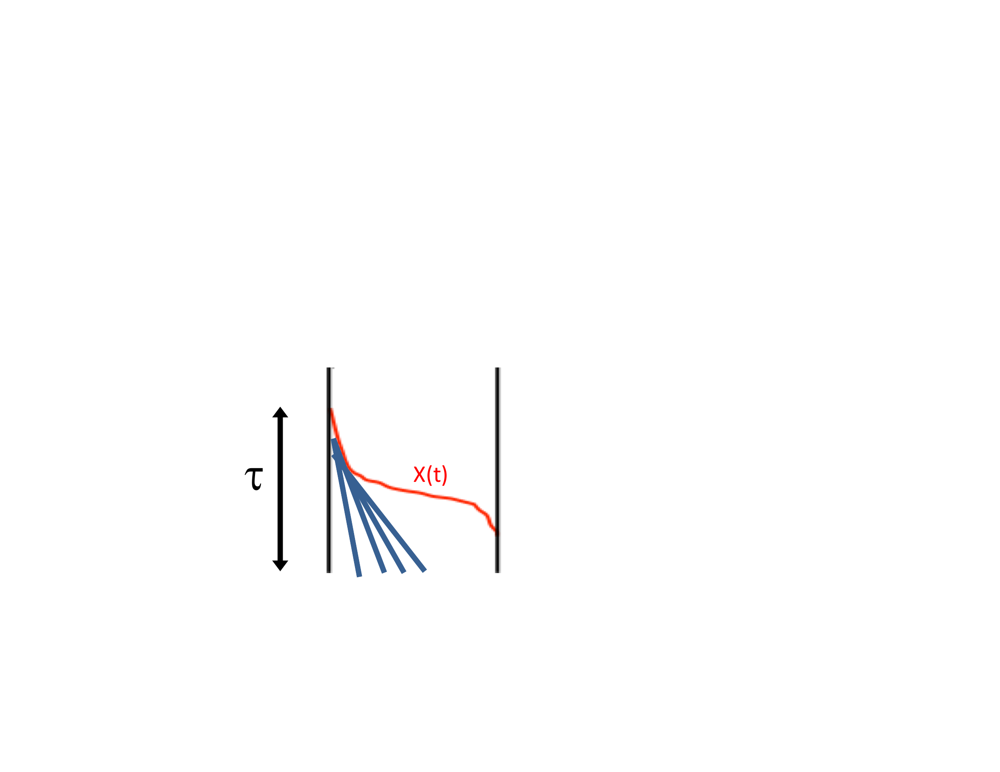
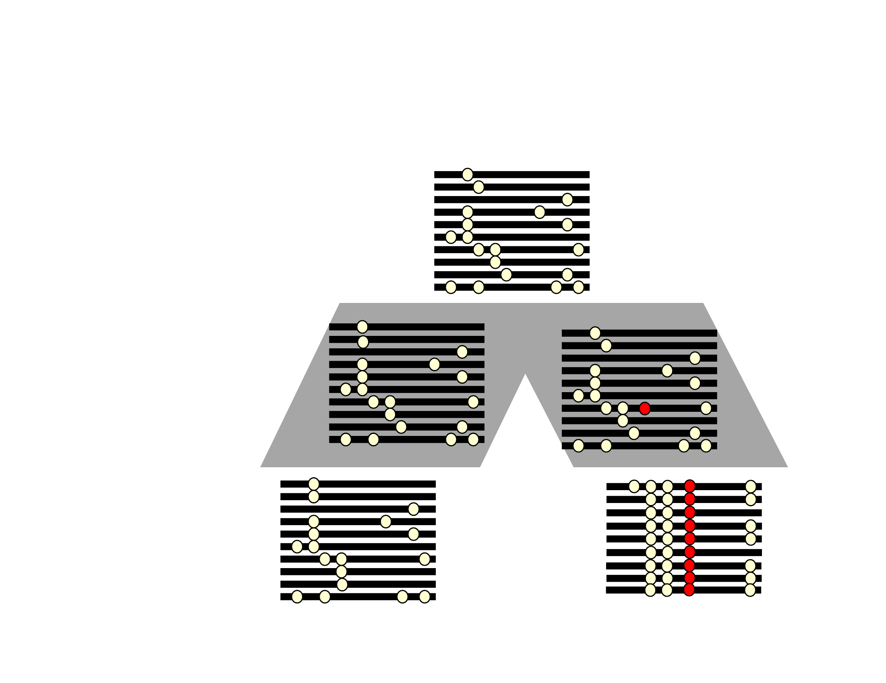
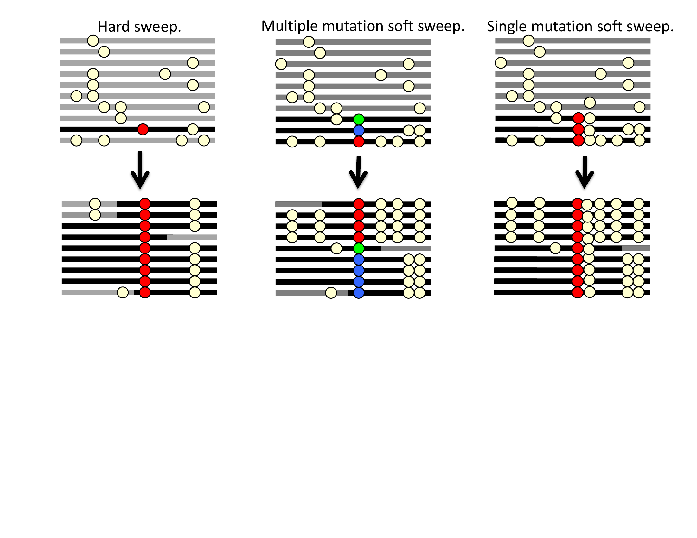

# The Effects of Linked Selection

[Genetic drift is not the only source of randomness]{.smallcaps} in the dynamics of alleles. Alleles also experience random fluctuations in frequency due to the fact that they are present on a set of random genetic backgrounds with different fitnesses. For example, when a beneficial allele arises via a single mutation, it arises on a particular genetic background, i.e. a particular haplotype ([@fig-HIV-sweep]A). Imagine this mutation arising in a region with no recombination, or in an organism where genetic exchange is rare. If our beneficial allele becomes established in the population, i.e. escapes loss by genetic drift in those first few generations, it will start to increase in frequency rapidly. As it rises in frequency, so will the alleles that happened to be present on the haplotype that the mutation arose on (if those other alleles are neutral or at least not too deleterious). These other alleles are getting to ’hitchhike’ along . The alleles that are not on that particular background are swept out of the population, so the net effect of this selective sweep is to remove genetic diversity from the population. Diversity will eventually recover, as new mutations arise and some slowly drift up in frequency. But in the short-term, selective sweeps remove genetic variation from populations.

![**A)** In the top panel, a selected mutation (red dot) arises on a particular haplotype in the population. It sweeps to fixation, carrying with it the haplotype on which it arose, middle panel, erasing the standing genetic diversity in the region. The bottom panel is some time after the selective sweep when some new neutral alleles (green dots) have started to drift up in frequency. **B)** Top panel: HIV sequences from a patient at the start of drug treatment in the protease and retrotransposase coding regions. Bottom panel: A sample 161 days later, after a drug resistant mutation has spread, the A $\rightarrow$ T in the $103^{rd}$ codon of retrotransposase. Each row is a haplotype, with the alleles present shown as coloured blocks. Figure B from @Williams548198, licensed under CC BY 4.0.](images/Journal_figs/recom_selection/Pleuni_HIV_sweep/HIV_no_recom_sweep.png){#fig-HIV-sweep width="100%" fig-alt="A) In the top panel, a selected mutation (red dot) arises on a particular haplotype in the population."}

@Williams548198 have visualized selective sweeps in HIV. In [@fig-HIV-sweep]B) we see a set of HIV haplotypes sampled from a patient before and after of a selective sweep of a drug-resistant mutation. The patient is taking a retrotransposase inhibitor (Efavirenz), but sadly within 161 days a drug-resistant mutation that changes the HIV retrotransposase protein has arisen and spread. Note how a particular haplotype is now fixed in the sample, and little genetic diversity remains, due to the hitchhiking effect of the strong selective sweep of this allele.

{#fig-no-recom-coal .column-margin width="75%" fig-alt="The coalescent of 4 lineages, marked in blue, at a locus completed linked to our selected allele."}

To better understand hitchhiking, first let’s imagine examining variation at a locus fully linked to our selected locus, just after our sweep reached fixation. Neutral alleles sampled at this locus must trace their ancestral lineages back to the neutral allele on whose background the selected allele initially arose (@fig-no-recom-coal). This is because that background neutral allele, which existed $\tau$ generations ago, is the ancestor of the entire population at this fully linked locus. Our individuals who carry the beneficial allele are, from the perspective of these alleles, experiencing a rapidly expanding population. Therefore, a pair of neutral alleles sampled at our linked neutral locus will be forced to coalesce $\approx \tau$ generations ago. A newly derived allele with an additive selection coefficient $s$ will take a time $\tau = 4\log(2N)/s$ generations to reach to fixation within our population (see @eq-diploid-fix-time). This is a very short-time scale compared to the average neutral coalescent time of $2N$ generations for a pair of alleles. Thus we expect little variation, as few mutations will have arisen on these very short branches, and those that have done will likely be singletons in our sample.

{#fig-sweep-haps .column-margin width="50%" fig-alt="A cartoon depiction of a sweep of a red beneficial allele over three time points with recombination."}

Now let’s think about a sweep in a recombining region. Again the selected mutation arises on a particular haplotype, and it and its haplotype starts to increase in frequency in the population (@fig-sweep-haps). However, now recombination events can occur between haplotypes carrying and not carrying the selected allele, in individuals who are heterozygote for the selected allele. These recombination events allow alleles that were not present on the original selected haplotype to avoid being swept out of the population, and also decouple the selected allele somewhat from hitchhiking alleles, preventing many of them from hitchhiking all the way to fixation. Far out from the selected site, the recombination rate is high enough that alleles that were present on the original background barely get to hitchhike along at all, as recombination breaks up their association with the selected allele very rapidly.

{#fig-sweep-haps-coal width="90%" fig-alt="Coalescent genealogies at three loci different distances along the genome from a selective sweep."}

What do the coalesecent genealogies look like at loci various distances away from the selected site? Well, close to the selected site all our alleles in the present day trace back to a most recent common ancestral allele present on that selected haplotype, and so are all forced to coalesce around $\tau$ generations ago (locus 1, see @fig-sweep-haps-coal). Slightly further out from the selected site (locus 2), we have lineages that don’t trace their ancestry back to the original selected haplotype, but instead are descended from recombinant haplotypes that recombined onto the sweep (the haplotype second from the bottom in @fig-sweep-haps-coal). These lineages can coalesce neutrally with the other ancestral lineages over far deeper time scales and mutations on these deeper lineages correspond to the standing diversity present in our population prior to the sweep. As we move even further out from the selected site (locus 3), we encounter more and more lineages descended from recombinant haplotypes that coalesce neutrally much deeper in time than $\tau$, allowing diversity to recover to background levels as we move away from the selected site (see @fig-hitchhiking-reduction).

.](images/figures/hitchhiking_reduction.png){#fig-hitchhiking-reduction width="75%" fig-alt="The expected reduction in diversity compared to its neutral expectation as a function of the distance away from a site where a selected allele has just gone to fixation."}

To model the expected pattern of diversity surrounding a selected site, we can think about a pair of alleles sampled at a neutral locus a recombination distance $c$ away from our selected site. Our pair of alleles will be forced to coalesce $\approx \tau$ generations if neither of them of are descended from recombinant haplotypes (Left side of @fig-recom-coal).

{#fig-recom-coal .column-margin width="100%" fig-alt="Left) two lineages coalesce roughly tau generations ago as they are both descended from the selected haplotypes."}

The probability that our alleles at our neutral locus is descended from the ancestral haplotype on which the selected allele occurs, i.e. that the alele does not descend from a recombinant haplotype is

$$p_{NR} = e^{-c \tau/2 }.$$ {#eq-prob-no-recom-sweep}

What’s the intuition for this werll there are $\tau$ generations in which a recombination can occur, so roughly the probability that absolutely no recombination occurs is $(1-c)^{\tau} =\approx
e^{-c\tau}$. Where does the factor of ${}^{1}\!/\!{}_{2}$ in @eq-prob-no-recom-sweep come from? Well in order to recombine an allele off the selected background the recombination must occur in a heterozygote for the selected allele, under an additive model a neutral allele linked to a fully sweeping allele spends on average ${}^{1}\!/\!{}_{2}$ its time in heterozyotes so reducing our effective recombination rate by a factor of two (see @sec-no-recom-sweep at the end of the chapter for more details).

The probability that neither of our lineages is descended from a recombinant haplotype, and hence are forced to coalesce, is $p_{NR}^2$ (assuming that they coalesce at a time close to $\tau$ so that they recombine independently of each other for times $< \tau$). If one or other of our lineages is descended from a recombinant haplotype, it will take them on average $\approx 2N$ generations to find a common ancestor, as we are back to our neutral coalescent probabilities (Right side of @fig-local-sweep-haps). Thus, the expected time till our pair of lineages find a common ancestor is

$$\mathbb{E}(T_2)  = \tau \times p_{NR}^2 +(1-p_{NR}^2) (\tau +2N) \approx
\left(1-p_{NR}^2 \right) 2N$$ {#eq-linked-selection-1}

where this last approximation assumes that $\tau \ll 2N$. So the expected pairwise diversity for neutral alleles at a recombination distance $r$ away from the selected sweep ($\pi_c$) is

$$\mathbb{E}(\pi_c) = 2\mu \mathbb{E}(T_2)  \approx \pi_0 \left(1-e^{-c\tau} \right)$$ {#eq-pi-HH}

So diversity increases as we move away from the selected site, slowly and exponentially plateauing to its neutral expectation $\pi_0$.

 contributed by TimVickers. United States public domain.]{.attribution}](images/illustration_images/hitchhiking/malaria/Laveran_Malaria_drawings.jpg){#fig-malaria .column-margin width="100%" fig-alt="Laveran’s 1880 drawing of various stages of Plasmodium falciparum as seen in fresh blood."}

The malaria pathogen (*Plasmodium falciparum*) has evolved drug resistance to anti-malaria drugs, often by changes at the dhfr gene. @fig-hitchhiking-malaria shows levels of genetic diversity (heterozygosity) at a set of markers moving out from the dhfr gene in a set of drug resistant malaria sequences collected in Thailand [@nash2005selection]. We see the characteristic dip in diversity around the gene, with zero diversity at a number of the loci very close to the gene, suggesting a strong selective sweep. Fitting our simple model of a sweep to this data, we estimate that $\tau \approx 40$ generations, corresponding to the drug-resistance allele fixing in very short time period.

![Levels of heterozygosity at a set of microsatellite markers surounding the dhfr gene in samples of drug-resistant malaria (*Plasmodium falciparum*) from Thailand. The dotted horizontal line gives the average level of heterozygosity found at these markers in a set of drug-resistant malaria; we take this background as our $\pi_0$. The dashed line shows our fitted hitchhiking model from @eq-pi-HH with $\tau \approx 40$, fitted by non-linear least squares. The recombination rate in *P. falciparum* is $c_{BP}\approx 10^{-6}$bp$^{-1}$. Data from @nash2005selection. Code [here](https://github.com/cooplab/popgen-notes/blob/master/Journal_figs/recom_selection/malaria_sweep/dhfr_sweep.R).](images/Journal_figs/recom_selection/malaria_sweep/dhfr_sweep.png){#fig-hitchhiking-malaria width="100%" fig-alt="Levels of heterozygosity at a set of microsatellite markers surounding the dhfr gene in samples of drug-resistant malaria (Plasmodium falciparum) from Thailand."}

To get a sense of the physical scale over which diversity is reduced, consider a region where recombination occurs at a rate $c_{BP}$ per base pair per generation, and a locus $\ell$ base pairs away from the selected site, such that $c=c_{BP } \ell$ (where $c_{BP}  \ell  \ll 1$ so we don’t need to worry about more than one recombination event occurring per generation). Typical recombination rates are on the order of $c_{BP} = 10^{-8}$. In @fig-hitchhiking-reduction we show the reduction in diversity, given by @eq-pi-HH, for two different selection coefficients.

For our expected diversity level to recover to $50\%$ of its neutral expectation $\mathbb{E}(\pi_c)/\theta=0.5$, requires a physical distance $\ell^{*}$ such that $\log(0.5) = -x_{BP} \ell ^*\tau$, and by re-arrangement,

$$\ell^* = \frac{-\log(0.5)}{c_{BP} \tau }.$$ {#eq-linked-selection-2}

As $\tau$ depends inversely on the selection $s$ (@eq-diploid-fix-time), the width of our trough of reduced diversity depends on $s/c_{BP}$. All else being equal, we expect stronger sweeps or sweeps in regions of low recombination to have a larger hitchhiking effect. For example, in a genomic region with a recombination rate $c_{BP}=10^{-8}$bp$^{-1}$ a selection coefficient of $s=0.1\%$ would reduce diversity over 10’s of kb, while a sweep of $s=1\%$ would affect $\sim$`<!-- -->`{=html}100kb.

::: {#exr-linked-selection-1}
@van2011industrial identified the genetic basis of melanism in the peppered moth (*Biston betularia*). This allele swept to fixation in northern parts of the UK; a classic case of adaptation to industrial pollution (made famous by the work of @kettlewell1955selection, see @majerus2009industrial and @cook2012selective). The genetic basis of melanism is a transposable element (TE) inserted into a pigmentation gene. @van2011industrial found that diversity is suppressed in a broad region around the TE. Specifically, on the background of the TE, it takes roughly 200 kb in either direction for diversity levels to recover to 50% of genome-wide levels.

Random facts: In all moths and butterflies only males recombine; chromosomes are transmitted without recombination in females. The recombination rate in males is 2.9 cM/Mb. Peppered moths have an effective population size of roughly a hundred thousand individuals. Kettlewell used to eat moths when out collecting them in the field (personal communication, Art. Shapiro).\
**A)** Briefly explain how this pattern offers further evidence that the melanic allele was favoured by selection.\
**B)** Using this information, and assuming the allele’s effects on fitness are additive, what is your estimate of the age of the allele?\
**C)** What is your estimate of the selection coefficient favouring this melanic allele?
:::

. Contributed by University of Illinois Urbana-Champaign. Not in copyright.]{.attribution}](images/illustration_images/hitchhiking/Pepper_moth/lespapillonsdans01robe_0375_trimmed.png){#fig-Peppered-moth .column-margin width="100%" fig-alt="Peppered moth (Biston betularia), non-melanic morph"}

**Other signals of selective sweeps.** The primary signal of a recently completed selective sweep is the characteristic reduction in diversity surrounding the selected site. However, sweeps do leave other signals, and these have also often been used to identify loci undergoing selection. For example, neutral alleles further away from the selected site may hitchhiw only part of the way to fixation if recombination occurs during the sweep, which can lead to an excess of high-frequency derived alleles at intermediate distances away from the selected site, a pattern lasting for a short time after a sweep [@Fay:00; @Przeworski:02; @Kim:06]. Also, as neutral diversity levels slowly recover through an influx of new mutations after a sweep, there is a strong skew towards low frequency derived alleles, a pattern that persists for many generations [@Braverman:95; @Przeworski:02; @Kim:06]. The excess of rare alleles, compared to a neutral model, can be captured by statistics such as Tajima’s *D* (which we encountered back in our discussion of the neutral site frequency @eq-Tajimas-D). Thus one way to look for loci that have undergone selective sweeps is to calculate Tajima’s *D* from data in windows along the genome and look for strong departures from the null distribution.

{#fig-local-sweep-haps width="50%" fig-alt="Two populations descended from a common ancestral population."}

We can also use comparisons among multiple populations to look for evidence of sweeps occurring in one of the populations, for example to identify alleles involved in local adaptation (see [-@fig-local-sweep-haps]). A selective sweep will decrease the within-population diversity ($H_S$) surrounding the selected site, without affecting the diversity between different populations. Thus local sweeps create peaks of $F_{\mathrm{ST}}$ between weakly differentiated populations.

@hohenlohe2010population studied genome-wide patterns of $F_{\mathrm{ST}}$ between marine and freshwater populations of threespine stickleback (*Gasterosteus aculeatus*), plotted in @fig-local-sweep-stickleback. Between different marine populations, they found no strong peaks of $F_{\mathrm{ST}}$; however, between the marine and freshwater comparisons they found a number of high $F_{\mathrm{ST}}$ peaks that were replicated over a number of freshwater-marine comparisons. They identified a number of novel regions responsible for the adaptation of sticklebacks to freshwater environments and also a number of loci previously identified in crosses between marine and freshwater populations. For example, the first peak of Linkage Group IV includes *Ectodysplasin A* (*Eda*), a gene involved in the adaptive loss of armour plating in freshwater environments.

![$F_{\mathrm{ST}}$ across the stickleback genome, with colored bars indicating significantly elevated ($p \leq 10^{−5}$, blue; $p \leq 10^{−7}$, red) and reduced ($p \leq 10^{−5}$, green) values. The alternating white and grey panels indicate different linkage groups. **A)** $F_{\mathrm{ST}}$ between two oceanic populations **B)** Average $F_{\mathrm{ST}}$ between a freshwater population and the two marine populations. Figure and caption text from @hohenlohe2010population, licensed under CC BY 4.0.](images/Journal_figs/recom_selection/Stickleback_FST/hohenlohe.png){#fig-local-sweep-stickleback width="90%" fig-alt="F_ST across the stickleback genome, with colored bars indicating significantly elevated (p <= 10^−5, blue; p <= 10^−7, red) and reduced (p <= 10^−5, green) values."}

**Soft Sweeps from multiple mutations and standing variation.** In our sweep model above, we assumed that selection favoured a beneficial allele from the moment it entered the population as a single copy mutation (left panel, @fig-soft-sweep-haps). However, when a novel selection pressure switches on, multiple mutations at the same gene may start to sweep, such that no one of these alleles sweeps to fixation (middle panel, @fig-soft-sweep-haps). These sweeps involving multiple mutations significantly soften the impact of selection on genomic diversity, and so are called ’soft sweeps’.

{#fig-soft-sweep-haps width="100%" fig-alt="Three types of sweeps."}

Another way that the impact of a sweep can be softened is if our allele was segregating in the population for some time before it became beneficial. That additional time means that our allele can have recombined onto various haplotype backgrounds, such that when selection pressures switch, the selected allele sweeps up in frequency on multiple different haplotypes (right panel, @fig-soft-sweep-haps). Detecting and differentiating these different types of sweeps is an active area of empirical research and theory in population genomics (see @hermisson2017soft for an overview of developments in this area).

## The genome-wide effects of linked selection.

To what extent are patterns of variation along the genome and among species shaped by linked selection, such as selective sweeps? We can hope to identify individual cases of strong selective sweeps along the genome, but how do they contribute to broader patterns of variation?

Two observations have puzzled population geneticists since the inception of molecular population genetics. The first is the relatively high level of genetic variation observed in most obligately sexual species. The neutral theory of molecular evolution was developed in part to explain these high levels of diversity. As we saw in @sec-Drift, under a simple neutral model, with constant population size, we should expect the amount of neutral genetic diversity to scale with the product of the population size and mutation rate. The second observation, however, is the relatively narrow range of polymorphism across species with vastly different census sizes (see @fig-Leffer and @leffler:12 for a recent review). As highlighted by @Lewontin:74 in his discussion of the paradox of variation, this observation seemingly contradicts the prediction of the neutral theory that genetic diversity should scale with the census population size. There are a number of explanations for the discrepancy between genetic diversity levels and census population sizes. The first is that the effective size of the population ($N_e$) is often much lower than the census size, due to high variance in reproductive success and frequent bottlenecks (as discussed in @sec-Drift). The second major explanation, put forward by @MaynardSmithHaigh74, is that neutral levels of diversity are also systematically reduced by the effects of linked selection. In large populations, selective sweeps and other forms of linked selection may come to dominate over genetic drift as a source of stochasticity in allele frequencies, potentially establishing an upper limit to levels of diversity [@Kaplan:89; @Gillespie:00].

![The relationship between (sex-averaged) recombination rate and synonymous site pairwise diversity ($\pi$) in *Drosophila melanogaster*. The curve is the predicted relationship between $\pi$ and recombination rate, obtained by fitting the recurrent hitchhiking @eq-pi-GW-HH to this data using non-linear least squares via the `nls()` function in ` R`. Data from [@Shapiro:07], kindly provided by Peter Andolfatto, see @sella2009pervasive for details. Code [here](https://github.com/cooplab/popgen-notes/blob/master/Rcode/Genomewide_HH.R).](images/figures/Genomewide_HH.png){#fig-GW-hitchhiking-reduction width="75%" fig-alt="The relationship between (sex-averaged) recombination rate and synonymous site pairwise diversity (pi) in Drosophila melanogaster."}

One strong line of evidence for the action of linked selection in reducing levels of polymorphism is the positive correlation between putatively neutral diversity and recombination seen in a number of species, as, all else being equal, linked selection should remove diversity more quickly in regions of low recombination [@Aguade:89; @Begun:92; @Wiehe:93; @Cutter:10; @Cai:09]. For example, *Drosophila melanogaster* diversity levels are much lower in genomic regions of low recombination (see @fig-GW-hitchhiking-reduction). This pattern can not be explained by differences in mutation rate between low and high recombination regions as this pattern is not seen strongly in divergence data among species.

These patterns could reflect the action of selective sweeps happening recurrently along the genome. In the next section we’ll present a model for how levels of genetic diversity should depend on recombination and the density of functional sites under a model of recurrent selective sweeps. However, other forms of linked selection can impact genetic diversity in similar ways. For example, linked genetic diversity is continuously lost from natural populations due to the removal of haplotypes that carry deleterious alleles [@Charlesworth:95; @Hudson:95]; this is called the ’background selection’ model. Below we’ll discuss the background selection model and its basic predictions.

More generally, a wide range of models of selection predict the removal of neutral diversity linked to selected sites. This is because the diversity-reducing effects of high variance in reproductive success are compounded over the generations when there is heritable variance in fitness [@Robertson:61; @Santiago:95; @Santiago:98; @Barton:00]. Many different modes of linked selection likely contribute to these genome-wide patterns of diversity; the present challenge is how to differentiate among these different modes.

### A simple recurrent model of selective sweeps

To explain how a constant influx of sweeps could impact levels of diversity, here we will develop a model of recurrent selective sweeps.

Imagine we sample a a pair of neutral alleles at a locus a genetic distance $c$ away from a locus where sweeps are initiated within the population at some very low rate $\nu$ per generation. The waiting time between sweeps at our locus is exponentially distributed $\sim Exp(\nu)$ (see math Appendix @eq-exp-rv-def). Each sweep rapidly transits through the population in $\tau$ generations, such that each sweep is finished long before the next sweep ($\tau \ll {}^{1}\!/\!{}_{\nu}$).

As before, the chance that our neutral lineage fails to recombine off the sweep is $p_{NR}$, such that the probability that our pair of lineages are forced to coalesce by a sweep is $e^{-c \tau}$. Our lineages therefore have a very low probability

$$\nu e^{-c \tau}$$ {#eq-linked-selection-3}

of being forced to coalesce by a sweep per generation. If our lineages do not coalesce due to a sweep, they coalesce at a neutral rate of ${}^{1}\!/\!{}_{2N}$ per generation. Thus the average waiting time till a coalescent event between our neutral pair of lineages due to either a sweep or a neutral coalescent event is

$$\mathbb{E}(T_2) = \frac{1}{\nu e^{-c \tau} + {}^{1}\!/\!{}_{2N}}$$ {#eq-linked-selection-4}

Now imagine that the sweeps don’t occur at a fixed location with respect to our locus of interest, but now occur uniformly at random across our genome. The sweeps are initiated at a very low rate of $\nu_{BP}$ per basepair per generation. The rate of coalescence due to sweeps at a locus $\ell$ basepairs away from our neutral loci is $2\nu_{BP} e^{-c_{BP} \ell \tau}$, where the factor of two comes from the fact that bases can be $\ell$ basepairs away on the left or right. If our neutral locus is in the middle of a chromosome that stretches $L$ basepairs in either direction, the total rate of sweeps per generation that could force our pair of lineages to coalesce is

$$2\int_0^{L} \nu_{BP} e^{-c_{BP} \ell \tau} d \ell =
\frac{2\nu_{BP}}{c_{BP} \tau} \left(1-e^{-c_{BP} \tau L} \right)$$ {#eq-linked-selection-5}

so that if $L$ is very large ($c_{BP} \tau L \gg 1$), the rate of coalescence per generation due to sweeps is ${}^{2\nu_{BP}}\!/\!{}_{c_{BP} \tau}$. The total rate of coalescence for a pair of lineages per generation is then

$$\frac{2\nu_{BP}}{c_{BP} \tau}+\frac{1}{2N}$$ {#eq-linked-selection-6}

So our average time untill a pair of lineages coalesce is

$$\mathbb{E}(T_2) = \frac{1}{{}^{2\nu_{BP}}\!/\!{}_{c_{BP} \tau}+{}^{1}\!/\!{}_{2N}} = \frac{c_{BP}2N}{{}^{4N\nu_{BP}}\!/\!{}_{ \tau}+c_{BP}}$$ {#eq-linked-selection-7}

such that our expected pairwise diversity ($\pi=2\mu\mathbb{E}(T_2)$) in a region with recombination rate $r_{BP}$ that experiences sweeps at rate $\nu_{BP}$ is

$$\mathbb{E}(\pi) = \pi_0 \frac{c_{BP}}{{}^{4N\nu_{BP}}\!/\!{}_{ \tau}+c_{BP}}$$ {#eq-pi-GW-HH}

where $\pi_0$ is our expected diversity without any selective sweeps, ($pi_0=\theta=4N\mu$). The expected diversity increases with $c_{BP}$, as higher recombination rates decrease the likelihood a neutral allele hitchhikes along with a sweep and is thus forced to coalesce by the sweep. Expected diversity decreases with $\nu_{BP}$, as a greater density of functional sites experiencing sweeps increases the chance of being linked to a nearby sweep. As we move to high $c_{BP}$, assuming that $\nu_{BP}$ doesn’t increase with $c_{BP}$, our level of diversity should plateau to $\theta$, the level of genetic diversity of a neutral site completely unlinked to any selected loci. If we assume that our genome experiences a constant rate of sweeps of a given strength, i.e. that ${}^{4N\nu_{BP}}\!/\!{}_{ \tau}$ is a constant, we can fit the variation in $\pi$ across regions that vary in their recombination rate ($c_{BP}$) to estimate a population’s rate of recurrent sweeps per basepair. An example of fitting this curve to data from *Drosophila melanogaster* is shown in @fig-GW-hitchhiking-reduction; see @wiehe1993analysis for an early example of fitting a similar recurrent hitchhiking model to such data. The parameter giving us this best-fitting curve is ${}^{4N\nu_{BP}}\!/\!{}_{ \tau} \approx 7 \times 10^{-9}$. With an effective population size of a million and assuming that the sweeps take a thousand generations to reach fixation, we find this implies $\nu_{BP} \approx 10^{-12}$. Thus, a really low rate of moderately strong sweeps, roughly one every megabase every million generations, is all we need to explain the profound dip in diversity seen in regions of the genome with low recombination. However, sweeps from positively selected alleles are not the only cause of genome-wide signals of linked selection. Selection against deleterious alleles can also drive these patterns.

### Background selection

Populations experience a constant influx of deleterious mutations at functional loci while selection acts to purge them from the population, thus preventing deleterious substitutions and maintaining function at these loci. As we discussed in @sec-OneLocusSelection, this balance between mutation and selection results in a constant level of deleterious variation in the population. The constant selection against this deleterious variation has effects on diversity at linked sites. Each deleterious mutation arises at random on a haplotype in the population, and as selection purges this mutation, it removes with it any neutral alleles that were also on this haplotype. This constant removal of linked alleles from the population acts to reduce diversity in regions surrounding functional loci [@Hudson:95b; @Nordborg:96], an effect known as background selection (BGS).

What proportion of our haplotypes are free of deleterious mutations in any given generation, and so free to contribute to future generations? Well, under mutation-selection balance, a constrained locus with a mutation rate $\mu$ towards deleterious alleles that experience a selection coefficient $sh$ against them in heterozygotes, will result in ${}^{\mu}\!/\!{}_{sh}$ chromosomes carrying the deleterious allele. Some of these haplotypes may be passed on to the next generation, but if they are fully linked to the deleterious locus they will all eventually be lost because they carry a deleterious mutation at a site under constraint. Thus, for a neutral polymorphism completed linked to a constrained locus, only $2N(1-{}^{\mu}\!/\!{}_{sh})$ alleles get to contribute to future generations. Therefore, the level of pairwise diversity in a constant population due to BGS at such a locus will be

$$\mathbb{E}[\pi] = 2 \mu \times 2N(1-{}^{\mu}\!/\!{}_{sh}) = \pi_0  (1-{}^{\mu}\!/\!{}_{sh})$$ {#eq-linked-selection-8}

where $\pi_0= 4N\mu$, the level of neutral pairwise diversity in the absence of linked selection.

![A cartoon depiction of a region for 10 haplotypes experiencing background selection. Neutral mutations are shown as gray circles, and deleterious mutations in red. Over time, chromosomes carrying deleterious mutations are removed from the population, such that most individuals are descended from a subset of chromosomes free of deleterious alleles (highlighted here by orange boxes). Mutation is constantly generating new deleterious alleles on the background of chromosomes previously free of deleterious alleles, and so this process is constantly repeating (orange arrow). Figure modified from @sella2009pervasive, licensed under CC BY 4.0.](images/figures/Hitchhiking/BGS_cartoon.png){#fig-BGS-cartoon width="75%" fig-alt="A cartoon depiction of a region for 10 haplotypes experiencing background selection."}

The effects of background selection are more pronounced in regions of low recombination, where neutral alleles are less able to recombine off the background of deleterious alleles. Thus, under background selection, we also expect to see reduced diversity in regions of lower recombination.

For a neutral locus that is a recombination fraction $r$ away from a locus subject to constraint, the level of diversity is

$$\mathbb{E}[\pi] = \pi_0  \left(1-\frac{\mu sh}{2(c+sh)^2} \right)$$ {#eq-pi-loc-BGS-1}

As we move away from a locus experiencing purifying selection, we increase $c$, and diversity should recover. For example, moving away from genic regions in the maize genome we see the average level of diversity recover. This occurs in both maize and teosinte, the wild progenitor of maize. The dip in diversity around non-synonymous sites is stronger in teosinte, perhaps because the accelerated drift due to the bottleneck in maize may have somewhat released constraint on sites where very weakly deleterious alleles segregated previously at mutation-selection balance.

![Relative diversity compared to the mean diversity in windows $\ge 0.01$ cM as a function of the distance to the nearest gene. See [@beissinger2016recent] for details. Figure licensed under CC BY 4.0 [ by Jeff Ross-Ibarra](https://github.com/RILAB/beissinger_ms).](images/Journal_figs/recom_selection/maize_dist_gene/Figure4_beissinger_A.png){#fig-BGS-maize .column-margin width="100%" fig-alt="Relative diversity compared to the mean diversity in windows >= 0.01 cM as a function of the distance to the nearest gene."}

More generally, if a neutral locus is surrounded by $L$ loci experiencing purifying selection at recombination distances $c_1,\cdots,c_L$, then compounding @eq-pi-loc-BGS-1 across these loci, the expected reduced diversity is approximately

$$\mathbb{E}[\pi] = \pi_0  \prod_{i=1}^L \left(1-\frac{\mu sh}{2(c_L+sh)^2}
\right) \approx \exp \left( \sum_{i=1}^L \frac{\mu sh}{2(c_i+sh)^2} \right)$$ {#eq-pi-loc-BGS}

To model an average neutral locus in a genomic region with a given recombination rate, we can imagine that our neutral locus is situated in the center of a large region with total recombination rate $C$ and total deleterious mutation rate $U$, where $U = \mu L$. Then our expression for diversity, @eq-pi-loc-BGS, simplies to

$$\mathbb{E}[\pi] \approx \pi_0 \exp \left( {}^{-U}\!/\!{}_{(sh+C)} \right)
\approx \pi_0 \exp \left( {}^{-U}\!/\!{}_{C} \right).$$ {#eq-GW-BGS-1}

In this last approximation, we assume that we’re looking at a large region, with $C \gg sh$ . Note that much like genetic load, @eq-mut-load, this expression depends only on the total deleterious mutation rate. Any dependence on the selection coefficient drops out, as weakly selected mutations segregate in the population at higher frequencies, but are also removed from the population more slowly, allowing more of the genome to recombine off the deleterious background.

.](images/figures/Genomewide_BGS_HH.png){#fig-GW-BGS-reduction .column-margin width="100%" fig-alt="The relationship between recombination rate and synonymous site pairwise diversity (pi) in D."}

For a first go at fitting this to genome-wide data, we could look at diversity in windows of length $W$ bp (as in @fig-GW-BGS-reduction). If we assume that there is a constant rate of deleterious mutation per base pair, $\mu_{BP}$, then $U=\mu_{BP}W$. Furthermore, if our genomic window has a recombination rate $c_{BP}$ per base-pair, our total genetic length is $R=c_{BP}W$. Making these substitutions in @eq-GW-BGS-1, our window size cancels out to give

$$\mathbb{E}[\pi] \approx \pi_0 \exp \left({}^{-\mu_{BP}}\!/\!{}_{c_{bp}}
  \right)$$ {#eq-GW-BGS-2}

Looking across windows that vary in their recombination rate, i.e. $c_{BP}$, we can fit @eq-GW-BGS-2 to data to estimate $\mu_{BP}$. An example of doing this to data from *D. melanogaster* is shown in @fig-GW-BGS-reduction, yielding an estimate of the deleterious mutation rate of $\mu_{BP}\approx
3.2 \times 10^{-9}$. This is roughly on the same order as the mutation rate per base pair in *D. melanogaster*, and so this deleterious mutation rate estimate is somewhat high as it would require most of the genome to be constrained, but as a first approximation it’s not terrible. Note how similar the fit is to a model of hitchhiking, suggesting that some combination of BGS and hitchhiking can explain the broad relationship between diversity and recombination seen in *D. melanogaster* and other species.

![Observed (black line) and predicted pairwise diversity across chromosome 1, from a background selection model that assumes a uniform mutation rate (red line) or a mutation rate that varies with local human/dog divergence (blue line). Figure from [@Mcvicker:09], licensed under CC BY 4.0.](images/Journal_figs/recom_selection/McVicker_human_BGS/McVicker_human_BGS.png){#fig-McVicker-BGS width="100%" fig-alt="Observed (black line) and predicted pairwise diversity across chromosome 1, from a background selection model that assumes a uniform mutation rate (red line) or a mutation rate that varies with local human/dog diverge..."}

As our annotations of functional regions of the genome have improved, so have our methods to infer background selection. A more rigorous version of this analysis today would incorporate variation in coding density among windows into the parameter $\mu_{BP}$. With detailed genomic annotations showing coding regions and constrained non-coding regions, we can also move beyond just analyzing broad-scale patterns. For example, @Mcvicker:09 fit a model of background selection to putatively neutral pairwise diversity along the human genome, using @eq-pi-loc-BGS to estimate the effect of BGS at each locus, weighing the genetic distance to all of the surrounding coding regions and constrained non-coding sites. This allowed @Mcvicker:09 to estimate mutation rates and average selection coefficients acting against deleterious alleles in these regions of the genome. This best fitting model also allowed them to predict diversity levels along the genome, a section of which is shown in figure [-@fig-McVicker-BGS]. Thus, broad-scale features of polymorphism along the genome are well described by background selection (or by linked selection more generally).

The deleterious mutation rates estimated by @Mcvicker:09 from fitting a model of BGS were again too high, as in the *Drosphila* example above, suggesting the BGS alone is not sufficient to explain all of the effect of linked selection. But how then do we go about distinguishing the impact of BGS from hitchhiking?

**Distinguishing the impact of hitchiking from background selection in genome-wide data.**

A variety of approaches have been taken to start to separate the effects of hitchhiking from background selection. Much of the strongest evidence showing the effects of both comes from *Drosophila melanogaster* and we review some of that evidence here. Hitchhiking is expected to have systematic effects on the neutral site frequency spectrum, distorting it towards rare minor alleles, (reflecting the slow recovery of diversity following a sweep). Therefore, we should expect a distortion of summary statistics such as Tajima’s D in regions of low recombination if hitchhiking is contributing to the reduction in diversity in these regions [@Braverman:95; @Przeworski:02; @Kim:06]. In *D. melanogaster*, there is a greater skew towards rare alleles at putatively neutral sites in regions of low recombination [@Andolfatto:01; @Shapiro:07]; see left panel of @fig-Tajimas-D-dN-pi. However, while this skew isn’t expected under simple models of strong background selection.

.](images/Journal_figs/recom_selection/Andolfatto_subs_vs_dN/Tajimas_D_subs_vs_dN.png){#fig-Tajimas-D-dN-pi width="100%" fig-alt="Left) Average Tajima’s D in genomic windows plotted against their recombination rate in D."}

Another prediction of the hitchhiking model, where an allele sweeps to fixation, is that there should be a functional substitution associated with each sweep. Or, to flip that around, we might expect to see a greater impact of hitchhiking where there are more functional substitutions. For example, regions surrounding non-synonymous substitutions should have lower levels of diversity, if a high fraction of non-synonymous substitutions are adaptive. Again, this pattern is seen in *D. melanogaster* [@Andolfatto:07; @Macpherson:07; @Sattath:11] (, right side of @fig-Tajimas-D-dN-pi).

{#fig-Elyashiv-around-subs width="100%" fig-alt="Left) Scaled synonymous pairwise diversity levels around non-synonymous (NS) and synonymous (SYN) substitutions in D."}

Pushing this idea further, we can look at the dip in diversity surrounding a non-synonymous substitution averaged across all the substitutions in the genome. @elyashiv2016genomic found a stronger dip in diversity around non-synonymous substitutions than synonymous substitutions [see also @sattath2011pervasive]. Extending the model of @Mcvicker:09 to fit a model of background selection and hitchhiking to putative neutral diversity along the genome, they found that the dip in diversity around synonymous substitutions comes mostly from BGS. But to fully explain the dip in diversity around non-synonymous substitutions, a reasonable proportion of these non-synonymous substitutions have to have been accompanied by a classic (hard) sweep. The majority of these sweeps are estimated to be due to very weak selection, with selection coefficients $<10^{-4}$. Furthermore, @elyashiv2016genomic estimated a $77$ - $89\%$ reduction in neutral diversity due to selection on linked sites, and concluded that no genomic window was entirely free of the effects of selection. Thus linked selection has a profound effect in some species such as *Drosophila melanogaster*.

## Appendix. The probability of not recombining off the selected haplotype during the sweep. {#sec-no-recom-sweep}

We know that in the present day our neutral lineage is linked to the selected allele. The probability that our lineage, in some generation $t$ back in time, is in a heterozygote is $1-X(t)$, and the probability that a recombination occurs in that individual is $r$. So the probability that our neutral lineage is descended from a recombinant haplotype $t$ generations back is

$$c (1-X(t))$$ {#eq-linked-selection-9}

So the probability ($p_{NR}$) that our lineage is not descended from a recombinant haplotype from a recombination event in the $\tau$ generations it takes our selected allele to move through the population is

$$p_{NR}=\prod_{t=1}^{\tau} \big(1- c(1-X(j))\big)$$ {#eq-linked-selection-10}

Assuming that $c$ is small, then $\left(1- c(1-X(t))\right) \approx
e^{-r(1-X(t))}$, such that

$$p_{NR}=\prod_{t=1}^{\tau} \left(1- c(1-X(t))\right) \approx \exp
\left( -c\sum_{t=1}^{\tau}
1- X(t) \right) =\exp
\left( -c \tau (1-\widehat{X}) \right)$$ {#eq-linked-selection-11}

where $\widehat{X}$ is the average frequency of the derived beneficial allele across its trajectory as it sweeps up in frequency, $\widehat{X} = \frac{1}{\tau}  \sum_{t=1}^{\tau}
 X(t)$. As our allele is additive, its trajectory for frequencies $<0.5$ is the mirror image of its trajectory for frequencies $>0.5$, therefore its average frequency $\widehat{X} =0.5$. This simplifies our expression to

$$p_{NR} = e^{-c \tau/2 }.$$ {#eq-linked-selection-12}

::: chapter-summary
**Chapter summary.**

-   When an initially rare selected allele sweeps up in frequency it carries with it the genetic background (haplotype) that it arose on. Alleles that are lucky enough to hitchhike along with the selected allele are dragged to high frequency and diversity is depleted by this hitchhiking effect.

-   In recombining regions, diversity is only locally supressed by a selective sweep as further from the selected site alleles can recombine on/off of the sweep allowing diversity to persist in the population. The genomic scale of the hitchiking effect depends linearly on the time it take the selected allele to sweep through the population and inversely on the local recombination rate. The characteristic dip in diversity is used to find selective sweeps in genome scans and to estimate the timing and strength of selection.

-   Selective sweeps leave a range of other genomic signals that have been used to identify them, including distortions to the frequency spectrum (a more extreme skew towards rare alleles) and elevated $F_{ST}$ between populations.

-   We see reduced diversity in regions of low recombination consistent with the greater removal of diversity in these regions due to recurrent hitchhiking. However, this genome-wide effect is also consistent with background selection, the removal of linked diversity along with deleterious alleles.
:::

{#fig-branched-teosinte .column-margin width="100%" fig-alt="Top) Teosinte plant architecture is branched, with multiple ears per plant."}

::: {#exr-linked-selection-2}
Modern maize derived from teosinte, a weedy plant that grows in South and Central America. A striking phenotypic difference between teosinte and maize is that teosinte is a bushy plant, while maize grows primarily upwards. One gene that has been implicated in this transformation is tb1. @wang1999limits sequenced a region around this gene to find that background levels of neutral diversity decrease around this gene.

**A)** It takes roughly 300bp for the diversity to recover moving away from the sweep. @wang1999limits estimate $r = 4 \times 10^{-7}$ per base pair. Estimate the time (in years) since the selected maize variant of tb1 arose as a new mutation. Maize is an annual plant, so assume 1 generation per year.\
**B)** Assume that the effective size of this diploid population is $N = 10^6$. What is the selective coefficient of this tb1 allele?
:::
