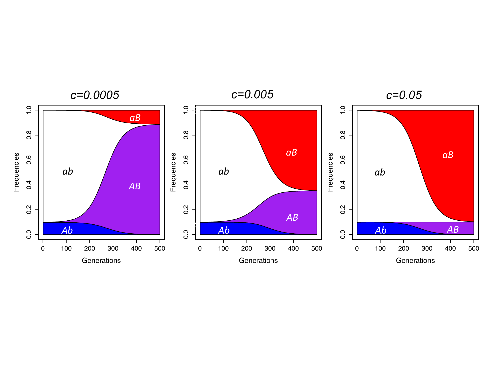
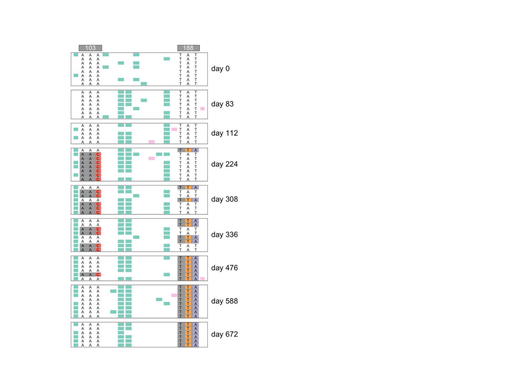
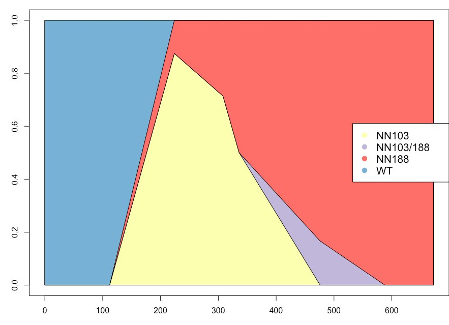
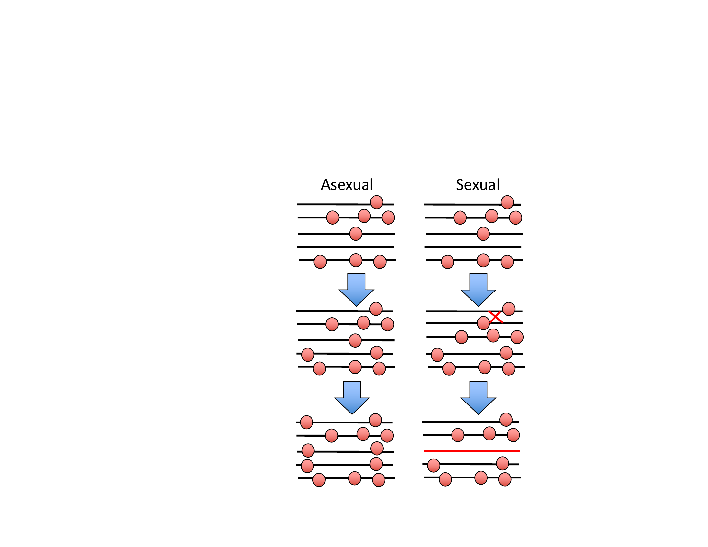
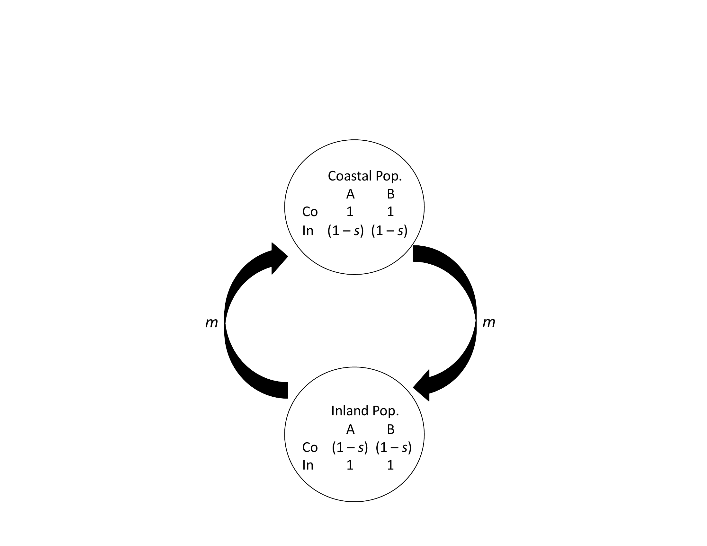
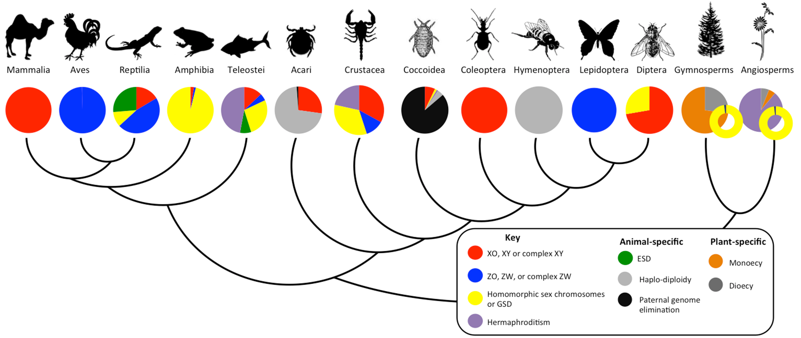

# Interaction of Multiple Selected Loci

Selection doesn’t act on loci in isolation, and the fates of selected alleles in the genome are correlated. In the prior chapter we looked into how selected loci affected neutral loci. Here we’ll explore the interaction of multiple selected loci. Throughout this chapter we’ll see how multi-locus dynamics are key to understanding hypotheses about the evolutionary significance of sexual reproduction, after all the primary evolutionary costs and benefits of sex arise the independent assortment of chromosomes and recombination. Multi-locus dynamics are also often key to understanding how new species arise and are maintained. From a population-genetic perspective, species are sets of traits and alleles held together by assortative mating and selection.

## Why sex?

. Contributed by Missouri Botanical Garden, Peter H. Raven Library. Not in copyright.]{.attribution}](images/illustration_images/multiple_sel_loci/whiptail_lizard/Cnemidophorus_guttatus.png){#fig-whiptail-lizard .column-margin width="100%" fig-alt="Mexican racerunner (Aspidoscelis guttatus."}

The vast majority of eukaryotic organisms reproduce sexually. Sexual reproduction, the fusion of two cells to form a zygote (*syngamy*) followed by meiosis, represents an ancient feature of eukaryotes. However, the ubiquity of sex is not just due to sex being a fixed ancestral state of eukaryotes. Many eukaryotic species are not obligately sexual and can reproduce clonally (i.e. asexually), e.g. vegetative growth in plants. However, they will reproduce clonally only for a short while before having sex again. There are even asexual vertebrate lineages. For example, there are a number of obligately parthenogenic species of whiptail lizard (*Aspidoscelis*), where every individual in the species is female and reproduce clonally. However, only a small fraction of eukaryote species are obligate asexuals, and these species appear to be short-lived twigs on the eukaryotic tree of life.

Sex reproduction is confined to eukaryotes, but most non-eukaryotic species have some form of genetic exchange where genetic material is acquired and incorporation into their genomes via a range of mechanisms. These non-eukaryotic mechanisms often seem to have evolved in part because they facilitate genetic exchange.

Thus, sex and genetic exchange are incredibly widespread. Yet sex has substantial short-term costs.

**The costs of sex.** Three broad costs of sex have often been hypothesized:

1.  The cost of mating. Finding and attracting a mate are costly and may be impossible, and mating can be dangerous.

2.  The cost of recombination. Why risk breaking it up a winning genotype? If you’ve managed to survive to reproduce you’re genotype likely can’t be a terrible fit to the environment. But if you engage in sexual reproduction, i.e. meiosis, you’re shuffling up your genome with that of your partner. There’s no guarantee that this new genotype will work well in the current environment.

3.  The two-fold cost of sex [@smith1971origin]. The offspring of sexual organisms have two parents. Therefore, sexual parents only contribute half of their genome to their offspring. While asexual organisms contribute their entire genome to the next generation. Thus a sexual organism has to have twice as many children to leave the same number of copies of their genome to the next generation. That might be doable if both sexual parents were equally committed to contributing to those offspring. However, that is rarely the case. This cost is sometimes called the two-fold cost of males, as males often provide little in terms of resources to their children. Thus any allele that makes its host asexual should initially spread all else being equal.

Yet sex and other forms of genetic exchange persist, despite these short-term advantages to asexual reproduction. Indeed asexual lineages often arise and spread within some sexual populations due to these advantages.

**The benefits of sex.** Numerous benefits to sexual reproduction have been suggested. Throughout this chapter we’ll encounter a range of models that touch on the advantages of sex. We’ll see that selection allows beneficial alleles to shed their background of deleterious alleles as they sweep through the population. In the absence of sex and recombination, beneficial alleles can block each other’s progression to fixation, so called ‘clonal interference’. Another major advantage of sex is that beneficial alleles can be brought together on the same genetic background via recombination, allowing faster rates of adaptation.

## A two locus model of selection and recombination.

Models involving many selected loci can be very challenging to analyze. Luckily for us many of the key insights of the interaction of selection and recombination can be understood in relatively intuitive terms, and demonstrated using two locus models.

Consider two biallelic loci segregating for $A/a$ and $B/b$. There are four haplotypes, $AB$, $Ab$, $aB$, $ab$, which for simplicity we label 1-4. The frequency of our four haplotypes are $x_1$, $x_2$, $x_3$, and $x_4$. Each individual has a genotype consisting of two haplotypes; we label $w_{ij}$ the fitness of an individual with the genotype made up of haplotype $i$ and $j$ (we assume that $w_{ij}=w_{ji}$, i.e. there are no parent-of-origin effects). Assuming that these fitnesses reflect differences due to viability selection, and that individuals mate at random, we can write the following table of our genotype proportions after selection:

|      |      $AB$      |        $Ab$        |        $aB$        |        $ab$        |
|:----:|:--------------:|:------------------:|:------------------:|:------------------:|
| $AB$ | $w_{11} x_1^2$ | $w_{12} 2 x_1 x_2$ | $w_{13} 2 x_1 x_3$ | $w_{14} 2 x_1 x_4$ |
| $Ab$ |   $\bullet$    |   $w_{22} x_2^2$   | $w_{23} 2 x_2 x_3$ | $w_{24} 2 x_2 x_4$ |
| $aB$ |   $\bullet$    |     $\bullet$      |   $w_{33} x_3^2$   | $w_{34} 2 x_3 x_4$ |
| $ab$ |   $\bullet$    |     $\bullet$      |     $\bullet$      |   $w_{44} x_4^2$   |

This follows from assuming that our haplotypes are brought together at random (HWE), then discounted by their fitnesses. Our mean fitness $\bar{w}$ is the sum of all the entries in the table, so dividing by $\bar{w}$ normalizes the complete table to sum to one. The frequency of the $AB$ haplotype ($1$) in the next generation of gametes is

$$x_1' = \frac{\big( w_{11} x_1^2 +    \tfrac{1}{2} w_{12} 2 x_1 x_2  + \tfrac{1}{2} w_{13} 2x_1 x_3  +    \tfrac{1}{2} (1-c) w_{14} 2 x_1 x_4 + \tfrac{1}{2} c w_{23} 2 x_2 x_3   \big)}{ \bar{w} }$$ {#eq-hapfreq}

This is a bit of a mouthful, but each of the terms is easy to understand. Each of the HWE genotype frequencies (e.g. $2x_1x_2$) is weighted by its fitness relative to the mean fitness ($w_{ij}/\bar{w}$), and by its probability of transmitting the AB haplotype to the next generation. For example, $AB/Ab$ individuals (1/2) transmit the $AB$ haplotype only half the time. The final two terms include the recombination fraction ($c$). The first term involving recombination refers to the $AB/ab$ genotype (1/4), who with probability $(1-c)/2$ transmits a non-recombinant $AB$ haplotype to the gamete. Similarly, the second term refers to the $Ab/aB$ genotype; a proportion $c/2$ of its gametes carry the recombinant $AB$ haplotype.

In the single locus case, we defined the marginal fitness of an allele. Here it will help us to define the marginal fitness of the $i^{th}$ haplotype:

$$\bar{w}_i = \sum_{j=1}^4 w_{ij} x_j$$ {#eq-multiple-selected-loci-1}

This is the fitness of the $i^{th}$ haplotype averaged over all of the diploid genotypes it could occur in, weighted by their probability under random mating. Using this notation, and with some rearrangement of @eq-hapfreq, we obtain

$$x_1' = \frac{x_1\bar{w}_1 - w_{14} c D}{\bar{w}}$$ {#eq-multiple-selected-loci-2}

Here we have assumed that $w_{23}=w_{14}$, i.e. that the fitness of $AB/ab$ individuals is the same as $Ab/aB$ individuals (i.e. that fitness depends only on the alleles carried by an individual, and not on which chromosome they are carried; this assumption is sometimes called no *cis*-epistasis).

We can then write the change in the frequency of our $1$ haplotype as

$$\Delta x_1= \frac{x_1(\bar{w}_1-\bar{w}) -c w_{14} D}{\bar{w}}$$ {#eq-multiple-selected-loci-3}

Generalizing this result, we write the change in any haplotype i from our set of four haplotypes as

$$\Delta x_i= \frac{x_i(\bar{w}_i-\bar{w}) \pm c w_{14} D}{\bar{w}}$$ {#eq-two-loc-sel}

where the coupling haplotypes 1 and 4 use $+D$ and repulsion haplotypes 2 and 3 use $-D$. Note that the sum of these four $\Delta x_i$ is zero, as our haplotype frequencies sum to one.

So the change in the frequency of a haplotype (e.g. *AB*, haplotype 1) is determined by the interplay of two factors: First, the extent to which the marginal fitness of our haplotype is higher (or lower) than the mean fitness of the population (the magnitude and sign of $(\bar{w}_1-\bar{w})/\bar{w}$). Second, whether there is a deficit or any excess of our haplotype compared to linkage equilibrium (the magnitude and sign of $D$), modified by the strength of recombination. This tension between selection promoting particular haplotypic combinations, and recombination breaking up overly common haplotypes is the key to a lot of interesting dynamics and evolutionary processes.

## Types of interaction between selection and recombination

Throughout the rest of the chapter we’ll discuss some general forms to the interactions between selected loci and how recombination plays into either facilitating or hindering selection. To illustrate these ideas we make use of Muller diagrams [@muller1932some], where we visualize the allele dynamics in terms of a plot of the stack frequencies over time. All of our simulations use the same basic two locus dynamics given by @eq-two-loc-sel. To keep things simpler we just discuss through the qualitative dynamics of these models, but many of these models have been investigated in much more depth.

### The hitchhiking of neutral alleles

{#fig-Neutral-HH width="90%" fig-alt="A beneficial mutation B arises on the background of a neutral allele whose initial frequency is p_A=10%."}

Let’s start by revisiting our neutral hitchhiking in this two locus setting in the previous chapter we saw that neutral alleles can hitchhike along with our selected allele if they are tightly linked enough. @fig-Neutral-HH shows the frequency trajectories of the various haplotypes for neutral allele ($A$) that is present at $10\%$ frequency in the population when our beneficial allele ($B$) arises on its background. When the recombination rate ($c$) is low between the loci, $A$ gets to hitchhike to high frequency, but for higher recombination rates it only gets dragged to intermediate frequencies. For the highest recombination rate shown ($c \approx s$) the neutral allele’s dynamics ($p_{Ab}+p_{AB}$) are barely changed at all, as it recombines on and off the sweeping allele frequently and so barely perceives the sweep.

### The hitchhiking of deleterious alleles

Deleterious alleles can also hitchhike along with beneficial mutations if they are not too deleterious compared to the benefits offered by the selected allele. Again our allele $A$ is at $10\%$ frequency in the population in @fig-deleterious-HH, but this time it is deleterious and so initially decreasing in frequency across the generations when the beneficial mutation ($B$) arises on its background. If the loci are tightly linked, and *A* were too deleterious, *B* would never get to take off in the population. However, if the benefits of *B* outweighs the cost of *A*, even in the case of no recombination between our loci, allele $A$ gets to hitchhike to fixation and merely slows down $B$’s rate of increase and their combined fitness is reduced. With moderate amounts of recombination between the loci, our deleterious starts to hitchhike but before it can get to fixation the beneficial allele manages to recombine off its background. This recombinant *aB* haplotype, which has higher fitness as it lacks the deleterious allele can now sweep through the population displacing the *AB* haplotype. For higher recombination events we have to wait less long for a recombination to break up the hitchhiking deleterious allele, so the adaptive allele easily escapes its background. For the purposes of illustration here, we’ve used a relatively common deleterious allele, but in reality these alleles will likely be often be rare in the population and at mutation-selection balance. If they are rare, it is likely that a beneficial mutation arises on a specific deleterious allele’s background, but as we have seen there are likely going to be many rare deleterious alleles in the population, so it is likely that a beneficial mutations may often have to contend with deleterious hitchhikers.

.](images/figures/selection_recom_interaction/Deleterious_Hitchhiking.png){#fig-deleterious-HH width="90%" fig-alt="The hitchhiking of a deleterious allele."}

.](images/figures/selection_recom_interaction/Interference_w_haps.png){#fig-Interference .column-page-right width="80%" fig-alt="Interference between two positively selected alleles."}

### Clonal interference between favourable alleles.

When rates of sex and recombination are zero, or very low, positively selected alleles can prevent each other from reaching fixation and so the rate of adaptation can be slowed. In the absence of sex and recombination, when two positively selected alleles arise on different genetic backgrounds in the population they cannot both fix (left side of @fig-Interference). They can initially increase in frequency, but necessarily compete with each other when they become common. This is called selective interference, or sometime clonal interference. If one of the alleles has a much larger selection coefficient it will fix, forcing the other allele from the population, but when they are relatively equally matched it may take some time for this situation to resolve itself resulting in a traffic jam in the population. Thus in an asexual adaptive alleles necessarily have to fix sequentially. However, with even a small amount of recombination beneficial alleles can recombine on to each others background, allowing them to fix in parallel (right side of @fig-Interference).

{#fig-HIV-interference .column-margin width="100%" fig-alt="HIV sequences from a patient over the course of drug treatment in the retrotransposase coding region."}

{#fig-HIV-interference-M width="70%" fig-alt="Muller plot of the drug resistance interference dynamics from @fig-HIV-interference."}

Given the rapid evolution of HIV, we can see interference taking place over very short time periods indeed. HIV uses its reverse transcriptase (*RT*) gene to write itself from an RNA virus into its host’s DNA, allowing HIV to hijack the hosts regulatory machinery, a critical part of its life cycle. One of the early HIV drugs was Efavirenz, which inhibits HIV’s RT protein. Sadly, mutations are common in the *RT* HIV gene, and these mutations, in the presence of the drug, confer a profound fitness advantage, allowing them to spread through the HIV population in patients undergoing anti-HIV treatment. In @fig-HIV-interference we see that by day 224 after the start of drug treatment two different drug-resistance amino-acid changes beginning to spread within a patient (also shown as a Muller diagram in @fig-HIV-interference-M). Because these alleles occur on different genetic backgrounds, with little chance for genetic exchange between them, they interfere in each other progress as they compete to fix within the population. Eventually the amino acid change at site 188 wins out.

### Epistatic combinations of alleles and the cost of recombination.

[“Love, love will tear us apart again” –Joy Division.]{.aside} Recombination comes at a cost. While recombination can bring beneficial combinations of alleles together, it will also tear them apart. To see this imagine a pair of alleles *A* and *B* at two loci that work very well together, and offer a fitness advantage over the ancestral combination of allele a and b. You could for example imagine that *A* and *B* are changes in a protein and its receptor, and that they offer a much more efficient signalling response. However, imagine that *A* doesn’t work with*b*, nor does the allele *a* work well with *B*. Perhaps the protein made by allele *A* gums up the receptor *b*, and similarly for the other the other combination.

The haplotype *AB* can spread from low frequency if recombination doesn’t break it apart at too high a rate. When recombination rates are higher, recombination prevents either the *A* or the *B* allele from spreading because recombination swops the *A* allele from the *B* background onto the *b* background, where it suffers low fitness (and similarly for the *B* allele). The *ab* haplotype doesn’t suffer the same consequence because it is in the majority, so when recombination occurs the a allele is usually recombined back on to the *b* background with no consequence. Thus recombination can prevent the spread of beneficial epistatic combinations of alleles. We’ll look into this more when we discuss the evolution of recombination suppressors in @sec-epistasis-inversion.

.](images/figures/selection_recom_interaction/Epistasis_vs_recom.png){#fig-fig-Epistasis-vs-recom width="100%" fig-alt="The spread of a beneficial epistatic combination of alleles is inhibited by recombination."}

### Muller’s ratchet

. Licensed under CC BY-2.0 ](images/illustration_images/multiple_sel_loci/ratchet/1200px-Sperrklinke_Schema.png){#fig-Ratchet .column-margin width="75%" fig-alt="A ratchet."}

There is a constant influx of deleterious mutations along any chromosome (red alleles in @fig-Mullers-Ratchet). In asexual populations, or regions of the genome lacking recombination, this leads to nearly inevitable decrease in fitness due to the loss of high fitness haplotypes— a process known as ‘Muller’s ratchet’ [@muller1964relation].

Different haplotypes vary in the number of deleterious alleles they carry. The haplotypes carrying the most deleterious alleles can be lost by drift, and by selection acting against them, but haplotypes carrying high numbers of deleterious alleles are quickly recreated by new mutations. The converse can also happen, if the selection against these each deleterious alleles is relatively weak, the population can accidentally lose the haplotype carrying the least number of deleterious alleles (middle panel of @fig-Mullers-Ratchet).

{#fig-Mullers-Ratchet .column-margin width="100%" fig-alt="A cartoon of haplotypes at three time points showing the action of Muller’s ratchet in Left) an asexual population and Right) a sexual population."}

Once we have lost this haplotype it is hard to recreate, as that would require unlikely back mutations to remove the deleterious mutations from the population. After the the loss of the least deleterious haplotype, we have ratcheted up the mean deleterious mutations in the population and ratcheted down the mean fitness of the population. This will keep happening, by chance we can keep losing the haplotype with fewest deleterious alleles (bottom left panel of @fig-Mullers-Ratchet). Thus number of deleterious alleles carried in our asexual population will gradually increase. This may eventually doom asexual population to extinction, as their mean fitness declines over time.

In a sexual population, the same process can start. We can lose by chance the haplotype with the fewest deleterious mutations (middle right panel of @fig-Mullers-Ratchet). However, recombination among deleterious haplotypes can recreate this haplotype carrying few deleterious alleles. Such a crossover is shown as a red X in the middle right panel of @fig-Mullers-Ratchet, and the resulting recombinant haplotype few of deleterious is shown in the lower right panel. Therefore, Muller’s ratchet doesn’t tick forward in sexual populations, as even a small amount of recombination is enough to stop its progression.

### An example of the costs of asexuality.

. Contributed by Missouri Botanical Garden. Licensed under CC BY-2.0.]{.attribution}](images/illustration_images/multiple_sel_loci/Evening_primrose/10575005313_f2c8839a80_k.jpg){#fig-Oenothera .column-margin width="100%" fig-alt="Showy evening primrose (Oenothera speciosa), the sexual species in the clade C2 from @fig-evening-primrose-omega."}

In the evening primrose genus (*Oenothera*), there are a number of young, independently-derived, asexual species. In each species this asexuality is due to a complicated series of reciprocal translocations, which form a ring at meosis preventing recombination and segregation, and ensure that every plant is permanently-heterozygote for these rearrangements due to lethality. This system is quite complicated, and super cool. We don’t need to worry about the details, but importantly each species is functionally asexual. @hollister2014recurrent sampled transcriptome data from across the evening primrose clade, and took advantage of 7 independent, asexual-sexual sister pairs of species to examine the impact of the evolution of asexuality for molecular evolution.

.\|](images/Journal_figs/recom_selection/evening_primrose/evening_primrose_omega.png){#fig-evening-primrose-omega width="80%" fig-alt="^d_N!/!_d_S calculated on sexual (circles) and asexual (diamonds) lineages of each of seven sister pairs of species."}

The ${}^{d_N}\!/\!{}_{d_S}$ for the sexual and asexual species for each of the seven pairs (C1-C7) is shown in @fig-evening-primrose-omega. In every pair ${}^{d_N}\!/\!{}_{d_S}$ is higher in the asexual species. The genomes of the asexual species are evolving in a less constrained fashion, likely due to weakly deleterious mutations accumulating due to hitchhiking with beneficial alleles and the slow crank of Muller’s ratchet.

### The maintenance of combinations of alleles in the face of recombination. {#sec-epistasis-inversion}

In some cases balancing selection may be attempting to maintain multiple combinations of alleles in the population that work well together. However, recombination may be constantly ripping those alleles away from each other making it difficult to maintain these alleles. This can select for the suppression of recombination. Some of the most dramatic demonstrations of this tension involve the evolution of so-called super genes. We’ll first consider the evolution of a mimicry supergene in *Heliconius numata* as an example of these dynamics.

Some of the most spectacular examples of Müllerian mimicry in the world are found in *Heliconius* butterflies. These butterflies are unpalatable to predators, and different species mimic each other so benefiting from not being eaten by predators, which rapidly learn to avoid all these species). In many of these species multiple mimicry morphs are found as we move across geographic space. In *Heliconius numata*, a number of different morphs mimic morphs from a distantly related *Melinaea* species, see @fig-H-numata.

{#fig-H-numata width="100%" fig-alt="Five sympatric forms of H."}

To keep things relatively simple, let’s focus on two differences between *silvana* and *bicoloratus*, the yellow stripe on the top wing of *silvana* and the black bottom wing of *bicoloratus*. Let’s imagine that these two differences are due to a simple two locus system (see left column of @fig-numata-two-loc-freqs). The first locus segregates for *Y/y*, where the *Y* allele encodes for a top-wing yellow band, and *y* encodes for the absence of the yellow band. The second locus segregates for *B/b* where *B* encodes for the bottom-wing being black, and *b* for the absence of black on the bottom wing. If *Y* is recessive and *B* is dominant, then the silvana phenotype corresponds to a YY bb genotype. Due to the dominance of the y and B alleles the bicoloratus phenotype can be achieved by various genotypes (*Yy Bb, yy BB, Yy BB, yy Bb*). Let’s assume that both of these phenotypes offer an advantage as they mimic a *M. menophilus* model. But there are also genotypes that don’t do as well; *YY BB* individuals have a yellow band and a black bottom and so don’t do a great job mimicking anything and so will be eaten. Thinking about the four possible haplotypes, *y-B* has high marginal fitness as due to its combo of dominant alleles it will always produce a bicoloratus phenotype. Likewise the *Y-b* haplotype has high marginal fitness, as it does well in the homozygous state (*silvana* phenotype) and when it is paired with the y͡-B allele. However, the *Y-B* and *y-b* haplotypes fair less well as they carry two alleles that don’t work well with each other and so are often individuals who suffer high rates of predation.

![**Left)** A hypothetical two locus model to describe the *H. numata* *silvana* and *bicoloratus* morphs. *Right* The frequency dynamics of the four haplotypes under two different recombination regimes. The model has negative frequency dependent selection acting to increase the frequency of the mimicry morph that is rarer in the population. While all individuals with genotypes corresponding to a mixed phenotype, e.g. *YY BB*, have very low fitness as they mimic no *Melinaea* and so are quickly eaten. Butterflies cropped from @joron2006conserved cropped, licensed under CC BY 4.0, Code [here](https://github.com/cooplab/popgen-notes/blob/master/Rcode/two_locus_sel.R).](images/figures/selection_recom_interaction/H_numata_two_loc_freqs.png){#fig-numata-two-loc-freqs width="100%" fig-alt="Left) A hypothetical two locus model to describe the H."}

If no recombination occurs between these loci ($c=0$, @fig-numata-two-loc-freqs), then the *Y-B* and *y-b* are selected out of the population, and the *y-B* and and *Y-b* can be stably maintained. However, when there’s too much recombination between our loci (e.g. $c=0.4$, @fig-numata-two-loc-freqs) the high-fitness haplotypes keep getting ripped apart by recombination and the *Y-b* is lost from the population as its recessive advantage is lost because it’s too often being broken up by recombination in heterozygotes.

[“\[Supergenes are\] coadapted combinations of several or many genes locked in inverted sections of chromosomes and therefore inherited as single units.” @dobzhansky1970genetics.]{.aside}

### Supergenes to the rescue! {#sec-super-genes}

So our polymorphisms can only be maintained if they are tightly linked, i.e if these alleles arose at loci that are genetically close to each other. But how is it possible that these alleles arose close to each other? The trick is that they don’t necessarily have to arise very close to each other. If such a system is polymorphic but being regularly broken up by recombination, a chromosomal inversion–the flipping around of a whole section of chromosome– can arise and will suppress recombination. Imagine that our two loci are far apart genetically, and a chromosomal inversion arises on the *Y-b* background forming the *b-Y* haplotype. This inverted haplotype will not recombine with the *y-B* haplotype when it is present in a heterozygote, thus it is not broken down by recombination. This inverted haplotype, which enjoys the fitness benefits of the *Y-b*, can therefore replace the *Y-b* haplotype in the population. The two other low fitness haplotypes will disappear as they are no longer being generated by recombination, leaving just the *y-B* and *b-Y*. The polymorphism system now behaves like alleles at a single locus, a super gene (e.g. like $c=0$ in @fig-numata-two-loc-freqs).

Now the *H. numata* system is vastly more complicated than our toy two locus system, presumably involving many changes and refinements, but the same principle holds [@joron2011chromosomal]. The differences between the different *H. numata* mimicry morphs is found on a single chromosome, and the inheritance behaves as if controlled by a single locus (albeit with many alleles). The *H. n. f. silvana* individuals carry a recessive haplotype of alleles that which is known to be locked together by a $\sim 400$kb inversion, that is a different chromosomal orientation from the *bicoloratus* allele (haplotype) which acts as a dominant allele. Other alleles at this same chromosomal region provide the genetic basis of the other morphs, and sometimes correspond to further inversions with a range of dominance relationships.

..](images/Journal_figs/recom_selection/Mimulus_inversion/annual_perennial_fitness.png){#fig-annual-perennial-fitness width="100%" fig-alt="Left) A coastal perennial and an inland annuals Mimulus gutatus , image from licensed under CC BY 4.0."}

**Local Adaptation, Speciation, and Inversions.**

{#fig-two-locus-mig .column-margin width="100%" fig-alt="A two locus, two population migration-selection balance system."}

Inversions have long been thought to play an important role in local adaptation and speciation. One example of an inversion underlying local adaptation occurs in *Mimulus gutatus*, in Western North America, where there are annual and perennial ecomorphs with very different life history strategies (see @fig-annual-perennial-fitness). The perennial form grows in many places along the Pacific coast, and in other places with year around moisture; it invests a lot of resources in achieving large size and laying down resources for the next year, and as a result flowers late. The annual form grows inland, e.g. the California central valley, where it has to invest all its effort in flowering rapidly before the long, hot, dry summer. Neither ecomorph does well in the other’s environment. The perennials get crisped before they have a chance to flower, while the annuals suffer from high rates of herbivory and cannot tolerate the salt spray. @lowry2010widespread found that large inversion controled a lot of the phenotypic variation in flowering time and a range of other morphological differences between these two morphs. They also showed that the inversion controled a reasonable proportion of the differences in fitness in the field, consistent with it underlying the fitness tradeoffs involved in local adaptation.

Why would an inversion be involved in locking together local adapted alleles? The basic idea, like above, is that an inversion can be selected for to block recombination when we have two (or more) loci segregating for locally adapted alleles (@fig-two-locus-mig). Locally advantagous haplotypes are in danger of being broken up by recombination with maladapted haplotypes, which are constantly being introduced into each population by migration from the other. If an inversion arises that locks these alleles together in one population, it can be selected for as it does not suffer the ill effects from recombination with migrating maladaptive haplotypes.

{#fig-Tree-of-sex .column-page-right width="100%" fig-alt="Diversity of sex determination systems for representative plant and animal clades."}

### Sex Chromosomes and the dynamics of selection and recombination.

The evolution of sex chromosomes and new systems of genetic sex determination provide a beautiful demonstration of the interplay of selection and recombination. But first it’s worth taking a step back and thinking the difference between an species being sexual, having male and female gametes, and having separate sexes (i.e. males and females), and the mechanisms for determining the sexes. Many species are sexual but with no separate sexes or even male or female gametes. The production of different sized gametes (anisogamy) has arisen a number of times in multi-cellular life, with male and female gametes are defined by their relative sizes. The smaller, and often more mobile, gametes are defined as male gametes (e.g. sperm), while the larger, well provisioned, and often less mobile are defined as female gametes (e.g. egg cell). The evolution of anisogamy is thought to be due to disruptive selection due to a tradeoff pulling in opposite directions towards mobile gametes able to move further and in the opposite direction towards better provisioned gametes better able to build larger zygotes. In many organisms individuals can produce both male and female gametes, while some species have evolved separate sexes, likely in part as an inbreeding avoidance mechanism. There is huge diversity in sex determination mechanisms across the eukaryotic tree (@fig-Tree-of-sex). This is all to say, biology is wonderfully diverse and complicated.

{.column-margin width="100%" fig-alt="Volvox aureus."}

In mammals, and many other systems with genetic sex determination, the genes responsible for sex determination lie on a pair of heteromorphic sex chromosomes, i.e. a pair of chromosomes that are quite different in size. In mammals, most males are XY and females XY, and the Y chromosome that has a very small gene content compared to the X chromosome. But in other groups such as birds, and some snakes, sex determination is a ZW system with females being ZW and males being ZZ. In those systems females carry a gene poor W with males being the homogametic sex, carrying two Zs. If you are still reading send Graham a picture of Nettie Stevens, she discovered sex chromosomes in 1905 [@stevens1905studies]. These examples of heteromorphic sex chromosomes, and many others like them, are thought to have arisen from an ancestral pair of autosomes. What then explains their evolution?

{#fig-neo-Y-evol .column-margin width="100%" fig-alt="A cartoon of formation of a neo-Y chromosome and subsequent suppression of recombination."}

One broad explanation for the evolution of sex chromosome is illustrated in @fig-neo-Y-evol and goes as follows:

1.  There are a pair of ancestral autosomes with sexually-antagonistic male-beneficial, female-detrimental alleles segregating on them (the converse can occur but aren’t central to the evolution of Y chromosomes). These alleles can persist in the population for some time but are eventually lost due to their cost in females.

2.  A dominant, male-determining allele arises on one of the chromosomes. Let’s call this chromosome our proto-Y and the other our proto-X. All individuals who are heterozygous for the proto-Y will be male, individuals who are homozygous for the proto-X. No individuals will be homozygous for the proto-Y, as individuals can receive at most one proto-Y, that of their father.

3.  Our sexually-antagonistic alleles benefit from being on the same chromosome as our male-determining allele because then they are guaranteed to be in males. However, if they recombine off the proto-Y on to the proto-X, they are at a disadvantage.

4.  If an inversion arises on the background of the proto-Y chromosome it can lock together the male-determining allele and some of our sexually-antagonistic alleles. This inversion can initially spread as gains the benefit of the sexually-antagonistic alleles without the cost of recombination. This inversion can’t spread to fixation as Fisherian selection on the sex ratio keeps it in check (see @sec-sex-ratios for more on sex-ratio selection).

5.  Further inversions can potentially cement additional sexually-antagonistic alleles into tight linkage with the male-determining allele.

Sex chromosomes, under this hypothesis, are super genes locking together sex determination and sexually-antagonistic alleles. Our male-beneficial, female-detrimental alleles work well on the background of the male-determining allele and poorly off it, that’s exactly the supergene setup we encountered in @sec-super-genes. This sketch can be flipped to describe the evolution of ZY systems.

.JPG); OB Male *L. fuelleborni* by [Doronenko](https://de.wikipedia.org/wiki/Schabemund-Buntbarsch#/media/File:Labeotropheus_fuelleborni_01.jpg); Brown ob *Tropheops* female by [Alexandra Tyers](https://www.flickr.com/photos/52993488@N03/4890217915); Female *L. fuelleborni* orange morph, by [Mikko Stenberg](https://commons.wikimedia.org/wiki/File:Labeotropheus_fuelleborni1.jpg) ](images/figures/selection_recom_interaction/Cichlid_OB_sex_linkage.png){width="100%" fig-alt="The sex-specific effects of the OB allele."}

A colourful example of the initial conditions for the evolution of a novel sex determination system is offered by cichids from Lake Malawi, where there are many very closely related cichlids species [@roberts2009sexual]. In many of these species the males are brightly coloured to attracted females, while the females are often brown to help them avoid predators. In some of these species there is an alternative orange morph, called the marmalade cat morph, which are cryptic against the rocky bottom of the lake. This morph is due to a dominant mutation called *OB* at the pax7, and the allele appears to shared across many of these species. This *OB* allele works well in females, however, in the males the *OB* allele disrupts their bright colouration. Thus the *OB* polymorphism is sexually antagonistic, i.e. it works well in females and poorly in males.

Males carrying the male-deleterious *OB* allele are rarely found, despite the allele being common in females. Why is that? Well because the *OB* allele is tightly linked to a newly emerged female-determining allele (*W*), with males carrying two copies of the Z allele. Males usually are homozygous for the *ob-Z* haplotype, while females can being either orange (*OB-W/ob-Z*) or brown (*ob-W/ob-Z*). Recombination between these two loci seems to be very rare, and so the sexually antagonistic allele *OB* appears to be mainly female specific. Thus the spread of this sex determining allele has potentially helped resolve sexually-antagonism while it aided its own spread. An inversion on the *Z* background would lock together these two alleles, and spread.

**The degradation of heterogametic sex chromosomes.** Our inversions on the neo-Y chromosome have created a issue (or conversely the neo-W in ZW systems). The inverted block, containing the male-determining allele, is now inherited as a non-recombining haplotype. Why’s that? The inversion doesn’t recombine in heterozygotes, and the neo-Y inversion region is only ever found in heterozygote males.[^multiple-selected-loci-1] Thus the region of chromosome tied up within inversions is effectively asexual and subject to many of the issues that come along with that. The hitchhiking of deleterious alleles will be common and Muller’s rachet will begin to tick. Many mildly deleterious alleles will be allowed to fix through these mechanisms, leading to the accumulation of permature stop codons and silencing mutations in non-essential genes within the neo-Y inversion. The X chomosome will maintain copies of these genes, and sometimes the expression of these genes will have to be up-regulated in males to accommodate for the degradation of the Y based copy leading to lower dosage of these genes.[^multiple-selected-loci-2] Transposable elements can also accumulate on the non-recombining section of the Y chromosome, some times in huge numbers, as the purging of these transposable elements will be inefficient in this region. But there’s little to stop the non-recombining section of neo-Y chromosome from expanding more due to the short-sighted selection for inversions that further tie up sexually-antagonistic alleles. Our non-recombining section of the Y chromosome maybe expanding to occupy more of the chromosome, as it is losing functional genes and bloating up with repeative DNA. Eventually much of what remains may be genes that are essential to male function, as is the case with old Y chromosomes such as humans.

[^multiple-selected-loci-1]: This differs from the situation that most other non-sex chromosome inversions find themselves in as they homozygous some of the time and so experience recombination.

[^multiple-selected-loci-2]: Indeed in some heterogametic sex chromosome systems there are evolved dosage compensation systems that deal specifically with these issues.

Evolutionary hypotheses about the evolution of sex chromosomes offer a wonderful illustration about the short term advantages of surpressing recombination and the long costs. In the short term supressing recombination between sexually atagonistic alleles and sex determining alleles offered strong advantages as it kept together a winning haplotype. However, in the long term the supression of recombination lets the long term disadvantages of asexuality play out for the sex chromosome, deleterious alleles accumulate and the chromosome loses functional gene content.

::: chapter-summary
**Chapter summary.**

-   There are a number of short-term advantages to asexuality. Asexuals don’t waste resources on finding/attracting a mate, they keep together winning genotypes, and they avoid the two-fold cost of sex. However, in the longer term sexual reproduction and recombination offer stronger advantages that lead to the long term maintainance of sexual species.

-   The advantages and disadvantages of sex and recombination both (mainly) result from the fact they break up existing combinations of alleles.

-   Recombination offers an advantage when allows it allows benificial alleles to shake off their deleterious hitchikers. Recombination also can help bring together beneficial alleles together on the same haplotype reducing the selective interference between alleles. Finally recombination allows haplotypes free of deleterious mutations to be brought together stopping the action of Muller’s rachet.

-   One significant cost of recombination and sex is that it breaks up beneficial, epistatic combinations of alleles. Thus, selection can favour the evolution of recombination supressors that arise on the haplotype background of favourable epistatic combinations as they lessen the costs of recombination. The evolution of recombination supression by inversions are one example of that, with the evolution of ‘supergenes’ being a particularly dramatic example.

-   Evolutionary hypotheses about the role of recombination in the evolution of new sex chromosomes offer a strong case study for the short-term costs and long-term advantages of recombination.
:::
