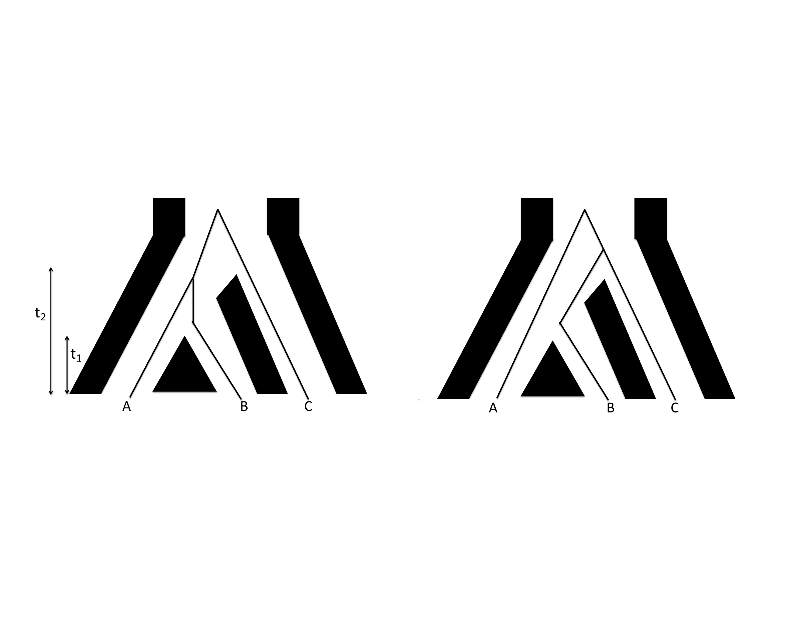

# Neutral Diversity and Population Structure

How does genetic differentiation build up between closely related populations? How does migration act to reduce differentiation? These questions are key to understand the conditions under which populations (and species) can start to genetically diverge from each other. To answer these questions, we’ll first consider this in the context of neutral alleles, and then return to think about selection and differentiation in later chapters. We’ve considered neutral alleles drawn from a randomly-mating population, and divergence among alleles drawn from two distantly-related populations. We’ll now turn to consider divergence among more closely related populations. In thinking about the coalescent within populations we made the assumption that any pair of lineages is equally likely to coalesce with each other. However, when there is population structure this assumption is violated, as the parent for an allele is likely to be found in the same population as it’s child and so lineages in different populations are less likely to coalesce.

To develop models of about population structure we’ll use the statistic $F_{\mathrm{ST}}$, which we introduced in @sec-F-stats of discussion of summarizing population structure in allele frequencies. We have previously written the measure of population structure $F_{\mathrm{ST}}$ as

$$F_{\mathrm{ST}} = \frac{H_T-H_S}{H_T}$$ {#eq-neutral-diversity-and-structure-1}

where $H_S$ is the probability that two alleles sampled at random from a subpopulation differ, and $H_T$ is the probability that two alleles sampled at random from the total population differ.

## A simple population split model

Imagine a population of constant size of $N_e$ diploid individuals that $T$ generations in the past split into two daughter populations (sub-populations) each of size $N_e$ individuals, which do not subsequently exchange migrants. In the current day we sample an equal number of alleles from both subpopulations.

.](images/figures/drift_split.png){#fig-drift-split width="80%" fig-alt="Change in allele frequencies following a population split."}

Consider a pair of alleles sampled within one of our sub-populations and think about their per site heterozygosity. These alleles have experienced a population of size $N_e$ and so the probability that they differ is $H_S \approx 4N_e \mu$ (assuming that $N_e \mu \ll 1$, using our @eq-hetero for heterozygosity within a population ).

The heterozygosity in our total population is a little more tricky to calculate. Assuming that we equally sample both sub-populations, when we draw two alleles from our total sample, $50\%$ of the time they are drawn from the same subpopulation and $50\%$ of the time they are drawn from different subpopulations. Therefore, our total heterozygosity is given by

$$H_T = \tfrac{1}{2} H_S + \tfrac{1}{2} H_B$$ {#eq-neutral-diversity-and-structure-2}

where $H_B$ is the probability that a pair of alleles drawn from our two different sub-populations differ from each other. A pair of alleles from different sub-populations cannot find a common ancestor with each other for at least $T$ generations into the past as they are in distinct populations (not connected by migration). Once our alleles find themselves back in the combined ancestral population it takes them on average $2N$ generations to coalesce. So the total opportunity for mutation between our pair of alleles sampled from different populations is $2 (T + 2N )$ generations of meioses, such that the probability that our pairs of alleles is different is

$$H_B \approx 2\mu ( T + 2 N)$$ {#eq-neutral-diversity-and-structure-3}

We can plug this into our expression for $H_T$, and then that in turn into $F_{\mathrm{ST}}$. Doing so we find that

$$F_{\mathrm{ST}} \approx \frac{ \mu T}{\mu T +  4N_e\mu }  = \frac{ T}{ T +  4N_e
}$$ {#eq-FST-split}

Note that $\mu$ cancels out of this equation. In this simple toy model, $F_{\mathrm{ST}}$ is increasing because the amount of between-population diversity increases with the divergence time of the two populations (initially linearly with $T$). $F_{\mathrm{ST}}$ grows at a rate give by ${}^{T}\!/\!{}_{(4N_e)}$ so that differentiation will be higher between populations separated by long divergence times or with small effective population sizes.

. Contributed by MBLWHOI Library. Not in copyright.]{.attribution}](images/illustration_images/Genetic_drift/Orang/7971889392_d32b45668b_z.jpg){#fig-Orang .column-margin width="80%" fig-alt="Orangutan (Pongo)."}

::: {#exr-neutral-diversity-and-structure-1}
The genome-wide $F_{ST}$ between Bornean and Sumatran orangutan species samples (*Pongo pygmaeus* and *Pongo abelii*) is $\approx 0.37$ [@locke2011], representing a deep population split between the species (potentially with little subsequent gene flow). Within the populations the genome-wide average Watterson’s $\theta$ is $\theta_W=1.4$kb$^{-1}$, estimated from the number of segregating sites. Assume a generation time of 20 years, and a mutation rate of $2 \times 10^{-8}$ per base per generation. How far in the past did the two populations diverge?
:::

## A simple model of migration between an island and the mainland.

We can also use the coalescent to think about patterns of differentiation under a simple model of migration-drift equilibrium. Let’s consider a small island population that is relatively isolated from a large mainland population, where both of these populations are constant in size. We’ll assume that the expected heterozygosity for a pair of alleles sampled on the mainland is $H_M$.

Our island has a population size $N_{I}$ that is very small compared to our mainland population. Each generation some low fraction $m$ of our individuals on the island have migrant parents from the mainland the generation before. Our island may also send migrants back to the mainland, but these are a drop in the ocean compared to the large population size on the mainland and their effect can be ignored.

If we sample an allele on the island and trace its ancestral lineage backward in time, each generation our ancestral allele has a low probability $m$ of being descended from the mainland in the preceding generation (if we go back far enough the allele eventually has to be descended from an allele on the mainland). The probability that a pair of alleles sampled on the island are descended from a shared recent common ancestral allele on the island is the probability that our pair of alleles coalesces before either lineage migrates. Well our pair of lineages coalesce with probability ${}^{1}\!/\!{}_{2N_I}$ in a given generation and, assuming that the rate of migration is not too high ($m \ll 1$), the probability that one or other lineage migrates in a given generation is $2m$. So the probability that our lineages coalesce before they migrate is

$$\frac{{}^{1}\!/\!{}_{(2N_I)}}{{}^{1}\!/\!{}_{(2N_I)} +   2m},$$ {#eq-neutral-diversity-and-structure-4}

which follows as an exactly analogous argument to our probability that a pair of lineages coalesce before a mutation, @eq-coal-no-mut, that we used in deriving the expected heterozygosity.

Conditional on one or other of our alleles migrating to the mainland, both of our alleles represent independent draws from the mainland and so differ from each other with probability $H_M$. Therefore, the level of heterozygosity on the island is given by

$$H_I = \left(1 - \frac{{}^{1}\!/\!{}_{(2N_I)}}{{}^{1}\!/\!{}_{(2N_I)} + 2m} \right)H_M$$ {#eq-neutral-diversity-and-structure-5}

So the reduction of heterozygosity on the island compared to the mainland is

$$F_{IM} = 1- \frac{H_I}{H_M} = \frac{{}^{
      1}\!/\!{}_{(2N_I)}}{{}^{1}\!/\!{}_{(2N_I)} + 2m} = \frac{ 1 }{1 + 4N_Im}.$$ {#eq-FIM}

The level of inbreeding on the island compared to the mainland will be high if the migration rate is low and the effective population size of the island is low, as allele frequencies on the island are drifting and diversity on the island is not being replenished by migration. The key parameter here is the number individuals on the island replaced by immigrants from the mainland each generation ($N_I m$), even a few migrants arriving on the island a generation is enough to prevent much allele frequency differentiation building up.

We have framed this problem as being about the reduction in genetic diversity on the island compared to the mainland. However, if we consider collecting individuals on the island and mainland in proportion to their population sizes, the total level of heterozygosity would be $H_T=H_M$, as samples from our mainland would greatly outnumber those from our island. Therefore, considering the island as our sub-population, we have derived another simple model of $F_{ST}$.

::: {#exr-neutral-diversity-and-structure-2}
You are investigating a small river population of sticklebacks, which receives infrequent migrants from a very large marine population. At a set of putatively neutral biallelic markers the freshwater population has frequencies:\
0.2, 0.7, 0.8\
at the same markers the marine population has frequencies:\
0.4, 0.5 and 0.7.\
From studying patterns of heterozygosity at a large collection of markers, you have estimated the long term effective size of your freshwater population is 2000 individuals.\
What is your estimate of the migration rate from the marine populations into the river?
:::

 Public domain.](images/illustration_images/Genetic_drift/stickleback/threespine.jpg){#fig-stickle .column-margin width="100%" fig-alt="Three-spined stickleback (Gasterosteus aculeatus)."}

## Incomplete Lineage Sorting

Often when we’re studying multiple populations, e.g. species, we’re interested in the underlying order in which populations split off from each other, and the timing of these events. In the case where populations split off from each other with no subsequent gene flow, we can represent this pattern of splitting by a population tree. Because it can take a long time for a polymorphism to drift up or down in frequency, multiple population splits may occur during the time an allele is still segregating. This can lead to incongruence between the overall population tree and the information about relationships present at individual loci. As we have seen in the previous chapters the relationships between sampled alleles at a locus are represented by coalescent tree, sometimes call gene trees in the context of incomplete lineage and more generally in phylogenetics. In @fig-NoILS-poly and [-@fig-ILS-poly] we show a simulation of three populations where the bottom population splits off from the other two first, followed by the subsequent splitting of the the top and the middle populations. We start both simulations with a newly introduced red allele being polymorphic in the combined ancestral population. The most likely fate of this allele is that it is quickly lost from the population, but sometimes the allele can drift up in frequency and be polymorphic when the populations split, as the allele in our two figures has done. If the allele is lost/fixed in the descendant populations before the next population split, our allele configuration will agree with the population tree, as it does in @fig-NoILS-poly, and so too the gene tree will agree with population tree (as shown in the left side of @fig-ILS-cartoon). However, if the allele persists as a polymorphism in the ancestral population until the top and the middle populations split, then the allele could fix in one of these populations and not the other. Such an event leads to a substitution pattern that disagrees with the population tree, as in @fig-ILS-poly. If we were to construct a phylogeny using the variation at this site we would see a disagreement between the gene tree and population tree. In @fig-ILS-poly an allele drawn from the top and the bottom populations are necessarily more closely related to each other than either is to an allele drawn from population 2; tracing our allelic lineages from the top and bottom populations back through time, they must coalesce with each other before we reach the point where the red mutation arose; in contrast, a lineage from the middle population cannot have coalesced with either other lineage until past the time the red mutation arose. An example of this ‘incomplete lineage sorting’ in terms of the underlying tree is shown on the right side of @fig-ILS-cartoon.

.](images/figures/Genetic_drift/ILS/no_ILS.png){#fig-NoILS-poly width="100%" fig-alt="An example of alleles assorting among three populations such that there is no incomplete lineage sorting."}

.](images/figures/Genetic_drift/ILS/ILS.png){#fig-ILS-poly width="100%" fig-alt="An example of alleles assorting among three populations leading to incomplete lineage sorting."}

{#fig-ILS-cartoon width="100%" fig-alt="The population tree of three populations ((A, B), C), as the white space blocked out between the black shapes."}

A natural pedigree analogy to incomplete lineage sorting is the fact that while two biological siblings are more closely related to each other genealogically than either is to their cousin, at any given locus one of the siblings can share an allele IBD with their cousin that they do not share with their own sibling, due to the randomness of Mendelian segregation down their pedigree. In these cases, the average relatedness of the individuals/populations disagrees with the patterns of relatedness at a particular locus.

 by [rawpixel.com](rawpixel.com){.uri}.](images/illustration_images/Genetic_drift/Poephila_cincta_finch/Poephila_cincta_finch.png){#fig-Poephila-cincta .column-margin width="100%" fig-alt="Banded grass Finch (P."}

As an empirical example of incomplete lineage sorting, let’s consider the work of @jennings:05 who sequenced a single allele from three different species of Australian grass finches (*Poephila*): two sister species of long-tailed finches (*Poephila acuticauda* and *P. hecki*) and the black-throated finch (*Poephila cincta*, see @fig-Poephila-cincta). They collected sequence data for 30 genes and constructed phylogenetic gene trees at each of these loci, resulting in 28 well-resolved gene trees. Sixteen of the gene trees showed *P. acuticauda* and *P. hecki* as sisters with *P. cincta*) (the tree ((A,H),C) ), while for twelve genes the gene tree was discordant with the population tree: for seven of their genes *P. hecki* fell as an outgroup to the other two and at five *P. acuticauda* fell as an outgroup (the trees ((A,C),H) and ((H,C),A) respectively).

Let’s use the coalescent to understand this discordance between gene trees and species trees. Let’s assume that two sister populations (A & B) split $t_1$ generations in the past, with a deeper split from a third outgroup population (C) $t_2$ generations in the past. We’ll assume that there’s no gene flow among our populations after each split. We can trace back the ancestral lineages of our three alleles. The first opportunity for the A & B lineages to coalesce is $t_1$ generations ago. If they coalesce with each other in their shared ancestral population before $t_2$ in the past (left side of @fig-ILS-cartoon) their gene tree will definitely agree with the population tree. So the only way for the gene tree to disagree with the population tree is for the A & B lineages to fail to coalesce in their shared ancestral population between $t_1$ and $t_2$; this happens with probability $\left(1 - {}^{1}\!/\!{}_{2N}\right)^{t_2-t_1}$. We’ll get a discordant gene tree if A & B make it back to the shared ancestral population with C without coalescing, and then one or the other of them coalesces with the C lineage before they coalesce with each other. This happens with probability $2/3$, as at the first pairwise-coalescent event there are are three possible pairs of lineages that could coalesce, two of which (A & C and B & C ) result in a discordant tree. So the probability that we get a coalescent tree that is discordant with the population tree is

$$\frac{2}{3} \left(1 - {}^{1}\!/\!{}_{2N}\right)^{t_2-t_1}.$$ {#eq-ILS-coal}

This equation allows us to relate the fraction of loci showing incomplete lineage sorting to the population genetics parameters of the ancestral population.

::: {#exr-neutral-diversity-and-structure-3}
Let’s return to @jennings:05’s Australian grass finches example. They estimated that the ancestral population size of our two long-tailed finches was four hundred thousand. What is your best estimate of the inter-speciation time, i.e. $t_2-t_1$?
:::

The fraction of loci showing ILS, @eq-ILS-coal, depends on the times between population splits ($t_2-t_1$) Thus we should expect gene-tree population-tree discordance when populations split in rapid succession and/or population sizes are large.

**Testing for gene flow.**

We often want to test whether gene flow has occurred between populations. For example, we might want to establish a case that interbreeding between humans and Neanderthals occurred or demonstrate that gene flow occurred after two populations began to speciate. A broad range of methods have been designed to test for gene flow and to estimate gene flow rates based on neutral expectations. Here we’ll briefly just discuss one method based on some simple coalescent ideas. Above we assumed that gene-tree population-tree discordance was due to incomplete lineage sorting due to populations rapidly splitting. However, gene flow among populations can also lead to gene-tree discordance. While both ILS and gene flow can lead to discordance, under simplifying assumptions, ILS implies more symmetry in how these discordances manifest themselves.

{#fig-ABBA-BABA width="100%" fig-alt="Incomplete lineage sorting between our single lineages sampled from populations 1, 2, and 3."}

Take a look at @fig-ABBA-BABA. In both cases the lineages from 1 and 2 fail to coalesce in their initial shared ancestral population, and one or the other of them coalesces with the lineage from 3 before they coalesce with each other. Each option is equally likely; therefore the mutational patterns ABBA and BABA are equally likely to occur under ILS, but differential gene flow will break the symmetry. [^neutral-diversity-and-structure-1]

[^neutral-diversity-and-structure-1]: Here we have to assume no structure in the ancestral population.

To test for this effect of gene flow, we can sample a sequence from each of our 4 populations and count up the number of sites that show the two mutational patterns consistent with the gene-tree discordance $n_{ABBA}$ and $n_{BABA}$ and calculate

$$\frac{n_{ABBA}-n_{BABA}}{n_{ABBA}+n_{BABA}}$$ {#eq-ABBA-BABA}

This statistic will have expectation zero if the gene-tree discordance is due to ILS. If there is gene flow between between 2 and 3, that excludes 1, see @fig-ABBA-BABA-introgression, there will be an excess ABBAs and so the ABBA-BABA statistic will be skewed positively (and conversely it’ll skew negatively if gene flow occurred between 3 into 1). In practice, whether this is significantly different from zero is judged by constructing a Z statistic with a standard error found by recalculating the statistic on computationally resampled dataset of large genomic windows.

{#fig-ABBA-BABA-introgression width="100%" fig-alt="A similar scenerio to @fig-ABBA-BABA but now gene flow has occured populations 2 and 3, as depicited by the white gap having opened up between 2 and 3."}

The big cats (*Panthera* ) clade is a recent radiation, with a considerable amount of shared genetic variation still segregating across the group. @figueiro2017genome examined patterns of genomic divergence, incomplete lineage sorting, and gene flow across this clade using ABBA-BABA tests with a Domestic cat sequence as the outgroup. One example, for snow leopard, tiger, and lion is shown below. Snow leopards and tigers are known more closely related to each other than either is to lions. @figueiro2017genome counted SNPs where snow leopard and lion sequences shared a derived allele to the exclusion of tiger (ABBA) and those where where the tiger and lion sequences shared a derived allele to the exclusion of snow leopard (BABA) and found:\

| Snow leopard | Tiger | Lion | Domestic cat |  Counts   |
|:------------:|:-----:|:----:|:------------:|:---------:|
|      A       |   B   |  B   |      A       | 1,434,106 |
|      B       |   A   |  B   |      A       | 1,250,134 |

. Contributed by Smithsonian Libraries. Not in copyright.]{.attribution}](images/illustration_images/Genetic_drift/Big_cat_ILS/Big_cat_ILS.png){#fig-Big-cat-ILS .column-margin width="100%" fig-alt="A simple schematic of the population history of snow leopard (Panthera uncia), tiger (Panthera tigris, and lion (Panthera leo) species."}

The calculated ABBA-BABA statistic, @eq-ABBA-BABA, is $0.07 \pm 0.0026~s.e.$, which is highly significantly different from zero. The direction of this statistics with a strong excess of derived SNPs where the tiger sequence is closer to the lion sequence than snow leopard, is consistent with gene flow between tigers and lions after tigers split off from snow leopards (@fig-Big-cat-ILS). Historically, lions had a large geographic range, and so this interbreeding deep in the past is plausible.

::: chapter-summary
**Chapter summary.**

-   We developed simple models of neutral population structure and developed expectations of allele frequency differentiation as measured by $F_{\mathrm{ST}}$ under these models.

-   Under a simple model of population isolation, allele frequency differentiation builds up due to genetic drift in proportion to the split time divided by the population size.

-   Only a small number of migrants between populations per generation is sufficient to prevent the build up of neutral allele frequency differentiation.

-   Incomplete lineage sorting of ancestral variation is one source of disagreement between population/species-trees and gene trees. It occurs when the split times between populations are in quick enough succession that lineages do not have time coalese between more closely related populations.

-   Gene flow can also lead to patterns similar to incomplete lineage sorting. We can test between a model of incomplete lineage sorting and gene flow using tests such as ABBA-BABA.
:::

::: {#exr-neutral-diversity-and-structure-4}
You are studying a two species of fish (red fish & blue fish), and sequencing a set of pseudogenes. Here are some facts you’ve collected:

-   A third species of fish (black fish) diverged from the common ancestor of red/blue fish 3 million years ago. Assume 1 fish generation per year. Between red fish and black fish there is on average 1 substitution every 100 basepairs.

-   In these pseudogenes, within red fish, you estimate that heterozygosity within red fish is $10^{-4}$ per basepair.

-   $F_{ST}$ between red fish and blue fish is 0.1.

-   There has been no gene flow among any of these species after they split.

**A)** What is the per base mutation rate?

**B)** What is the effective population size of red fish?

**C)** When did the red and blue fish populations split? Assume they have equal population sizes.
:::

{#fig-ABBA-Neanderthal .column-margin width="100%" fig-alt="A simple population tree diagram, not to scale, of human populations and Neanderthals."}

::: {#exr-neutral-diversity-and-structure-5}
With reference to the population tree shown in @fig-ABBA-Neanderthal: **A)** On the population tree the dashed lines show an incomplete gene phylogeny (for a single allele drawn from each population). At a locus, the Chimp lineage has the A allele. Complete a gene genealogy in a way that would be consistent with Neanderthal and European lineages sharing a derived B allele, to the exclusion of the African lineage (ABBA). Mark the branch that a mutation from $A
\rightarrow B$ must occur on in order to generate this pattern (assuming a single mutation).\
**B)** What is the probability of observing a gene tree consistent with the one you drew in part A under the coalescent model? Hint: Remember that incomplete lineage sorting is due to failing to coalesce within an ancestral population.\
Assume a generation time of 30 years, and an effective population size of 10,000 in all populations. Further, assume that lineages sampled from the Neanderthal and modern human populations will definitely coalesce with each other before the common ancestral population with chimp.
:::
