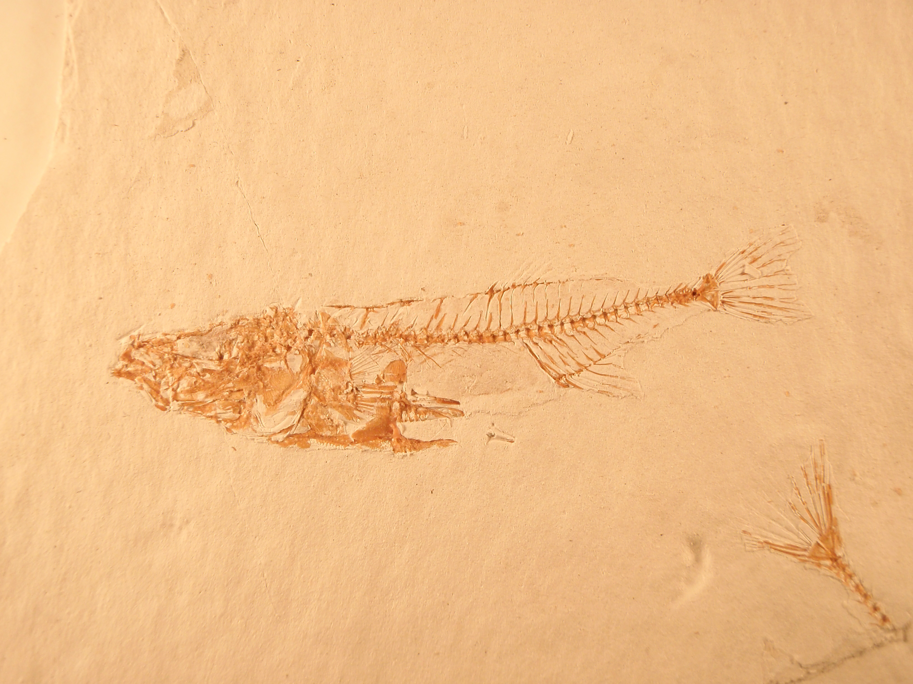

# The Response to Phenotypic Selection

[See @lewontin1970units. Note that these requirements are not specific to DNA, i.e. the concept of evolution by natural selection is substrate independent.]{.aside} Evolution by natural selection requires:

1.  Variation in a phenotype

2.  That survival and reproduction is non-random with respect to this phenotypic variation.

3.  That this variation is heritable.

Points 1 and 2 encapsulate our idea of Natural Selection, but evolution by natural selection will only occur if the 3rd condition is also met.[^response-to-selection-1] It is the heritable nature of variation that couples change within a generation due to natural selection to change across generations (evolutionary change).

[^response-to-selection-1]: Some people consider natural selection to only operate on heritable phenotype varation and so require all three conditions to say that natural selection occurs. This is mostly a semantic point, however, the defintion here is useful as we can distinguish the action of selection from a possible response.

Let’s start by thinking about the change within a generation due to directional selection, where selection acts to change the mean phenotype within a generation. For example, a decrease in mean height within a generation, due to taller organisms having a lower chance of surviving to reproduction than shorter organisms. Specifically, we’ll denote our mean phenotype at reproduction by $\mu_S$, i.e. after selection has acted, and our mean phenotype before selection acts by $\mu_{BS}$. This second quantity may be hard to measure, as obviously selection acts throughout the life-cycle, so it might be easier to think of this as the mean phenotype if selection hadn’t acted. So the change in mean phenotype within a generation is $\mu_{S} - \mu_{BS}= S$, we’ll call $S$ the selection differential.

.](images/figures/Response_to_sel/QT3.png){.column-margin width="100%" fig-alt="Top."}

We are interested in predicting the distribution of phenotypes in the next generation. In particular, we are interested in the mean phenotype in the next generation to understand how directional selection has contributed to evolutionary change. We’ll denote the mean phenotype in offspring, i.e. the mean phenotype in the next generation before selection acts, as $\mu_{NG}$. The change across generations we’ll call the response to selection $R$ and put this equal to $\mu_{NG}- \mu_{BS}$.

The mean phenotype in the next generation is

$$\mu_{NG} = \mathbb{E} \left( \mathbb{E}(X_{kid} | X_{mum},X_{dad}) \right)$$ {#eq-response-to-selection-1}

where the inner expectation is giving us the expected phenotype of the child given the parents, and the outer expectation is over possible pairings of parents formed by randomly mating individuals who survive to reproduce. We can use @eq-predict-kid to obtain an expression for this expectation:

$$\mu_{NG} = \mu_{BS} +
\beta_{mid,kid} ( \mathbb{E}(X_{mid}) - \mu_{BS})$$ {#eq-response-to-selection-2}

.](images/figures/Response_to_sel/Breeders_eqn.png){.column-margin width="100%" fig-alt="A visual representation of the Breeder’s equation."}

So to obtain $\mu_{NG}$ we need to compute $\mathbb{E}(X_{mid})$, the expected mid-point phenotype of pairs of individuals who survive to reproduce. This is just the expected phenotype in the individuals who survived to reproduce ($\mu_{S}$), so

$$\mu_{NG} = \mu_{BS} +
h^2 (\mu_S - \mu_{BS})$$ {#eq-response-to-selection-3}

So we can write our response to selection as

$$R = \mu_{NG} -\mu_{BS}  =
h^2 (\mu_S - \mu_{BS}) = h^2 S$$ {#eq-breeders-eqn}

So our response to selection is proportional to our selection differential, and the constant of proportionality is the narrow sense heritability. This equation is sometimes termed the Breeder’s equation.[The earliest formulation of the Breeder’s equation appears as a footnote in @lush1943animal.]{.aside} It is a statement that the evolutionary change across generations ($R$) is proportional to the change caused by directional selection within a generation ($S$), and that the strength of this relationship is determined by the narrow sense heritability ($h^2$).

.](images/Journal_figs/Quant_gen/Galen_flower_herit/Galen_corolla_flare.png){#fig-Galen-corolla width="60%" fig-alt="The relationship between maternal and offspring corolla flare (flower width) in P."}

. Contributed by New York Botanical Garden, Mertz Library. Not in copyright.]{.attribution} Cropped from original.](images/illustration_images/Quant_gen/Polemonium_viscosum_Galen/Polemonium_viscosum.jpg){.column-margin width="75%" fig-alt="Sticky jacob’s ladder (Polemonium viscosum)."}

::: {#exr-response-to-selection-1}
@galen:96 explored selection on flower shape in *Polemonium viscosum*. She found that plants with larger corolla flare had more bumblebee visits, which resulted in higher seed set and a $17\%$ increase in corolla flare in the plants contributing to the next generation. Based on the data in the caption of @fig-Galen-corolla what is the expected response in the next generation?
:::

, Code [here](https://github.com/cooplab/popgen-notes/blob/master/Journal_figs/Quant_gen/Illinois_long_term_selection_corn/corn_LTS.R).](images/Journal_figs/Quant_gen/Illinois_long_term_selection_corn/Illinois_LTS_breeders_eq.png){#fig-Illinois-LTS-breeders-eq .column-margin width="100%" fig-alt="Top."}

If we know $R$ and $S$ we can estimate $h^2$. Heritabilities estimated like this are called ‘realized heritability’. Estimates of the ‘realized heritability’ can readily be produced in artificial selection experiments:

::: {#exr-response-to-selection-2}
From the experiment shown in @fig-Illinois-LTS-breeders-eq, the mean corn oil content in 1897 was $4.78$, among the $24$ individuals chosen to breed to for the next generation the mean was $5.2$. The offspring of these individuals had a mean kernel oil content of $5.1$. What is the narrow sense realized heritability?
:::

To understand the genetic basis of the response to selection take a look at @fig-Response-num-alleles. The setup is the same as in our previous simulation figures.

.](images/figures/QT3_w_genosums.png){#fig-Response-num-alleles width="100%" fig-alt="Top."}

The individuals who are selected to form our next generation carry more alleles that increase the phenotype in the current range of environments currently experienced by the population. The average individual before selection carried 100 of these ‘up’ alleles, while the average individual surviving selection carries 108 ‘up’ alleles.

As individuals faithfully transmit their alleles to the next generation the average child of the selected parents carries $108$ up alleles. Note that the variance has changed little, the children have plenty of variation in their genotype, such that selection can readily drive evolution in future generations. The average frequency of an ‘up’ allele has changed from $50\%$ to $54\%$. Gains due to selection will be stably inherited to future generations and can be compounded on generation after generation if selection pressures were to remain constant.

## The Long-Term Response to Selection

, Code [here](https://github.com/cooplab/popgen-notes/blob/master/Journal_figs/Quant_gen/Illinois_long_term_selection_corn/corn_LTS.R).](images/Journal_figs/Quant_gen/Illinois_long_term_selection_corn/Illinois_LTS_means.png){#fig-Illinois-LTS-means .column-margin width="100%" fig-alt="The mean oil content of corn in the Illinois long term selection experiment."}

If our selection pressure is sustained over many generations, we can use our breeder’s equation to predict the response. If we are willing to assume that our heritability does not change and we maintain a constant selection differential ($S$), then after $n$ generations our phenotype mean will have shifted

$$n h^2 S$$ {#eq-response-to-selection-4}

i.e. our population will keep up a linear response to selection.

, Code [here](https://github.com/cooplab/popgen-notes/blob/master/Journal_figs/Quant_gen/Illinois_long_term_selection_corn/corn_LTS.R).](images/Journal_figs/Quant_gen/Illinois_long_term_selection_corn/Illinois_LTS_ggridges_distribution.png){#fig-Illinois-LTS-dists width="100%" fig-alt="Density plots showing the phenotypic distributions of the up- and down-selection populations of the Illinois long term selection experiment over time."}

Therefore, long-term, consistent selection can drive impressive evolutionary change. One example of this comes from a field experiment in Illinois, where plant breeders have systematically selected for higher and lower oil content in corn (see our previous @fig-Illinois-LTS-breeders-eq for one generation of up selection). For over a century, they have taking seeds from the plants in the extremes of the distribution and using them to form the next generation. They have achieved impressive long-term responses, pushing the population distributions well beyond their initial range (@fig-Illinois-LTS-dists. For example, the oil up-selection line went from a mean oil content of $4.7\%$ in 1896 to $22.1\%$ in 2004. They’ve established two secondary populations where the selection differential was reversed. In the up-selection population they have maintained an impressively linear increase in oil content, shown by red line in @fig-Illinois-LTS-means, but while the response is linear at first in the down line but they quickly reach very low oil content (limited by the physical boundary at 0% oil content).

. Contributed by New York Botanical Garden. Not in copyright.]{.attribution}](images/illustration_images/Genetic_drift/maize/7845339168_66aa3d8ccc_z.jpg){#fig-maize .column-margin width="70%" fig-alt="Maize (Zea mays.)"}

::: {#exr-reddeer}
A population of red deer were trapped on Jersey (an island off of England) during the last inter-glacial period. From the fossil record we can see that the population rapidly adapted to their new conditions, perhaps due to selection for shorter reproductive times in the absence of predation [@lister:89]. Within 6,000 years they evolved from an estimated mean weight of the population of 200kg to an estimated mean weight of 36kg (a 6 fold reduction)! You estimate that the generation time of red deer is 5 years and, from a current day population, that the narrow sense heritability of the phenotype is 0.5.

**A)** Estimate the mean change per generation in the mean body weight.

**B)** Estimate the change in mean body weight caused by selection within a generation. State your assumptions.

**C)** Assuming we only have fossils from the founding population and the population after 6000 years, should we assume that the calculations accurately reflect what actually occurred within our population?
:::

, CC BY 3.0.](images/illustration_images/Quant_gen/dwarf_elephant/M_exilis_skeletal.png){#fig-Pygmy-mammoth .column-margin width="100%" fig-alt="It’s not just deer that evolve to be small on islands, pygmy mammoths and elephants have evolved from large mainland species on numerous islands."}

.](images/Journal_figs/Quant_gen/Darwins_Finches_unpred/Darwins_Finches_unpred.png){#fig-Darwins-Finches-unpred width="70%" fig-alt="Top) Mean body size of the medium ground-finch population measured each year."}

In wild populations, selection pressures are likely rarely sustained for large numbers of generations. For example, the Grants’ have measured phenotypic selection in Darwin’s Finches over multiple decades on the island of Daphne Major. They have seen that selection pressures in the Medium ground-finch (*Geospiza fortis*) have reversed a number of times over the years (@fig-Darwins-Finches-unpred).

**Patterns of long-term phenotypic change in the wild.** Looking across the diversity of plants and animals we see huge changes in size and form, can the strengths of selection we can observe over short time periods possibly explain these changes?

To compare phenotypic changes over various time periods we need some measure of the rate of phenotypic change. @haldane1949suggestions proposed the rate of change from $X_1$ to $X_2$ in time interval $\Delta t$, measured in millions of years, be quantified as

$$\frac{\log \left({}^{X_2}\!/\!{}_{X_1} \right) }{\Delta t}  = \frac{\log
  \left(X_2 \right) -\log \left(X_1 \right)  }{\Delta t}$$ {#eq-response-to-selection-5}

by expressing this the log of the ratio,[^response-to-selection-2] we are looking at the proportional fold change, which makes sense as a evolutionary change of 1cm in length is more impressive if you’re a mouse than an elephant. By putting this on a $\log$-scale we are looking at the fold relative change. @haldane1949suggestions called the units of this measure *\`*the Darwin’, with a one Darwin change corresponding to a $e\approx 2.71$ fold change in a million years, a two Darwin change corresponding to a $e^2\approx  7.34$ fold change in a million years and so on.

[^response-to-selection-2]: Note that here, as elsewhere, $\log$ refers the natural logarithm, i.e. $\log$ base $e$. We’ll make it clear if we using $\log$ in a different base, e.g. we’ll use $\log_{10}$ for $\log$ in base 10.

. Contributed by University of Toronto - Earth Sciences Library. Not in copyright.]{.attribution}](images/illustration_images/Quant_gen/dog_whelks/dog_whelks.jpg){#fig-dg-whelks .column-margin width="100%" fig-alt="Variation in Atlantic dog whelks (Nucella lapillus, synonym Purrpura lapukkus) along the coast of Great Britain."}

::: {#exr-response-to-selection-4}
Calculate the rate of change in body size in the Jersey red deer from @exr-reddeer in Darwins. Do the same for the total change in corn oil content in the up lines in @fig-Illinois-LTS-means.
:::

@gingerich1983rates examined the absolute rate of phenotypic change in field study data and the fossil record, a dataset considerably expanded by @uyeda2011million. In @fig-uyeda-gingerich each point is an observation of phenotype evolution. The *x*-axis shows the time period in years over which the evolutionary change was observed, the *x*-axis is plotted on a $\log_{10}$ scale. The *y*-axis shows absolute rate of phenotypic change, measured in Darwins, again on a $\log_{10}$ scale.

Over short timescales we see incredibly rapid evolution, note the high rates on the left of @fig-uyeda-gingerich. For example, the first black dot from the left is a case of evolution over decades in dog whelks. The invasion the green crab (*Carcinus maenas*) drove the evolution of more robust shells in Atlantic dog whelk (*Nucella lapillus*) in response to predation along the North American coast [@vermeij1982phenotypic]. The shell lip thickness of dog whelks in the St. Andrews, New Brunswick population had changed from 0.94mm to 1.44mm in just 25 years. That’s a 50% increase, and a rate of 17060 Darwins.

![The absolute rate of phenotypic evolution, measured in Darwins, plotted against the time interval over which the evolution was observed. The green points show direct observations of phenotypic change in historical and contemporary populations. The orange dots give changes observed in the fossil record. The three black dots left to right give examples from dog whelks, our red deer example, and *Triceratops*. Based on an original plot by @gingerich1983rates using an expanded dataset from @uyeda2011million. Code [here](https://github.com/cooplab/popgen-notes/blob/master/Journal_figs/Quant_gen/Uyeda_evol_rates/Uyeda_evol_rates.R).](images/Journal_figs/Quant_gen/Uyeda_evol_rates/Uyeda_evol_rates.png){#fig-uyeda-gingerich width="100%" fig-alt="The absolute rate of phenotypic evolution, measured in Darwins, plotted against the time interval over which the evolution was observed."}

However, when we observe phenotypic evolution over longer time periods it is usually much slower. For example, the rightmost black dot in @fig-uyeda-gingerich shows the phenotypic evolution along the lineage leading to *Triceratops*. *Triceratops* measured in an impressive 25.9–29.5 ft in length. They evolved from a close relative of *Protoceratops*, which was a bit bigger than a sheep at $\sim$`<!-- -->`{=html}5.9 ft in about 7.5 million years [@colbert1948evolution]. However, that’s only a phenotypic change of $0.143$ Darwins, its only a roughly four fold change in millions of years. These rates of change in dinosaurs have nothing on our dog whelks, or many other examples of evolution on short time scales. Thus evolutionary changes we can observe over short timescales readily explain long term changes in quantitative phenotypes.

 for a fun updated view of the *Coronosauria* phylogeny. See these [figures](https://www.geol.umd.edu/~tholtz/G104/lectures/104margino.html) from Holtz for an updated & fuller phylogeny. [The dinosaur book : the ruling reptiles and their relatives. (1951) Colbert, E.H. Image from the [Internet Archive](https://www.biodiversitylibrary.org/ia/bookruli00colb#page/86/mode/1up). Contributed by American Museum of Natural History Library. No known copyright restrictions.]{.attribution}](images/illustration_images/Quant_gen/Triceratops/Triceratops_phylo.png){#fig-Triceratops-phyl .column-margin width="100%" fig-alt="The evolution of Triceratops from Protoceratops; see here for a fun updated view of the Coronosauria phylogeny."}

## Fitness and the Breeder’s Equation.

So directional evolution occurs as selection drives a change in the mean phenotype within a generation. But precisely how does this relate to the natural-selection requirement that organisms vary in their fitness? Some different ways of formulating the Breeder’s equation give us insight into the conditions for directional selection and the relationship to fitness landscapes.

### Directional selection as the covariance between fitness and phenotype.

To think more carefully about this change within a generation, let’s think about a simple fitness model where our phenotype affects the viability of our organisms (i.e. the probability they survive to reproduce). The probability that an individual has a phenotype $X$ before selection is $p(X=x)$, so that the mean phenotype before selection is

$$\mu_{BS} = \mathbb{E}[X] =  \int_{-\infty}^{\infty} x p(x) dx$$ {#eq-response-to-selection-6}

The probability that an organism with a phenotype $X$ survives to reproduce is $w(X)$, and we’ll think about this as the fitness of our organism. The probability distribution of phenotypes in those who do survive to reproduce is

$$\mathbb{P}(X | \textrm{survive}) =  \frac{p(x) w(x)}{
\int_{-\infty}^{\infty} p(x) w(x) dx}.$$ {#eq-response-to-selection-7}

where the denominator is a normalization constant which ensures that our phenotypic distribution integrates to one. The denominator also has the interpretation of being the mean fitness of the population, which we’ll call $\overline{w}$, i.e.

$$\overline{w} =  \int_{-\infty}^{\infty} p(x) w(x) dx.$$ {#eq-pheno-mean-fitness}

Therefore, we can write the mean phenotype in those who survive to reproduce as

$$\mu_S = \frac{1}{\overline{w}}\int_{-\infty}^{\infty} x p(x) w(x) dx$$ {#eq-response-to-selection-8}

. Contributed by Field Museum of Natural History Library. Licensed under CC BY-2.0.]{.attribution}](images/illustration_images/Quant_gen/red_deer/Red_deer.png){#fig-red-deer .column-margin width="100%" fig-alt="Red deer (Cervus elaphus)."}

If we mean center the distribution of phenotypes in our population, i.e. set the phenotype before selection to zero, then

$$S=\mu_S= \frac{1}{\overline{w}}\int_{-\infty}^{\infty} x p(x) w(x) dx = \frac{1}{\overline{w}}\mathbb{E} \left (X
  w(X) \right)$$ {#eq-response-to-selection-9}

where the final part follows from the fact that the integral is taking the mean of $X w(X)$ over the population.

As our phenotype is mean centered ($\mathbb{E}(X)=0$), we can see that $S$ has the form of a covariance[^response-to-selection-3] between our phenotype $X$ and our relative fitness ${}^{w(X)}\!/\!{}_{\overline{w}}$.

[^response-to-selection-3]: See our math appendix @eq-def-covar for the definition of covariance.

$$S =  \mathbb{E} \left (X
  {}^{w(X)}\!/\!{}_{\overline{w}} \right) =Cov \left(X, {}^{w(X)}\!/\!{}_{\overline{w}} \right)$$ {#eq-S-covar}

Thus our change in mean phenotype is directly a measure of the covariance of our phenotype and our fitness. Rewriting our breeder’s equation using this observation we see

$$R = \frac{V_A}{V_P}  Cov \left(X, {}^{w(X)}\!/\!{}_{\overline{w}} \right)$$ {#eq-response-to-selection-10}

we see that the response to selection is due to the fact that our fitness (viability) of our organisms/parents covaries with our phenotype, and that our child’s phenotype covaries with our parent’s phenotype.

**Fitness Gradients and linear regressions.**

To understand this in more detail let imagine that we calculate the linear regression of an individual $i$’s mean-centered phenotype ($X_i$) on fitness ($W_i$), i.e.

$$W_i \sim \beta X_i + \overline{w}$$ {#eq-fitness-regression}

the best fitting slope of this regression ($\beta$), we’ll call it the ‘fitness gradient’, is given by

$$\beta = Cov(X, {}^{w(X)}\!/\!{}_{\overline{w}} )/ V_P$$ {#eq-beta-covar}

i.e. the fitness gradient is the phenotype-fitness covariance divided by the phenotypic variance. [^response-to-selection-4] Using this result we can rewrite the breeder’s equation as

[^response-to-selection-4]: see math appendix around @eq-def-linear-regression for more on linear regression

$$R= V_A \beta$$ {#eq-R-beta}

i.e. we’ll see a directional response to selection if there is a linear relationship of phenotype on fitness, and if there is additive genetic variance for the phenotype. As one example of a fitness gradient, in @fig-red-deer-fitness-grad the lifetime reproductive success (LRS) of male Red Deer is plotted against the weight of their antlers. The red line gives the linear regression of fitness (LRS) on antler mass and the slope of this line is the fitness gradient ($\beta$).

..](images/Journal_figs/Quant_gen/red_deer_selection_gradient/selection_grad_deer.png){#fig-red-deer-fitness-grad .column-margin width="100%" fig-alt="Lifetime reproductive success (LRS) of male Red Deer as a function of their antler mass."}

**Fisher’s fundamental theorem of natural selection.** Finally how does the mean fitness of our population evolve? If we choose relative fitness to be our phenotype ($X={}^{w(X)}\!/\!{}_{\overline{w}}$), then the response in fitness is

$$\begin{aligned}
  R &= \frac{V_A}{V_P}  Cov \left({}^{w(X)}\!/\!{}_{\overline{w}} ,
  {}^{w(X)}\!/\!{}_{\overline{w}} \right) = \frac{V_A}{V_P} V_P \\
  &=V_A
\end{aligned}$$

i.e. the response to selection is equal to the additive genetic variance for relative fitness. Or as Fisher put it

> “The rate of increase in fitness of any organism at any time is equal to its genetic variance in fitness at that time.” -@fisher1930 (pg 37)

Fisher called this ‘the fundamental theorem of natural selection’. Our proof here is just a sketch, and more formal approaches are needed to show it in generality. There has been much gnashing of teeth over exactly how broadly this result holds, and exactly what Fisher meant [see @ewens2010gene for a recent overview].

### Directional Selection on Fitness Landscapes. {#sec-pheno-fitness-landscapes}

![An example of a fitness landscape, showing the mean fitness of the population ($\overline{w}$) as a function of the mean phenotype of the population ($\bar{x}$. The arrows show the expected direction of movement of our population on the fitness landscape, with natural selection moving our population toward local fitness optima. The coloured bar shows the derivative (slope) of the mean fitness with respect to mean phenotype (@eq-pheno-fitness-landscape). Red values are positive slopes corresponding to the population evolving towards the right of the page, blue is a negative slope with the population moving to the left.](images/figures/Response_to_sel/fitness_landscape_1D.png){#fig-fitness-landscape-1D .column-page-right width="80%" fig-alt="An example of a fitness landscape, showing the mean fitness of the population (w) as a function of the mean phenotype of the population (x."}

One common metaphor when we talk about evolution is that of a population exploring an adaptive landscape with natural selection pushing a population towards higher fitness states corresponding to peaks in this landscape (see e.g. @fig-fitness-landscape-1D). @lande1976natural found an evocative formulation of the Breeder’s equation which aids our intuition of phenotypic fitness landscapes. @lande1976natural showed that, if the phenotype is normally distributed, the response to selection ($R$) could be written in terms of the gradient (derivative) of the mean fitness ($\overline{w}$) of the population

This follows from the fact that we can move the derivative inside the integral of $\overline{w}$, @eq-pheno-mean-fitness, to write the new term in @eq-pheno-fitness-landscape as

$$\begin{aligned}
\frac{1}{\overline{w}}  \frac{\partial \overline{w}}{\partial \bar{x}} &=
                                                                   \frac{1}{\overline{w}}
                                                                   \int_{-\infty}^{\infty}w(x)
                               \frac{\partial p(x)}{\partial \bar{x}}  dx \\
& =\int_{-\infty}^{\infty} \frac{w(x)}{\overline{w}}  \frac{(x-\bar{x})}{V_P}  dx  \\
                             & = \frac{cov(w(x),x) }{var(x)} 
\end{aligned}$$ {#eq-proof-landscape}

which is $\beta$, so that eqns ([-@eq-R-beta]) and ([-@eq-pheno-fitness-landscape]) are equivalent. For this equivalence to hold, in the first line we assume that $w(x)$ is not a function of $\bar{x}$, while the middle line is true when $p(x)$ is the normal distribution.

as a function of the mean phenotype:

$$R = \frac{V_A}{\overline{w}} \frac{\partial \overline{w}}{\partial \bar{x}}$$ {#eq-pheno-fitness-landscape}

What does this mean? Well ${}^{V_A}\!/\!{}_{\overline{w}}$ is always positive, so the direction our population responds to selection is predicted by the sign of the derivative (see Appendix @sec-calculus for more on derivatives). If increasing the mean phenotype of the population slightly would increase mean fitness (${}^{\partial \overline{w}}\!/\!{}_{\partial \bar{x}}
>0$) our population will respond that generation by evolving toward higher values of the trait ($R>0$), left panel of @fig-fitness-landscape-1D-w-wbar. Conversely, if decreasing the population mean phenotype slightly would increase the mean fitness (${}^{\partial \overline{w}}\!/\!{}_{\partial \bar{x}}
<0$) the population will that generation evolve towards lower values of the phenotype (middle panel of @fig-fitness-landscape-1D-w-wbar). Thus, if selection pressures remain constant, we can think of the population as evolving on an adaptive landscape where the elevation is given by the population mean fitness. Natural selection operates on the basis of individual-level fitness, but as a result of this our population is increasing in its average fitness, i.e. our population is becoming better adapted. We’ll discuss the caveats of this hill-climbing interpretation below.

.](images/figures/Response_to_sel/fitness_landscape_1D_w_wbar.png){#fig-fitness-landscape-1D-w-wbar .column-page-right width="80%" fig-alt="A population evolving on a (guassian) fitness surface."}

What happens when it reaches the top of a peak? Well at the top of a peak ${}^{\partial
  \overline{w}}\!/\!{}_{\partial \bar{x}}=0$, as it is a local maximum, and so $R=0$. Assuming that the relationship between fitness and phenotype stays constant, our population will stay at the top of the fitness peak. This view of natural selection does not imply that the population is evolving to the best possible state. Our population is just marching up the hill of mean fitness (end panel @fig-fitness-landscape-1D-w-wbar). However, this peak isn’t necessarily the highest fitness peak but simply whichever peak was closest. So our population can become trapped on a local, but not global peak of fitness (see, for example @fig-fitness-landscape-1D).

.](images/Journal_figs/Quant_gen/Stickleback_fossil_traj/Stickleback_fossil_traj.png){#fig-Stickleback-fossil-traj .column-margin width="100%" fig-alt="Top) A time series of stickleback phenotypic evolution from the fossil record."}

One dramatic example documenting adaptive evolution to a new fitness optimum is offered by a remarkable time-series of stickleback evolution from a fossil lake-bed in Nevada [@bell2006inferring]. In this lake the layers of sediment are laid down each year allowing a very detailed time series with over five thousand fossils measured. The time-series documents the evolution towards a new set of optimum phenotypes in the fifteen thousand years after the initial invasion of the lake by a heavily armoured stickleback species. In @fig-Stickleback-fossil-traj the population mean number of touching pterygiophores, the bones supporting the dorsal spines, through the fossil record (@fig-Stickleback-fossil). Note how quickly the species evolves toward its new value, presumably a fitness optimum in their new environment, and the long subsequent time interval over which the population mean phenotype fluctuates about its new value.

@hunt2008evolution fitted a model of a population adapting to a fitness landscape, with a single peak, to these time-series data. Their fitted fitness surface is shown in the lower panel of @fig-Stickleback-fossil-traj . The arrows show the moves that the population mean phenotype is making on this inferred fitness surface. The population initially takes large steps up toward the peak of this surface and subsequently fluctuates around the peak. Under the interpretation that there is a single stationary peak these fluctuations represent genetic drift randomly knocking the population off its optimum, with selection acting to restore the population towards this local optimum.

{#fig-Stickleback-fossil .column-margin width="100%" fig-alt="Fossil stickleback."}

**Issues with the interpretation of fitness landscapes.** In practice, fitness landscapes may not be constant. The environment may be constantly changing so our population is constantly forced to change to keep up with the fitness peak. Indeed our environment may change so quickly that our population cannot keep up with the peak. Our population is still trying to increase its mean fitness, to ‘adapt’, but the landscape itself is evolving. In the case of very rapid environmental change our population may slide further and further away the peak, and as a consequence its mean fitness decreases which may drive the population to extinction if our population drops below $\overline{w}<1$ for long enough. The conditions for extinction are an active area of research in the field of ‘Evolutionary rescue’. More generally, for our fitness landscape result (@eq-pheno-fitness-landscape) to hold, and for us to be able to talk of our population attempting to evolve to higher mean fitness states, we need the fitness of our phenotypes to be independent of the frequency of other phenotypes in the population. (This independence allows us to assume that the fitness of individuals is not a function of the mean phenotype, as needed in @eq-proof-landscape). The assumption of frequency independence may not hold when there is competition between individuals, e.g. for resources or mates, as then the fitness of an individual depends on the strategies pursued by other individuals in the populations.

### Stabilizing and Disruptive selection

Up to now we have just looked at directional selection, where selection acts to change the mean phenotype. However, we can also use quantitative genetic models to describe other modes of selection, extending from effects on the population mean the next natural step is to think about selection which acts on the population variance. Selection might act more strongly against individuals in the tails of the distribution, with those closer to the mean phenotype having higher fitness, which lowers the variance. Selection could also disfavour individuals close to the population mean, with individuals with extreme phenotypes having higher fitness, which acts to increase the variance of the population.

Directional selection occurs because of the covariance between our phenotype and fitness, @eq-S-covar. Just as expressing directional selection as a covariance allowed us to characterize directional selection as the linear relationship between fitness and phenotype, $\beta$, we can summarize the variance reducing selection by including a quadratic term in the regression of fitness on phenotype

$$w_i \sim \beta x_i + {}^{1}\!/\!{}_{2}  \gamma x_i^2  + \overline{w}$$ {#eq-fitness-regression-stab}

This $\gamma$, the coefficient of the quadratic term in our model, is the quadratic selection gradient: the covariance of fitness and the squared deviation from the phenotypic mean ($\mu_{BS}$), i.e.

$$\gamma = \frac{Cov\left(w(X), (X-\mu_{BS})^2 \right)}{V^2}$$ {#eq-response-to-selection-11}

Our $\gamma$ describes the curvature of the fitness surface around the mean. [Just like how $\beta$ could be interpreted as the mean gradient of the fitness surface, our $\gamma$ is the mean curvature of the fitness surface $$\gamma = \mathbb{E} \left[{}^{\partial^2 w(x)}\!/\!{}_{\partial x^2}  \right] =
\int {}^{\partial^2 w(x)}\!/\!{}_{\partial x^2} p(x) dx$$ see Appendix @sec-calculus for more on 2nd derivatives.]{.aside} Values of $\gamma<0$ are consistent with stabilizing selection, reducing the variance. While values of $\gamma>0$ are consistent with disruptive selection, increasing the variance.

.](images/Journal_figs/Quant_gen/birth_weight/Karn_Penrose_birth_weight.png){#fig-Birth-weight width="60%" fig-alt="Bars show the total number of births with different birth weights (left axis) Dots show the mortality probability for different birth-weight bins (right axis), the red line shows a fitted quadratic model to mortality."}

Under stabilizing selection the individuals with extreme phenotypes in either tail have lower fitness, the result of which is to reduce the phenotypic variance within a generation. A classic case of stabilizing selection is birth weight in humans [@karn1951birth]. Mary Karn collected data for nearly fourteen thousand pregnancies from 1935-46 for birth weight and mortality. These data are replotted in @fig-Birth-weight. The variance of all births is $1.575$lb$^2$, while in live births this was reduced to $1.26$lb$^2$, a 20% reduction in variance due to stabilizing selection. It is worth noting that this selection pressure has been greatly reduced over the decades in societies with access to good prenatal care [@ulizzi1992natural].

. Contributed by Smithsonian Libraries. Not in copyright.]{.attribution}](images/illustration_images/Quant_gen/Pyrenestes_seedcracker/Pyrenestes_minor.jpg){.column-margin width="100%" fig-alt="Lesser seedcracker Pyrenestes minor a close relative of the black-bellied seedcracker, whose beak is about the same size as the smallest black-bellied individuals."}

In Central Africa, Black-bellied seedcrackers ( *Pyrenestes ostrinus*) show disruptive selection on a remarkable beak-size polymorphism (@fig-Black-bellied-seedcrackers-beaks). The small-beaked individuals feed on soft seeds from one species of marsh sedge while the big-beaked individuals feed on hard seeds from another sedge, which requires ten times the force to crack. @smith1993disruptive recorded the fates of hundreds of juveniles, and found that individuals with intermediate beak sizes survived at much lower rates (@fig-Black-bellied-seedcrackers-beaks) because they were not well adapted to either seed resource. Break length is subject to disruptive selection, as can also be seen by the significant positive quadratic term in the regression of survival probability on break length. The variance of mandible length in the total sample of individuals was $0.5$mm$^2$ in the survivors this variance increased by a factor of $2.5$ to $1.3$mm$^2$.

![**Left** An illustration of the the remarkable variation in beak size within Black-bellied seedcrackers (*P. ostrinus*). **Right** A histogram of a beak size measurement in Black-bellied seedcrackers. All juveniles are shown in grey, while the black bars show the survivors. The red curve shows the best fitting linear and quadratic model to the probability of survival, fitted using a binomial generalized linear model with a logit link function. [Left illustration from: Size variation in *Pyrenestes* by Chapin J.P. in the Bulletin of the American Museum of Natural History (Vol. XLIX 1923) Image from the [Biodiversity Heritage Library](https://archive.org/stream/bulletinofameric49alleuoft/#page/417/mode/1up). Contributed by Toronto Library. Not in copyright.]{.attribution}](images/Journal_figs/Quant_gen/Smith_black_bellied_seed_cracker/Smith_black_bellied.png){#fig-Black-bellied-seedcrackers-beaks width="100%" fig-alt="Left An illustration of the the remarkable variation in beak size within Black-bellied seedcrackers (P."}

To illustrate how directional selection and quadratic terms play off during adaptation, let’s consider the goldenrod gall fly (*Eurosta solidaginis*), aka the goldenrod ball gallmaker. See @fig-gall-size-stab. As it’s wonderful name implies this insect lays its eggs in goldenrod plants, and the larvae release chemicals forcing the plant to form a gall that forms a home for the larvae as they develop. While this seems like a pretty sweet deal for the larvae, it is not without its perils.

. Contributed by The LuEsther T Mertz Library, the New York Botanical Garden. Not in copyright.]{.attribution}](images/illustration_images/Quant_gen/goldenrod_ball_gall_maker/goldenrod_ball_gall_maker.png){.column-margin width="70%" fig-alt="The gall formed by the goldenrod ball gallmaker (Eurosta solidaginis) in a goldenrod plant."}

When the small, ball galls fall prey to parasitism from parasitoid wasps. When all the ball galls are small in the population selection drives strong positive directional selection on gall size, with little stabilizing selection. Notice in the left panel of @fig-gall-size-stab the good agreement between the linear selection gradient and the fit including a linear and quadratic term. However, bigger galls fall under the pall of predation from downy woodpeckers and black-capped chickadees, who seek out the tasty larvae. Thus intermediate size galls are favoured, a fitness peak that the population quickly reaches. Once on this peak, as shown in the right panel of @fig-gall-size-stab there is no directional selection, i.e. no linear slope, but there is strong stabilizing selection, i.e. a quadratic term. Thus the population will be maintained at this fitness peak indefinitely if the environment remains unchanged.

.](images/Journal_figs/Quant_gen/Weis_Gorman_gall_size_stablizing_sel/gall_size.png){#fig-gall-size-stab width="100%" fig-alt="Fitness surface for gall diameter in goldenrod ball gallmakers."}

::: chapter-summary
**Chapter summary.**

-   Phenotypic natural selection requires variation in phenotypes impacts fitness in a non-random way. For evolution by natural selection to occur we need this phenotypic variation to be heritable.

-   A simple model for the response to directional selection on a phenotype is given by the breeder’s equation. The expected response to selection between adjacent generations ($R$) is proportional to the response to selection within a generation, the selection differential ($S$), where the constant of proportionality is the narrow-sense heritability ($h^2$) of the trait. Thus we expect to see, and indeed do see, strong responses to selection when selection causes large changes within a generation in heritable phenotypes.

-   If selection pressures and heritability remain constant we expect a linear response to selection across many generations. We can often see this in selection experiments, but in the wild selection pressures often fluctuate from generation to generation. The large changes in phenotype we see in the fossil record are easily explained by the strengths of selection we see acting over short time-scales.

-   There are two other common ways to write the breeder’s equation. The first uses the selection gradient ($\beta$), the regression of fitness on phenotype. The second, the fitness landscape interpretation relies on writing this selection gradient as the derivative of mean fitness by phenotype. The fitness landscape form to the breeder’s equation helps us to understand how and when we can expect selection to act to increase the mean fitness of the population.

-   We can understand other forms of selection on our phenotype that are expected to act on the phenotypic variance rather than the mean, such as disruptive and stabilizing selection, by extensions of the breeder’s equation to include terms for quadratic selection gradients.
:::

::: {#exr-response-to-selection-5}
You are studying the rapid evolution of light organ size in fireflies (*Photinus pyralis*) in response to light pollution on a prairie in Ohio. In January of 1985, a highway was constructed through the prairie with bright streetlights. Since fireflies use light signals to locate mates, individuals with smaller, and thus less visible, light organs were less successful at mating in these new light conditions. You know the light organ was, on average, 4mm long prior to the construction of the highway. In 2005, the average light organ size in this population before mating was 6mm. If this firefly has 1 generation per year and the narrow sense heritability is 0.1, what was the mean light organ length of successfully reproducing individuals in 1985 (the first year of selection)?
:::

::: {#exr-response-to-selection-6}
You are a rabbit breeder, and you decide that you want rabbits with long fur. The phenotypic variance is $4\textrm{cm}^2$. The covariance of fur length between between full sibs is $1\textrm{cm}^2$. The mean fur length in the initial population is $3\textrm{cm}$. You choose to breed the top ${}^{1}\!/\!{}_{3}$ of the population with the longest fur, and their mean fur length is $5$cm.\
Assuming that the covariance between sibs is due to only additive genetic variance, how many generations of this selection regime will it take for the fur length to be $10cm$ in the population?
:::
