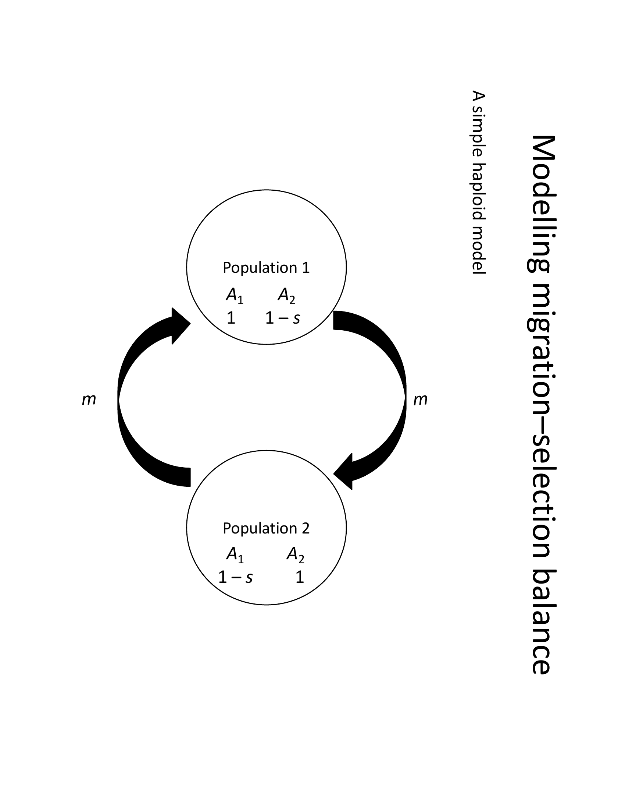
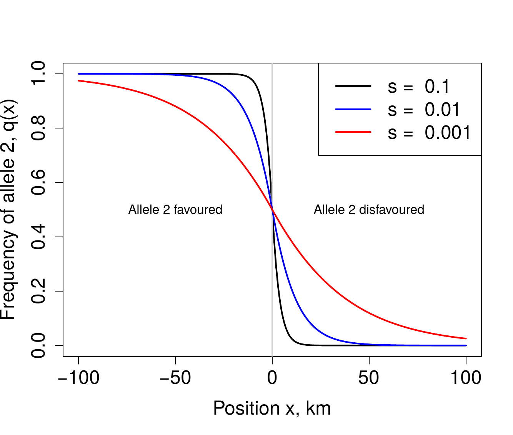

# The Interaction of Selection, Mutation, and Migration {#sec-Sel-Mut-Mig}

Genetic variation is the raw fuel of evolution. Without variation, natural selection would have nothing to act on to shape adaptive traits. However, variation can be deleterious.

Mutation, broadly defined, is the ultimate source of all genetic variation and is constantly introducing new variation into all populations. However, mutation is random and so mutations that affect function are often damaging. Thus mutation will, in the absence of sufficiently strong selection, degrade pre-existing adaptations and undo the work of selection that has built up functional regions of DNA over time.

Migration, the movement of individuals into a population, can also increase variation to the population as the individuals bring new alleles in from surrounding populations. Thus migration can be an important source of adaptive alleles, aiding their spread amongst populations within a species. Adaptive alleles can even spread between species if low levels of interbreeding occur. However, again, just like mutation, migration can disrupt adaptations. When populations are locally adapted migration amongst populations can introduce maladaptive alleles into well adapted populations. If this migration pressure is sufficiently strong, it can lead to the collapse of local adaptations, or even the collapse of species.

In this chapter we’ll study some of the interplay between selection, migration, and mutation.

## Mutation–Selection Balance

Mutation is constantly introducing new alleles into the population. Therefore, variation can be maintained within a population not only if selection is balancing (e.g. through heterozygote advantage or fluctuating selection over time, as we have seen in the previous section), but also due to a balance between mutation introducing deleterious alleles and selection acting to purge these alleles from the population [@haldane1927mathematical; @Haldane:37]. To study mutation-selection balance, we return to the model of directional selection, where allele $A_1$ is advantageous, i.e.

| genotype         |  $A_1A_1$  |      $A_1A_2$      |   $A_2A_2$    |
|:-----------------|:----------:|:------------------:|:-------------:|
| absolute fitness |  $W_{11}$  | $\geq W_{12} \geq$ |   $W_{22}$    |
| relative fitness | $w_{11}=1$ |   $w_{12}=1-sh$    | $w_{22}=1-s$. |

We’ll begin by considering the case where allele $A_2$ is not completely recessive ($h>0$), so that the heterozygotes suffer at least some disadvantage. We denote by $\mu = \mu_{1\rightarrow2}$ the mutation rate per generation from $A_1$ to the deleterious allele $A_2$, and assume that there is no reverse mutation ($\mu_{2\rightarrow1} = 0$). Let us assume that selection against $A_2$ is relatively strong compared to the mutation rate, so that it is justified to assume that $A_2$ is always rare, i.e. $q_t = 1-p_t \ll 1$. Compared to previous sections, for mathematical clarity, we also switch from following the frequency $p_t$ of $A_1$ to following the frequency $q_t$ of $A_2$. Of course, this is without loss of generality. The change in frequency of $A_2$ due to selection can be written as

$$\Delta_S q_t = \frac{ \overline{w}_2 - \overline{w}_1}{\overline{w}} p_t q_t  \approx  -hs q_t.$$ {#eq-dirSelApprox}

This approximation can be found by assuming that $q^2 \approx 0$, $p \approx 1$, and that $\overline{w} \approx w_1$. All of these assumptions make sense if $q \ll 1$. From @eq-dirSelApprox we see that selection acts to reduce the frequency of $A_2$ (as both $h$ and $s$ are positive), and it does so geometrically across the generations. That is, if the initial frequency of $A_2$ is $q_0$, then its frequency at time $t$ is approximately

$$q_t = q_0 (1 - hs)^t.$$ {#eq-dirSelExplApprox}

We will now consider the change in frequency induced by mutation. Recalling that $\mu$ is the mutation rate from $A_1$ to $A_2$ per generation, the frequency of $A_2$ after mutation is

$$q^{\prime} =  \mu p_t + q_t = \mu(1 - q_t) + q_t.$$ {#eq-selection-mutation-migration-1}

Assuming that $\mu \ll 1$ and that $q \ll 1$, the change in the frequency of allele $A_2$ due to mutation ($\Delta_M q_t$) can be approximated by

$$\Delta_M q_t = q^{\prime} - q_t =  \mu.$$ {#eq-mutApprox}

Hence, when $A_2$ is rare and the mutation rate is low, mutation acts to linearly increase the frequency of the deleterious allele $A_2$.

If selection is to balance deleterious mutation, their combined effect over one generation has to be zero. Therefore, to find the mutation–selection equilibrium, we set

$$\Delta_M q_t + \Delta_S q_t = 0,$$ {#eq-selection-mutation-migration-2}

insert eqns. ([-@eq-dirSelApprox]) and ([-@eq-mutApprox]), and solve for $q$ to obtain

$$q_e = q_t = \frac{\mu}{hs}.$$ {#eq-mut-sel-bal}

We see that the frequency of the deleterious allele $A_2$ is balanced at a frequency equal to the mutation rate ($\mu$) divided by the reduction in relative fitness in the heterozygote ($hs$).

It is worth pointing out that the fitness of the $A_2A_2$ homozygote has not entered this calculation, as $A_2$ is so rare that it is hardly ever found in the homozygous state. Therefore, if $A_2$ has any deleterious effect in a heterozygous state (i.e. if $h>0$), it is this effect that determines the frequency at which $A_2$ is maintained in the population. Also, note that by writing the total change in allele frequency as $\Delta_M q_t + \Delta_S q_t$ we have implicitly assumed that we can ignore terms of order $\mu
\times s$. That is, we have assumed that mutation and selection are both relatively weak. This assumption is valid under our prior assumption that both $\mu$ and $s$ are small.

If an allele is truly recessive (although few likely are), we have $h=0$, and so @eq-mut-sel-bal is not valid. However, we can make an argument similar to the one above to show that, for truly recessive alleles,

$$q_e = \sqrt{\frac{\mu}{s}}.$$ {#eq-recess-mut-sel-bal}

. Contributed by MBLWHOI Library. Not in copyright.]{.attribution}](images/Journal_figs/single_locus_selection/mutation_selection_balance/Pink_Katydid.png){#fig-katydid .column-margin width="100%" fig-alt="Oblong-winged katydid."}

[The analysis of these pink katydids is a nice example of early Mendelian reasoning in a wonderfully titled paper.[@Wheeler:07]]{.aside}

::: {#exr-selection-mutation-migration-1}
Oblong-winged katydids (*Amblycorypha oblongifolia*) are usually green. However, some are bright pink, thanks to an erythrism mutation . This pink condition is thought to be due to a dominant mutation ([Crew, 2013](https://blogs.scientificamerican.com/running-ponies/in-north-american-katydids-green-isne28099t-the-dominant-colour-pink-is/)). Assume that roughly one in ten thousand katydids is bright pink and that the mutation rate at the gene underlying this condition is $10^{-5}$. What is the relative fitness of heterozygotes for the pink mutation?
:::

**The genetic load of deleterious alleles.** What effect do such deleterious mutations at mutation–selection balance have on the population? It is common to quantify the effect of deleterious alleles in terms of a reduction of the mean relative fitness of the population. For a single site at which a deleterious mutation is segregating at frequency $q_e = \mu/(hs)$, the population mean relative fitness is reduced to

$$\overline{w} = 1- 2p_e q_e hs - q_e^2s \approx 1-2\mu.$$ {#eq-mut-load}

Somewhat remarkably, the drop in mean fitness due to a site segregating at mutation–selection balance is independent of the selection coefficient against the heterozygote; it depends only on the mutation rate [@Haldane:37]. Intuitively this is because, given a fixed mutation rate, less deleterious alleles can rise to a higher equilibrium frequency, and thus contribute the same total load as more deleterious (rarer) alleles, but this load is spread across more individuals in the population. Note that this result applies only if the mutation is not totally recessive, i.e. if $h > 0$.

.](images/Journal_figs/single_locus_selection/LOF_variants/Neatherlands_LOF_variants.png){#fig-LOF width="100%" fig-alt="Left) The distribution of LOF alleles in 769 individuals from the Genome of the Netherlands project."}

A fitness reduction of $2\mu$ is very small, given that the mutation rate of a gene is usually on the order of $10^{-5}$. However, if there are many loci segregating at mutation–selection balance, small fitness reductions can accumulate to a substantial so-called genetic load, a major cause of variation in fitness-related traits among individuals. To see how all of these loci contribute to variation in fitness consider the fact that the human genome contains over twenty thousand protein-coding genes, and many other functional regions, the vast majority of which will be subject to purifying selection against mutations that disrupt their function. In humans, most loss of function (LOF) variants, which severely disrupt a protein-coding gene, are found at low frequencies but each human genome typically carries over a hundred LOF variants [@macarthur:12; @lek:16]. Not every LOF allele will be deleterious; some could even be advantageous. However, the combined load of these LOF alleles must on average lower our fitness, otherwise selection wouldn’t be removing them from the population. Each one of us carries a unique set of these LOF alleles, usually in a heterozygous state. We differ slightly in how many of these alleles we carry. For example, the left side of @fig-LOF shows the distribution of the number of LOF alleles carried by 769 individuals of Dutch ancestry. The individuals who carry fewer of these LOF alleles will on average likely have higher fitness than those individuals with more. We don’t yet know how much fitness variation this explains across individuals, nor do we know how most of these LOF alleles manifest their fitness consequences through disease and other mechanisms. However, it’s a reasonable guess that this variation in LOF alleles, presumably maintained by mutation-selection balance, is a major source of variation in fitness.

### Inbreeding depression

All else being equal, @eq-mut-sel-bal suggests that mutations that have a smaller effect in the heterozygote can segregate at higher frequency under mutation–selection balance. As a consequence, alleles that have strongly deleterious effects in the homozygous state can still segregate at low frequencies in the population, as long as they do not have too strong a deleterious effect in heterozygotes. Thus, outbred populations may have many alleles with recessive deleterious effects segregating within them.

::: {#exr-selection-mutation-migration-2}
Assume that a deleterious allele has a relative fitness $0.99$ in heterozygotes and a relative fitness $0.2$ when present in the homozygote state. Assume that the deleterious allele is at a frequency $10^{-3}$ at birth and the genotype frequencies follow from HWE. Only considering the fitness effects of this locus, and measuring fitness relative to the most fit genotype, answer the following questions:\
**A)** What is the average fitness of an individual in the population?\
**B)** What is the average fitness of the child of a full-sib mating?
:::

.](images/Journal_figs/single_locus_selection/Silene_inbreeding_Richards/Silene_inbreeding_depression.png){#fig-Silene-inbreeding width="75%" fig-alt="Data showing inbreeding depression over different degrees of inbreeding in S."}

.](images/illustration_images/single_locus_selection/Silene_inbreeding_dep/Silene_latifolia_Sturm18.jpg){#fig-Silene .column-margin width="100%" fig-alt="White campion (S."}

One consequence of segregating for low-frequency recessive deleterious alleles is that inbreeding can reduce fitness. In typically outbred populations, the mean fitness of individuals decreases with the inbreeding coefficient, i.e. so-called ’inbreeding depression’ is a common observation. This wide-spread observation dates back to systematic surveys of inbreeding depression by @darwin:1876. Inbreeding depression is likely primarily a consequence of being homozygous at many loci for alleles with recessive deleterious effects.

One example of inbreeding depression is shown in @fig-Silene-inbreeding. White campion (*Silene latifolia*) is a dioecious flowering plant; dioecious means that the males and females are separate individuals. @richards:00 performed crosses to create offspring who were outbred, the offspring of half-sibs, full-sibs, and of two generations of full-sib mating. He measured their germination success, which is plotted in @fig-Silene-inbreeding. Note how the fitness of individuals declines with increased inbreeding.

![Inbreeding depression for offspring lifespan in humans in Iceland. Data from [@helgason2008association]. Code [here](https://github.com/cooplab/popgen-notes/blob/master/Journal_figs/single_locus_selection/Decode_human_inbreeding/decode_inbreeding.R).](images/Journal_figs/single_locus_selection/Decode_human_inbreeding/decode_inbreeding.png){#fig-Decode-inbreeding width="80%" fig-alt="Inbreeding depression for offspring lifespan in humans in Iceland."}

We also see evidence for inbreeding depression in various human populations. For example, @helgason2008association used the remarkable genealogical records in Iceland to look at the effects of inbreeding on various fitness components in humans. They saw that parents who were closer than 2nd cousins had children with reduced lifespans. However, these patterns were more complex for other fitness components with parents with immediate levels of relatedness having more descendants overall. More generally, studying inbreeding depression is challenging in humans because it can be difficult to differentiate the cultural and socio-economic effects frombiological effects on reproduction. Finally, it is important to note that societal views of inbreeding risks can be overblown compared to the actual risks and that these fears have often been used to stigmatize immigrant and rural poor communities [@paul2008s].

**Purging the inbreeding load.** Populations that regularly inbreed over sustained periods of time are expected to partially purge this load of deleterious alleles. This is because such populations have exposed many of these alleles in a homozygous state, and so selection can more readily remove these alleles from the population.

If the population has sustained inbreeding, such that individuals in the population have an inbreeding coefficient $F$, deleterious alleles at each locus will find a new equilibrium frequency. Assuming the mutation-selection model, now with inbreeding, the equilibrium frequency is

$$q_e = \frac{\mu}{\big( h(1-F) + F \big) s}$$ {#eq-selection-mutation-migration-3}

The frequency of the deleterious allele is decreased due to the allele now being expressed in homozygotes, and therefore exposed to selection, more often due to inbreeding. Thus, all else being equal, populations that have had a long-term history of close inbreeding will purge their load.

### Migration–selection balance

The influx of alleles carried by migrants from other populations can be an important source of genetic and phenotypic variation. Thus, one reason for the persistence of deleterious alleles in a population is that there is a constant influx of maladaptive alleles from other populations where these alleles are locally adaptive. Migration–selection balance seems unlikely to be as broad an explanation for the persistence of deleterious alleles genome-wide as mutation-selection balance. However, a brief discussion of such alleles is worthwhile, as it helps to inform our ideas about local adaptation, hybrid zones, and speciation.

. Contributed by New York Botanical Garden. Not in copyright.]{.attribution}](images/illustration_images/single_locus_selection/Anthoxanthum_odoratum/19750531053_28f0b3b36e_z.jpg){#fig-Zinc-plant .column-margin width="100%" fig-alt="Sweet vernal grass (Anthoxanthum odoratum)."}

Local adaptation can occur over a range of geographic scales. Local adaptation is relatively unimpeded by migration at broad geographically scales, where selection pressures change more slowly than distances over which individuals typically migrate over a number of generations. Adaptation can, however, potentially occur on much finer geographic scales, from kilometers down to meters in some species. On such small scales, dispersal is surely rapidly moving alleles between environments, but local adaptation is maintained by the continued action of selection. An example of adaptation at fine-scales is shown in @fig-Zinc-mine . @jain1966evolutionary studied the patterns of heavy-metal resistance in plants on mine tailings and in nearby meadows, a set of classic studies of population differences maintained by local adaptation to different soils.

.](images/Journal_figs/single_locus_selection/Anthoxanthum_mines_Jain_Bradshaw/Anthoxanthum_zinc.png){#fig-Zinc-mine width="100%" fig-alt="Data showing the zinc tolerance of Anthoxanthum odoratum on and off of the Trelogan Mine, Flintshire, North Wales."}

Even at these very short geographically scales, over which seed and pollen will definitely move, we see strong local adaptation. Zinc-intolerant alleles are nearly absent from the mine tailings because they prevent plants from growing on these zinc-heavy soils; conversely, zinc-tolerant alleles do not spread into the meadow populations, likely due to some trade-off or fitness cost of zinc-tolerance.

As a first pass at developing a model of local adaptation, let’s consider a haploid two-allele model with two different populations, see @fig-mig-sel-bal, where the relative fitnesses of our alleles are as follows

|    allele    | $1$ | $2$ |
|:------------:|:---:|:---:|
| population 1 |  1  | 1-s |
| population 2 | 1-s |  1  |

As a simple model of migration, let’s suppose within a population a fraction of $m$ individuals are migrants from the other population, and $1-m$ individuals are from the same population.

{#fig-mig-sel-bal .column-margin width="100%" fig-alt="Setup of a two-population haploid model of local adaptation."}

To quickly sketch an equilibrium solution to this scenario, we’ll take an approach analogous to our mutation-selection balance model. To do this, let’s assume that selection is strong compared to migration ($s \gg m$), such that allele $1$ will be almost fixed in population $1$ and allele $2$ will be almost fixed in population $2$. If that is the case, migration changes the frequency of allele $2$ in population $1$ ($q_1$) by

$$\Delta_{Mig.} q_1 \approx m$$ {#eq-selection-mutation-migration-4}

while as noted above $\Delta_{S} q_1= -sq_1$, so that migration and selection are at an equilibrium when $0 = \Delta_{S} q_1+
\Delta_{Mig.}q_1$, i.e. an equilibrium frequency of allele $2$ in population $1$ of

$$q_{e,1} = \frac{m}{s}$$ {#eq-selection-mutation-migration-5}

Here, migration is playing the role of mutation and so migration–selection balance (at least under strong selection) is analogous to mutation–selection balance.

We can use this same model by analogy for the case of migration–selection balance in a diploid model. For the diploid case, we replace our haploid $s$ by the cost to heterozygotes $hs$ from our directional selection model, resulting in a diploid migration–selection balance equilibrium frequency of

$$q_{e,1} = \frac{m}{hs}$$ {#eq-mig-sel-eq}

If selection is weaker and only of the order of migration $s \approx
m$ our migration-selection polymorphism collapses, as selection can not maintain the difference in the face of gene flow. Under this situation, both populations are expected to have roughly the same frequency of the alleles. Migration has swamped out local adaptation.

.](images/Journal_figs/single_locus_selection/Rock_Pocket_mice/Rock_pocket_mice.png){#fig-mig-sel-bal-mice width="80%" fig-alt="Frequency of melanic mice on the lava flow, and at nearby locations (diamonds)."}

. Contributed by American Museum of Natural History Library. Not in copyright.]{.attribution}](images/illustration_images/single_locus_selection/chaetodipus_pocket_mice/chaetodipus.png){#fig-chaetodipus .column-margin width="100%" fig-alt="Two species from the genus Chaetodipus, pocket mice, formally known as Perognathus."}

::: {#exr-selection-mutation-migration-3}
@hoekstra2004ecological found that the dark $D$ allele was at $3\%$ frequency at the Tule Mountains study site. Using $F_{ST}$-based approaches, for unlinked markers, they estimated that the per individual migration rate was $m=7.0 \times
10^{-4}$ per generation between this site and the Pinacate lava flow. What is the selection coefficient acting against the dark $D$ allele at the Tule Mountains site?
:::

As an example of fine-scale local adaptation due to a single locus, consider the case of the rock pocket mice adapting to lava flows. Throughout the deserts of the American Southwest there are old lava flows, where the rocks and soils are much dark than the surrounding desert. Many populations of small animals that live on these flows have evolved darker pigmentation to be cryptic against this dark substrate and better avoid visual predators. One example of such a locally adapted population are the rock pocket mice (*Chaetodipus intermedius*) who live on the Pinacate lava flow on the Arizona-Mexico border, studied by @hoekstra2004ecological. These mice have much darker, more melanic pelts than the mice who live on nearby rocky outcrops (see @fig-mig-sel-bal-mice). @nachman2003genetic determined that a dominant allele ($D$) at *MC1R* is the primary determinant of this melanic phenotype. The frequency of this allele across study sites is shown in @fig-mig-sel-bal-mice. @hoekstra2004ecological found that other, unlinked markers showed little differentiation over these populations, suggesting that the migration rate is high.

**The width of a genetic cline.** We can also extend these ideas beyond our discrete model to a model of a population spread out on a landscape where individuals migrate in a more continuous fashion. For simplicity, let’s assume a one dimensional habitat, where the habitat makes a sharp transition in the middle of our region. You could imagine this to be a set of populations sampled along a transect through some environmental transition. Our individuals disperse to live on average $\sigma$ miles away from where they were born (we can think of this as our individuals migrating a random displacement drawn from a normal distribution, with mean zero, and $\sigma$ being the standard deviation of this distribution). [“Upon an island hard to reach, the East Beast sits upon his beach. Upon the west beach sits the West Beast. Each beach beast thinks he’s the best beast.” – Theodor Seuss Geisel]{.aside} We’ll think of a bi-allelic model where the homozygotes for allele 1 have an additive selective advantage $s$ over allele $2$ homozygotes to the east of our habitat transition (left of zero in @fig-cline-main). This flips to allele $2$ having the same advantage $s$ west of the transition (right of zero). If you’ve read this send Prof Coop a picture of the East and West Beast.

.](images/figures/equilib_cline.png){#fig-cline-main width="70%" fig-alt="An equilibrium cline in allele frequency (the frequency of allele 2, q(~) is shown)."}

With this setup, we get an equilibrium distribution of our two alleles, where to the left of zero our allele $2$ is at higher frequency, while to the right of zero allele $1$ predominates. As we cross from the left to the right side of our range, the frequency of our allele $2$ decreases in a smooth cline. The frequency of allele $2$, $q(x)$, is shown as a function of location, $x$, along the cline for a variety of selection coefficients ($s$) in @fig-cline-main. The width of this cline, i.e. the geographic distance over which the allele frequency changes, depends on the relative strengths of dispersal and selection. If selection is strong compared to dispersal, then selection acts to remove maladaptive alleles much faster than migration acts to move alleles across the environmental transition. Thus the allele frequency transition would be very rapid, and the cline narrow, as we move across the environmental transition. In contrast, if individuals disperse long distances and selection is weak, many alleles are being moved back and forth over the environmental transition much faster than selection can act against these alleles and so the cline would be very wide.

.](images/figures/equilib_width_cline.png){#fig-cline-tangent .column-margin width="100%" fig-alt="An equilibrium cline in allele frequency from @fig-cline-main, s=0.01."}

The width of our cline, i.e. the distance over which we make this shift from allele $2$ to allele $1$ predominating, can be defined in a number of different ways. One way to define the cline width, which is simple to define but perhaps hard to measure accurately, is via the slope (i.e. the tangent) of $q(x)$ at $x=0$. See @fig-cline-tangent. Under this definition, the cline width is approximately

$$0.6 \sigma/\sqrt{s} ~\textrm{miles},$$ {#eq-cline-width}

note that the units are miles here just because we defined the average dispersal distance ($\sigma$) in miles above. Thus the cline will be wider if individuals dispersal further, higher $\sigma$, and if selection is weaker, smaller $s$. The appendix at the end of this chapter, talks through the math underlying these ideas in more detail.

![Allele frequency clines of two pesticide resistance alleles, at the *Ace 1* and *Ester* genes, in the mosquito *Culex pipiens*. The dotted line shows where we move from pesticide-treated to untreated areas as we move away from the French coast. The dots show observed allele frequencies, the solid lines clines fit under a migration-selection balance model of a cline. These allele frequencies represent collections over two summers, the frequencies of the alleles are substantially reduced in the winter due to the reduced use of pesticides. Data from @lenormand1999tracking. Code [here](https://github.com/cooplab/popgen-notes/blob/master/Journal_figs/single_locus_selection/Culex_resistance/culex_resistance.R).](images/Journal_figs/single_locus_selection/Culex_resistance/culex_resistance.png){#fig-cline-culex width="100%" fig-alt="Allele frequency clines of two pesticide resistance alleles, at the Ace 1 and Ester genes, in the mosquito Culex pipiens."}

@lenormand1999tracking collected mosquitoes (*Culex pipiens*) in a north–south transect moving away from the Southern French coast. Areas near the coast were are treated with pesticides, and the mosquitos have evolved resistance, but areas just a few tens of kilometers from the coast were untreated. @lenormand1999tracking estimated the frequency of two unlinked, pesticide-resistance alleles, and found them at high frequency near the coast but found that their frequencies declined rapidly moving inland. @lenormand1999tracking fit migration-selection cline models to their data, similar to those in @fig-cline-main, with the pesticide-resistance alleles having an selection advantage ($s$) in treated areas an a cost ($c$) in untreated areas (they didn’t force the selective advantage and cost to be symmetric).

. Contributed by U.S. Department of Agriculture, National Agricultural Library. Not in copyright.]{.attribution}](images/illustration_images/single_locus_selection/Culex_pipiens/Culex_pipiens.png){#fig-culex .column-margin width="70%" fig-alt="Mosquito (Culex pipiens)."}

They estimated that a higher selective advantage for the *Ace 1* allele than*Ester* allele ($s=0.33$ and $s=0.19$ respectively) and a higher cost to the *Ace 1* allele than *Ester* allele in untreated areas ($c=0.11$ and $c=07$ respectively) potentially explaining the less extreme cline for *Ester* allele than the *Ace 1* allele. Despite these strong selection pressures, we still see a cline over tens of kilometers because dispersal is relatively high ($\sigma=
6.6$km per generation).

**Hybrid zones.** Local adaptation isn’t the only way that selection can generate strong spatial patterns. We can also see strong selection-driven clines when partially-reproductively isolated species spread back in to secondary contact they can hybridize bringing alleles together that may not work well with each other. One simple model of is to think about an under-dominant polymorphism, i.e. where the heterozygote has lower fitness. The two ancestral populations are alternatively fixed for the two fitter homozygote states, e.g. ancestral population 1 fixed $A_1A_1$ and ancestral population two the $A_2 A_2$. The hybrid population forming at the mating edge between the two ancestral populations has a high frequency of the less fit heterozygotes. Thus hybrids are at a disadvantage, potentially acting to keep the two populations from collapsing into each other.

![The frequency of the southern neo-X chromosome moving along a valley transect (more southern locations to the right of the graph). This represents data from four different valleys in the French Alps over less then a kilometer, each point represents a sample of 20 males. The red curve is the fitted cline under a model of heterozygote disadvantage [@bazykin1969hypothetical]. Data from @barton1981chromosomal, Code [here](https://github.com/cooplab/popgen-notes/blob/master/Journal_figs/single_locus_selection/grasshopper_cline_barton_hewitt/grasshopper_cline_barton_hewitt.R).](images/Journal_figs/single_locus_selection/grasshopper_cline_barton_hewitt/grasshopper_cline_barton_hewitt.png){#fig-grasshopper-cline width="65%" fig-alt="The frequency of the southern neo-X chromosome moving along a valley transect (more southern locations to the right of the graph)."}

Two previously isolated populations of the short-horned grasshopper *Podisma pedestris* have spread into secondary contact in the French Alps, probably after the last ice age. The population that has spread into the Alps from the south has a large section of novel X chromosome, due to a chromosomal fusion. This ‘neo-X’ is absent in the populations that spread from the North into the Alps. The two populations meet in many valleys running through the Alps, and repeatedly form a narrow hybrid zone, with the frequency of the neo-X chromosome forming a very steep cline transitioning in frequency over a few hundred meters [@barton1981chromosomal]. One potential reason for this steep cline is that females who are heterozygous for the neo-X (neo-X/old-X) may have reduced fitness, consistent with an underdominant polymorphism. The neo-X allele cannot spread into the northern population as it cannot increase in frequency when rare. Conversely the northern population cannot displace the neo-X, as the old-X is at a disadvantage. This spatial distribution at this locus is a tension zone between the two populations, where neither allele can push the other out due to the low fitness of the hybrid.

, public domain.](images/illustration_images/single_locus_selection/Grasshoppers/634px-Brockhaus_and_Efron_Encyclopedic_Dictionary_b56_402-0.jpg){#fig-grasshoppers .column-margin width="100%" fig-alt="7."}

We can use our same continuous model of migration and selection to study this setup. Assuming that the homozygotes are equally fit, and that the heterozygotes relative fitness is reduced by a selection coefficent $s_h$, the width of the cline is

$$\frac{\sigma}{\sqrt{s_h}}$$ {#eq-selection-mutation-migration-6}

The stronger the selection the more abrupt the transition between the populations. These wingless grasshoppers move $\sigma \sim 20$ meters a generation. Thus a reduction in the relative fitness of the hybrid would be needed to explain this hybrid zone with a width of $\sim
800$m.

More generally we can see tension zones arise when hybrids have reduced fitness compared to either species. For example, this can occur due to be due to bad epistatic interactions between alleles from each species. If selection is strong enough on hybrids, often because many loci are involved in incompatibilities between the species, the entire genome can be tied up in a tension zone between the two species.

### Appendix: Some theory of the spatial distribution of allele frequencies under deterministic models of selection {.unnumbered}

Imagine a continuous haploid population spread out along a line. Each individual disperses a random displacement $\Delta x$ from its birthplace to the location where it reproduces, where $\Delta x$ is drawn from the probability density $g(\Delta x)$. To make life simple, we will assume that $g(\Delta x)$ is normally distributed with mean zero and standard deviation $\sigma$, i.e. migration is unbiased and individuals migrate an average displacement of $\sigma$.

The frequency of allele $2$ at time $t$ in the population at spatial location $x$ is $q(x,t)$. Assuming that only dispersal occurs, how does our allele frequency change in the next generation? Our allele frequency in the next generation at location $x$ reflects the migration from different locations in the proceeding generation. Our population at location $x$ receives a contribution $g(\Delta x)q(x+\Delta x,t)$ of allele $2$ from the population at location $x+\Delta x$, such that the frequency of our allele at $x$ in the next generation is

$$q(x,t+1) = \int_{-\infty}^{\infty} g(\Delta
x)q(x+\Delta x,t) d \Delta x.$$ {#eq-selection-mutation-migration-7}

To obtain $q(x+\Delta x,t)$, let’s take a Taylor series expansion of $q(x, t)$:

$$q(x+\Delta x,t) = q(x,t) + \Delta x \frac{dq(x,t)}{dx}+ \tfrac{1}{2}(\Delta x)^2 \frac{d^2q(x,t)}{dx^2}+\cdots$$ {#eq-selection-mutation-migration-8}

then

$$q(x,t+1) = q(x,t) +\left( \int_{-\infty}^{\infty} \Delta x g(\Delta x) 
  d \Delta x \right) \frac{dq(x,t)}{dx} + \tfrac{1}{2}\left( \int_{-\infty}^{\infty}(\Delta x)^2 g(\Delta x) 
  d \Delta x \right)  \frac{d^2q(x,t)}{dx^2}+\cdots$$ {#eq-selection-mutation-migration-9}

Because $g(~)$ has a mean of zero, $\int_{-\infty}^{\infty} \Delta x g(\Delta x) d
\Delta x =0$, and has because $g(~)$ has variance $\sigma^2$, $\int_{-\infty}^{\infty}(\Delta
x)^2 g(\Delta x) d \Delta x = \sigma^2$. All higher order terms in our Taylor series expansion cancel out (as all higher central moments of the normal distribution are zero). Looking at the change in allele frequency, $\Delta q(x,t) = q(x,t+1)-q(x,t)$, so

$$\Delta q(x,t) = \frac{\sigma^2}{2} \frac{d^2q(x,t)}{dx^2}$$ {#eq-selection-mutation-migration-10}

This is a diffusion equation, so that migration is acting to smooth out allele frequency differences with a diffusion constant of $\tfrac{\sigma^2}{2}$. This is exactly analogous to the equation describing how a gas diffuses out to equal density, as both particles in a gas and our individuals of type $2$ are performing Brownian motion (blurring our eyes and seeing time as continuous).

We will now introduce fitness differences into our model and set the relative fitnesses of allele $1$ and $2$ at location $x$ to be $1$ and $1+s\gamma(x)$. To make progress in this model, we’ll have to assume that selection isn’t too strong, i.e. $s \gamma(x) \ll 1$ for all $x$. The change in frequency of allele $2$ obtained within a generation due to selection is

$$q^{\prime}(x,t) - q(x,t) \approx s\gamma(x) q(x,t) \big( 1 - q(x,t) \big)$$ {#eq-selection-mutation-migration-11}

i.e. logistic growth of our favoured allele at location $x$. Putting our selection and migration terms together, we find the total change in allele frequency at location x in one generation is

$$q(x,t+1) -
q(x,t) = s\gamma(x) q(x,t) \big( 1 - q(x,t) \big)+\frac{\sigma^2}{2}
\frac{d^2q(x,t)}{dx^2}$$ {#eq-fisherKPP}

In deriving this result we have ignored terms of the order of $\sigma s$.

{#fig-cline width="50%" fig-alt="An equilibrium cline in allele frequency."}

**The cline in allele frequency associated with a sharp environmental transition.** To make progress, let’s consider a simple model of local adaptation where the environment abruptly changes. Specifically, we assume that $\gamma(x)= 1$ for $x<0$ and $\gamma(x)= -1$ for $x \geq 0$, i.e. our allele $2$ has a selective advantage at locations to the left of zero, while this allele is at a disadvantage to the right of zero. In this case we can get an equilibrium distribution of our two alleles, where to the left of zero our allele $2$ is at higher frequency, while to the right of zero allele $1$ predominates. As we cross from the left to the right side of our range, the frequency of our allele $2$ decreases in a smooth cline.

Our equilibrium spatial distribution of allele frequencies can be found by setting the left-hand side of @eq-fisherKPP to zero to arrive at

$$s\gamma(x) q(x) \left( 1 - q(x) \right) = - \frac{\sigma^2}{2} \frac{d^2q(x)}{dx^2}$$ {#eq-selection-mutation-migration-12}

We then could solve this differential equation with appropriate boundary conditions ($q(-\infty)=1$ and $q(\infty) = 0$) to arrive at the appropriate functional form for our cline. While we won’t go into the solution of this equation here, we can note that by dividing our distance $x$ by $\ell=\sigma/\sqrt{s}$, we can remove the effect of our parameters from the above equation. This compound parameter $\ell$ is the characteristic length of our cline, and it is this parameter which determines over what geographic scale we change from allele $2$ predominating to allele $1$ predominating as we move across our environmental shift.

::: chapter-summary
**Chapter summary.**

-   Deleterious variation can be maintained in the population by a balance of selection and mutation. If the mutations are not completely recessive, the equilibrium frequency of deleterious alleles is given by the ratio of mutation to the selection coefficient against heterozygotes ($q_{eq}= {}^{\mu}\!/\!{}_{hs}$). The more recessive an allele the higher frequency it segregates under mutation-selection balance, all else being equal, as they better avoid selection in the heterozygote state.

-   While the equilibrium frequency of alleles under mutation-selection balance at any one locus is low, there are many such loci in the genome such that every individual carries many deleterious alleles.

-   As more recessive deleterious alleles segregate at higher frequency, inbred individuals are expected to have lower fitness than typical outbred individuals in the population as they are on average homozygous for recessive deleterious alleles.

-   Divergent selection between populations can maintain allele frequency differences between populations in the face of migration. The constant influx of alleles by migration can maintain maladaptive alleles at low frequency in the face of selection leading to a migration selection balance, an analog to mutation selection balance.

-   When strong selection pressures change over short geographical scales, we expect abrupt allele frequency clines at the selected loci. We also expect strong allele frequency clines in hybrid zones at loci underpinning hybrid fitness disadvantage.
:::

::: {#exr-selection-mutation-migration-4}
You are studying a gene causing partial infertility, due to errors during meiosis, in an outcrossing plant population. You estimate that $5\%$ of heterozygotes for knockout mutation in this gene are completely sterile, but $95\%$ of heterozygote individuals have normal fertility. Homozygotes for the knockout are often embryonic lethal due to errors in mitosis. The frequency at birth of knockouts for the gene is ${}^{1}\!/\!{}_{5000}$.\
**A)** What is the knockout mutation rate at this gene?

**B)** You find a sister species which has had a high degree of inbreeding for many generations due to selfing. Do you expect to find the knockout allele at higher or lower frequency? Explain your answer.
:::

::: {#exr-selection-mutation-migration-5}
There’s an outbred population of mice living in a farmer’s field. Mutations occur at a gene called nurseryrhyme that cause a totally recessive form of blindness. These blind mice do not survive to reproduce as the farmer’s wife cuts off their tail (and other bits) with a carving knife. Surveying the field for baby mice you find that 3 in ten thousand mice are blind.\
**A** Assuming that the population mates at random, what is the mutation rate of blindness causing alleles?\
**B** Following more careful study you now find that there is actually a $20
\%$ reduction in the viability of heterozygotes for these mutations. What would you now estimate as the mutation rate for this gene? **C)** Explain how and why your answers differ?
:::
